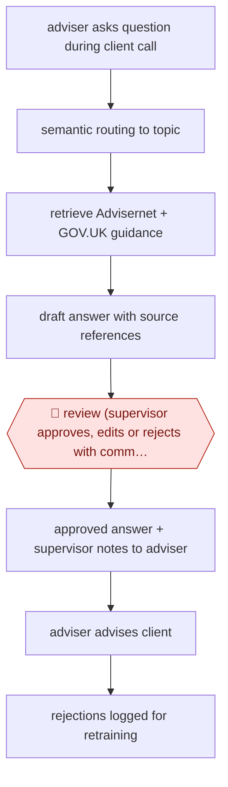

# Supervisor-approved adviser answers

`ORG › GOV › CASEWORK` · assist · evidence A · **draft: needs a reference example** ([how to add one](../../../../../CONTRIBUTING.md#1-add-an-example-run))

**Shape:** `adviser asks question during client call → semantic routing to topic → retrieve Advisernet + GOV.UK guidance → draft answer with source references → 🛑 review (supervisor approves, edits or rejects with comment) → approved answer + supervisor notes to adviser → adviser advises client → rejections logged for retraining`
**How it differs:** AWF-0081 Summary-aided casework decision (closest): there a decision-maker uses a summary to decide one case and quality is dip-sampled. Here the deliverable is an answer to an adviser's live question, and a second person (the supervisor) approves every AI answer before the frontline adviser ever sees it. AWF-0141 fills a form; AWF-0142 drafts a case note.
**Variants:** `caddy`

<!-- shape diagram: generated by scripts/build_diagrams.py from `shape`; don't edit -->

<!-- end shape diagram -->

## Steps
1. A frontline adviser on a live call or chat with a client types the question they are unsure about into Caddy in their existing chat platform (Google Workspace chat in the pilot). Clients only ever deal with the adviser [[1]](#sources)[[3]](#sources).
2. Caddy uses semantic routing so that, for a given topic, it raises the factors that experienced advisers trained it to consider [[1]](#sources).
3. It retrieves from trusted sources only (Citizens Advice Advisernet and GOV.UK) and drafts an answer (around 400 words) with references to where each point came from [[1]](#sources)[[3]](#sources).
4. 🛑 **Review**: the draft goes to a supervisor queue, never straight to the adviser. A supervisor reviews, can edit and add extra context, then approves or rejects. Advisers see only approved answers; on rejection they see the supervisor's comment [[2]](#sources)[[3]](#sources).
5. The adviser passes the validated advice to the client. In the pilot, the full generate-validate-return loop took about 4 minutes [[1]](#sources).
6. Rejected answers are logged and used to find improvement areas and retrain; Caddy 2.0 adds a verification engine that splits answers into checkable claims cross-referenced to the sources to speed the supervisor check, while keeping the human check [[3]](#sources)[[4]](#sources).

**Output:** A supervisor-approved, sourced answer returned to the adviser in chat, which the adviser relays to the client; approval/rejection data stored per response.
**Failure modes → guards:** Hallucinated or out-of-date advice on benefits, debt or housing → supervisor validation of every answer before an adviser sees it, sources restricted to Advisernet and GOV.UK. Supervisor queue becomes a bottleneck → Caddy 2.0 claim-level verification to shorten checks. New advisers over-trusting answers → answers carry source links and supervisor notes.

## Public runs

Coverage as of 2026-11-13: **Strong**: a first-hand, detailed run that matches most of the shape. Collected and re-checked in [Third collection pass](../../../../../research/2026-11-third-pass.md).

- [i.AI, Transforming Civic Engagement with Caddy](https://ai.gov.uk/blogs/transforming-civic-engagement-with-caddy/) (2025-03-13). Randomised trial over 1,000+ calls; supervisor-validated answers returned in about 4 minutes. "80% of responses were of a high enough quality to be passed directly to advisors without revisions". *First-hand: yes; confidence: high.*
- [Citizens Advice SORT, Caddy v2 slides](https://www.ukauthority.com/media/yyhakfjr/stuartpearson-caddy-v2-ukauthority-presentation-1.pdf) (undated, 2025). 4-6 week pilot in 6 offices; supervisor queue approves, comments, returns to adviser. "Over 80% of Caddy's responses were approved". *First-hand: yes; confidence: high.*
- [i.AI, Frontline Services](https://ai.gov.uk/our-work/frontline-services/) (undated). Rollout scale after the trial. "Caddy is already supporting over 40 local Citizens Advice offices, earning a 90% approval rating from advisers". *First-hand: yes; confidence: med.*

## Sources

1. Andreas Varotsis, i.AI, Transforming Civic Engagement with Caddy, 2025-03-13. https://ai.gov.uk/blogs/transforming-civic-engagement-with-caddy/
2. i.AI, Caddy quickstart / Introducing Caddy (open-source docs). https://i-dot-ai.github.io/caddy-chatbot/docs/about_caddy.html
3. Stuart Pearson, Citizens Advice SORT, Caddy: AI adviser copilot (UKAuthority conference slides). https://www.ukauthority.com/media/yyhakfjr/stuartpearson-caddy-v2-ukauthority-presentation-1.pdf
4. UKAuthority, Citizens Advice SORT to launch Caddy 2.0. https://www.ukauthority.com/articles/citizens-advice-sort-to-launch-caddy-20
5. i.AI, Frontline Services: Caddy. https://ai.gov.uk/our-work/frontline-services/
