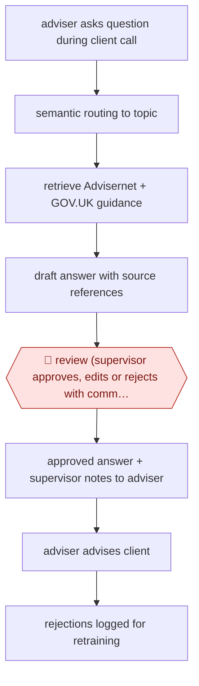

# Supervisor-approved adviser answers

`ORG › GOV › CASEWORK` · assist · evidence A · **draft: needs a reference example** ([how to add one](../../../../../CONTRIBUTING.md#1-add-an-example-run))

**Shape:** `adviser asks question during client call → semantic routing to topic → retrieve Advisernet + GOV.UK guidance → draft answer with source references → 🛑 review (supervisor approves, edits or rejects with comment) → approved answer + supervisor notes to adviser → adviser advises client → rejections logged for retraining`
**Variants:** `caddy`

<!-- shape diagram: generated by scripts/build_diagrams.py from `shape`; don't edit -->

<!-- end shape diagram -->

## Background

Citizens Advice is a UK charity network whose advisers help members of the public with problems such as benefits, debt and housing. The rules are complicated and change, so an adviser on a call with a client is often unsure and has to ask a more experienced supervisor or search long guidance while the client waits. Here the agent drafts a sourced answer from a short list of trusted guidance, so the adviser gets something to work from quickly. A supervisor still reads every draft before the adviser sees it. Wrong advice on benefits, debt or housing can harm the client, and the supervisor is the person accountable for what advisers are told.

**Terms:**
- **Adviser**: the frontline staff member or volunteer who talks to the client.
- **Supervisor**: an experienced adviser who checks answers before they reach the adviser.
- **Advisernet**: Citizens Advice's own knowledge base of advice guidance.
- **GOV.UK**: the UK government's public website, here used as a trusted source of official guidance.
- **Semantic routing**: matching a question to its topic by meaning, so that the factors experienced advisers consider for that topic are raised.
- **Verification engine**: in the later version, a step that splits an answer into single claims and cross-checks each against the sources.

## Build it with an agent

**Form:** `service`. A question arrives as a chat message and a supervisor answers it later, so nobody is in the agent's conversation: each question starts a run, and people see only the draft in a queue.

**You need:** a small program that listens for new messages in the advisers' chat space and starts one run per question, using the Agent SDK or `claude -p`; read access to the two trusted sources only (Advisernet and GOV.UK), as local copies beside the skill or through an MCP connector; one reference file per topic listing the factors experienced advisers consider; a supervisor channel or queue where drafts land; a store that records each answer, its approver, the decision and any comment. The question may carry client details, so use a setup approved for personal data and tell advisers to leave identifying details out of the question.

| Step | Built as |
|---|---|
| adviser asks question during client call | The program receives the adviser's chat message and starts a run with the question as input. |
| semantic routing to topic | The skill's first instruction: pick the closest topic from the list and open that topic's reference file of factors. If none fits, return "no topic match" to the supervisor queue. |
| retrieve Advisernet + GOV.UK guidance → draft answer with source references | The agent can search only those two sources. The skill requires a link or section reference for every point and tells the agent to say so when the sources do not cover the question. |
| 🛑 review (supervisor approves, edits or rejects with comment) | See Checkpoints. |
| approved answer + supervisor notes to adviser → adviser advises client | The program, not the agent, posts the approved text and the supervisor's notes to the adviser. |
| rejections logged for retraining | The program writes each decision and comment to the store. Maintainers read the rejections to change the topic files and the skill. No model is retrained. |

**Checkpoints:** `review`: the run ends after posting the draft to the supervisor queue. The agent has no tool that posts to the advisers' space, so a draft cannot reach an adviser unless a supervisor approves it and the program relays it. An edit by the supervisor replaces the draft. A rejection returns the supervisor's comment to the adviser instead.

**Since the sources:** Sources date from 2025-03 to 2025, and some are undated. Sources 1, 4 and 5 could not be opened in this session (the site refused the page reader), and source 3, a slide deck, did not come back as readable text, so this was checked against source 2, which describes how Caddy works, and a Stanford write-up of the same slides (2025-03-20). Searches in 2026-11 found no newer account: they returned only material from 2024-2025, with a national rollout and Caddy 2.0 noted as plans, so their status in 2026 is unconfirmed. Caddy itself is open source and runs on a cloud serverless stack inside the chat platform; this build replaces that with an Agent SDK or `claude -p` program and leaves out the claim-level verification engine of Caddy 2.0. The sources report an approval rate but nothing about how a build like this performs.

*A design based on this entry's steps and the tool documentation as of 2026-11, not a reported run.*

## Steps

*As reported by the sources.*

1. A frontline adviser on a live call or chat with a client types the question they are unsure about into Caddy in their existing chat platform (Google Workspace chat in the pilot). Clients only ever deal with the adviser [[1]](#sources)[[3]](#sources).
2. Caddy uses semantic routing so that, for a given topic, it raises the factors that experienced advisers trained it to consider [[1]](#sources).
3. It retrieves from trusted sources only (Citizens Advice Advisernet and GOV.UK) and drafts an answer (around 400 words) with references to where each point came from [[1]](#sources)[[3]](#sources).
4. 🛑 **Review**: the draft goes to a supervisor queue, never straight to the adviser. A supervisor reviews, can edit and add extra context, then approves or rejects. Advisers see only approved answers; on rejection they see the supervisor's comment [[2]](#sources)[[3]](#sources).
5. The adviser passes the validated advice to the client. In the pilot, the full generate-validate-return loop took about 4 minutes [[1]](#sources).
6. Rejected answers are logged and used to find improvement areas and retrain; Caddy 2.0 adds a verification engine that splits answers into checkable claims cross-referenced to the sources to speed the supervisor check, while keeping the human check [[3]](#sources)[[4]](#sources).

**Output:** A supervisor-approved, sourced answer returned to the adviser in chat, which the adviser relays to the client; approval/rejection data stored per response.
**Failure modes → guards:** Hallucinated or out-of-date advice on benefits, debt or housing → supervisor validation of every answer before an adviser sees it, sources restricted to Advisernet and GOV.UK. Supervisor queue becomes a bottleneck → Caddy 2.0 claim-level verification to shorten checks. New advisers over-trusting answers → answers carry source links and supervisor notes.
**How it differs:** AWF-0081 Summary-aided casework decision (closest): there a decision-maker uses a summary to decide one case and quality is dip-sampled. Here the deliverable is an answer to an adviser's live question, and a second person (the supervisor) approves every AI answer before the frontline adviser ever sees it. AWF-0141 fills a form; AWF-0142 drafts a case note.

## Public runs

Coverage as of 2026-11-13: **Strong**: a first-hand, detailed run that matches most of the shape. Collected and re-checked in [Third collection pass](../../../../../research/2026-11-third-pass.md).

- [i.AI, Transforming Civic Engagement with Caddy](https://ai.gov.uk/blogs/transforming-civic-engagement-with-caddy/) (2025-03-13). Randomised trial over 1,000+ calls; supervisor-validated answers returned in about 4 minutes. "80% of responses were of a high enough quality to be passed directly to advisors without revisions". *First-hand: yes; confidence: high.*
- [Citizens Advice SORT, Caddy v2 slides](https://www.ukauthority.com/media/yyhakfjr/stuartpearson-caddy-v2-ukauthority-presentation-1.pdf) (undated, 2025). 4-6 week pilot in 6 offices; supervisor queue approves, comments, returns to adviser. "Over 80% of Caddy's responses were approved". *First-hand: yes; confidence: high.*
- [i.AI, Frontline Services](https://ai.gov.uk/our-work/frontline-services/) (undated). Rollout scale after the trial. "Caddy is already supporting over 40 local Citizens Advice offices, earning a 90% approval rating from advisers". *First-hand: yes; confidence: med.*

## Sources

1. Andreas Varotsis, i.AI, Transforming Civic Engagement with Caddy, 2025-03-13. https://ai.gov.uk/blogs/transforming-civic-engagement-with-caddy/
2. i.AI, Caddy quickstart / Introducing Caddy (open-source docs). https://i-dot-ai.github.io/caddy-chatbot/docs/about_caddy.html
3. Stuart Pearson, Citizens Advice SORT, Caddy: AI adviser copilot (UKAuthority conference slides). https://www.ukauthority.com/media/yyhakfjr/stuartpearson-caddy-v2-ukauthority-presentation-1.pdf
4. UKAuthority, Citizens Advice SORT to launch Caddy 2.0. https://www.ukauthority.com/articles/citizens-advice-sort-to-launch-caddy-20
5. i.AI, Frontline Services: Caddy. https://ai.gov.uk/our-work/frontline-services/
