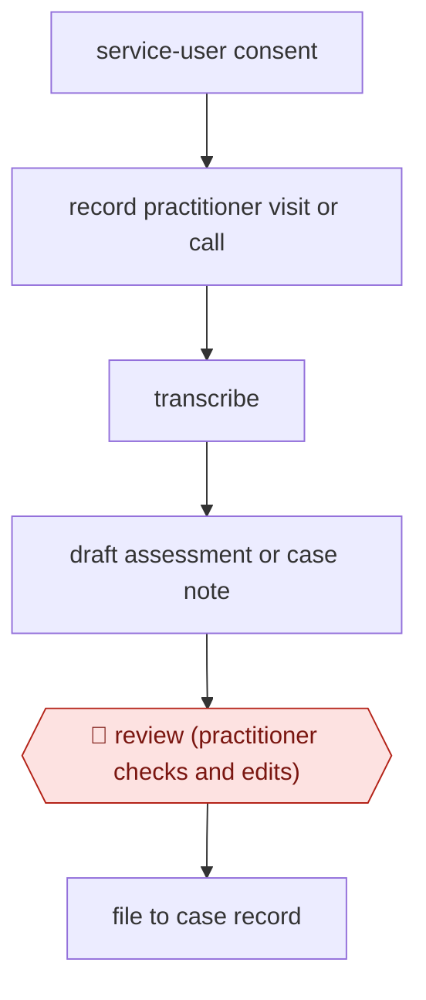

# Visit-recorded care assessment

`ORG › GOV › CASEWORK` · assist · evidence A · **draft: needs a reference example** ([how to add one](../../../../../CONTRIBUTING.md#1-add-an-example-run))

**Shape:** `service-user consent → record practitioner visit or call → transcribe → draft assessment or case note → 🛑 review (practitioner checks and edits) → file to case record`
**Variants:** `magic-notes`

<!-- shape diagram: generated by scripts/build_diagrams.py from `shape`; don't edit -->

<!-- end shape diagram -->

## Background

In England a council has a duty under the Care Act (the law on adult social care) to assess adults who may need care and support. A practitioner, such as a social worker or occupational therapist, visits or phones the person, talks through their needs, and then writes the conversation up as an assessment or case note that goes into the council's record. The write-up takes hours and is done from memory or hurried notes, and a practitioner who is busy typing during the visit is paying less attention to the person. The agent works from a recording of the conversation: it turns it into a transcript and drafts the assessment or note. The practitioner who held the conversation still reads and corrects every draft and files it, because the record is a statutory document, the practitioner is professionally accountable for it, and the person must first agree to being recorded.

**Terms:**
- **Practitioner**: the social worker, occupational therapist or assessment worker who holds the conversation.
- **Service user (the person supported)**: the person being assessed.
- **Care Act conversation, assessment**: the structured talk about a person's needs, and the written record the council keeps of it.
- **Case note**: a dated record of a contact with a person, kept in their case file.
- **Statutory**: required by law; a statutory assessment is the one the council has a legal duty to carry out.
- **BASW**: the British Association of Social Workers, the profession's body.
- **EHCP**: Education, Health and Care Plan, a legal document describing a child's or young person's support needs.

## Build it with an agent

**Form:** `platform`. Turning a recording into a transcript needs a speech-to-text service that a general agent does not replace, and filing goes into the council's own case record system. The drafting step runs as a `skill`.

**You need:** the person's consent, recorded before the visit starts; a recording and transcription service your council has approved for care records, with data kept in the country the council requires; the council's assessment or case-note template as a reference file beside the skill; a setup approved for sensitive personal data. Give the agent no write access to the case record system.

| Step | Built as |
|---|---|
| service-user consent → record practitioner visit or call → transcribe | The platform. The practitioner asks for consent, records, and the service produces the transcript. A general agent cannot do this step. |
| draft assessment or case note | A skill reads the transcript and the template and writes the draft into the template's headings. Where the transcript does not cover a heading, the skill writes "not covered in the conversation" and does not fill it in. |
| 🛑 review (practitioner checks and edits) → file to case record | See Checkpoints. |

**Checkpoints:** `review`: the skill presents the draft beside the transcript and stops while the practitioner checks and edits it. Filing is the practitioner's own act: the agent has no tool that writes to the case record, so nothing reaches the record unless the practitioner puts it there.

**Since the sources:** Sources and runs date from 2024-10 to 2026-01. They describe one vendor's product, Magic Notes from Beam, used by several councils; the steps inside it are not visible in the public material, so this design splits the work into the recording service and a drafting skill. Source 5 could not be opened (the site refused the page reader), and the two PDF reports (sources 4 and a run) opened but did not come back as readable text, so their figures were not re-checked here. The council pages and the vendor article were read. Most time-saving figures in the runs are the councils' or the vendor's own; the one independent evaluation is the Health Innovation KSS report. No performance claim is made for the build above.

*A design based on this entry's steps and the tool documentation as of 2026-11, not a reported run.*

## Steps

*As reported by the sources.*

1. The practitioner obtains consent from the person supported. Kingston describes the tool as built with 'data safety and service user consent at its absolute heart' [[2]](#sources).
2. The practitioner records the routine visit or Care Act conversation with Magic Notes. Data is stored in the UK [[1]](#sources)[[2]](#sources).
3. The tool transcribes the audio and generates a detailed assessment, report or case note [[1]](#sources)[[2]](#sources).
4. 🛑 **Review**: the practitioner checks and edits the draft. A Kingston senior social worker describes getting 'a really accurate and detailed record and summary for me to review' [[2]](#sources).
5. The reviewed note or assessment becomes the case record [[2]](#sources).

**Output:** A practitioner-approved statutory assessment or case note in the council's social care record.
**Failure modes → guards:** Poor audio produces inaccurate transcripts (reported in Kingston's evaluation via secondary coverage, not opened) → practitioner review of every draft. Over-reliance and skill erosion → BASW has called for more evaluation. Vendor-inflated savings → prefer council figures (Swindon, Kingston) over Beam projections.

**Recent practice (2026):**
- Review step: Kent supervisors reported fewer amendments needed to AI-drafted reports, and audits found assessments more consistent (HI-KSS evaluation).

**How it differs:** AWF-0081 Summary-aided casework decision. That workflow summarises an asylum interview to support a decision by another official. Here, the practitioner who held the conversation gets a drafted statutory assessment or case note for the record, and there is no decision step. Cross-class it resembles AWF-0026 Ambient scribe and AWF-0086 minutes, but the deliverable is a social care assessment, not a clinical note or minutes.

## Public runs

Coverage as of 2026-11-06: **Strong**: a first-hand, detailed run that matches most of the shape. Collected and re-checked in [Second collection pass](../../../../../research/2026-11-second-pass.md). More runs added in [Third collection pass](../../../../../research/2026-11-third-pass.md).

- [Swindon Borough Council, AI trial](https://www.swindon.gov.uk/news/article/1071/council_completes_ai_trial_to_enhance_adult_social_care_services) (2024-10-01). Trial with 19 social workers across 184 frontline meetings, April to July 2024. "the time taken to write up these assessments was reduced from four hours to one hour 30 minutes.". *First-hand: yes; confidence: high.*
- [Kingston Council launch](https://www.kingston.gov.uk/news/2024/kingston-council-launches-ai-tool-free-time-frontline-social-workers) (2024-11-20). Pilot then rollout to more adult social care workers; practitioner reviews each record. "saves each frontline social worker at least 4 hours a week" (the same page also says "up to four hours"). *First-hand: yes; confidence: med.*
- [Beam via techUK, Kent rollout](https://www.techuk.org/resource/how-local-government-is-using-ai-to-transform-social-care.html) (2025-12-10). Kent pilot of 29 practitioners scaled to over 1,000 staff. "seven hours per week". *First-hand: vendor; confidence: low.*
- [Health Innovation KSS, Evaluation of test and learn of Magic Notes in Kent County Council adult social care](https://healthinnovation-kss.com/wp-content/uploads/2026/01/Magic-Notes-Evaluation-Report-HI-KSS-final.pdf) (2026-01). Independent evaluation; 29 staff, May-June 2025, care needs and OT assessments. "an average reduction of 2.7 hours per assessment (48%)". *First-hand: study; confidence: high.*
- [St Helens Borough Council, rolls out AI tool to 450 frontline staff](https://news.sthelens.gov.uk/article/14316/St-Helens-Borough-Council-rolls-out-innovative-AI-tool-to-450-frontline-staff) (2025-11-26). Council pilot (17 practitioners) then rollout to 450 staff, incl. EHCP reports. "able to submit reports and assessments 71 per cent faster". *First-hand: yes; confidence: high.*

## Sources

1. Swindon Borough Council, Council completes AI trial to enhance Adult Social Care services, 2024-10-01. https://www.swindon.gov.uk/news/article/1071/council_completes_ai_trial_to_enhance_adult_social_care_services
2. Kingston Council, Kingston Council launches AI tool to free up time for frontline social workers, 2024-11-20. https://www.kingston.gov.uk/news/2024/kingston-council-launches-ai-tool-free-time-frontline-social-workers
3. Rachel Astall (Beam), How local government is using AI to transform social care, techUK, 2025-12-10. https://www.techuk.org/resource/how-local-government-is-using-ai-to-transform-social-care.html
4. Unity Insights, Magic Notes Validation Report v3.0, 2025-09. https://unityinsights.co.uk/wp-content/uploads/2025/10/202509_UI-Magic-Notes-Validation-Report-v3.0.pdf
5. Slough Borough Council, Cabinet report (Magic Notes proof of concept). https://democracy.slough.gov.uk/mgConvert2PDF.aspx?ID=87342
