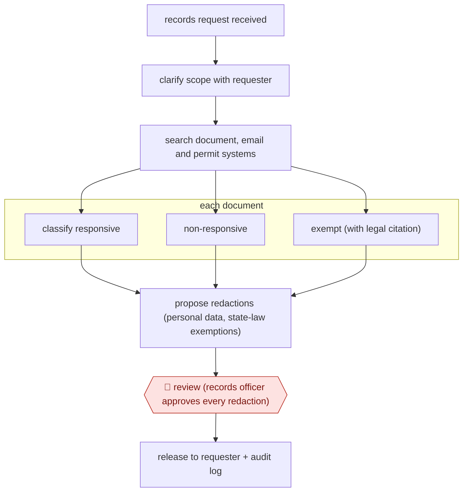

# Exemption-cited records redaction

`ORG › GOV › CIVIC` · checkpointed · evidence B · **draft: needs a reference example** ([how to add one](../../../../../CONTRIBUTING.md#1-add-an-example-run))

**Shape:** `records request received → clarify scope with requester → search document, email and permit systems → each document: classify responsive | non-responsive | exempt (with legal citation) → propose redactions (personal data, state-law exemptions) → 🛑 review (records officer approves every redaction) → release to requester + audit log`
**How it differs:** AWF-0082 Model-triaged records release (closest): that bulk-classifies archived cables for declassification, with humans taking only 'unsure' records and sampling model calls. This handles one incoming request end to end (search, exemption classification, redaction), and a person approves every redaction; the deliverable is a redacted release for one requester.
**Variants:** `common-sense-ai` · `atea-masking-service`

<!-- shape diagram: generated by scripts/build_diagrams.py from `shape`; don't edit -->

<!-- end shape diagram -->

## Steps
1. Intake: an AI chat asks the requester to clarify vague requests before staff see them [[1]](#sources).
2. The agent searches the agency's document management, Outlook/SharePoint, permitting and other systems for responsive records and routes parts of the request to the right departments [[1]](#sources).
3. Each document is classified as responsive, non-responsive, or exempt, with the legal citation for the exemption [[1]](#sources).
4. The agent proposes redactions: personal data (direct and indirect identifiers) and content covered by the jurisdiction's rules, using templates per service area in the Swedish municipal version [[1]](#sources)[[2]](#sources)[[3]](#sources).
5. 🛑 **Review**: the responsible official checks and approves every proposed redaction before release; under the Swedish regulator's guidance the tool is 'purely an aid' and the official decides what is confidential [[1]](#sources)[[2]](#sources).
6. Records go to the requester; the system keeps a log of what was searched, returned and withheld [[1]](#sources).

**Output:** A redacted release package for the requester, plus an audit trail of searches, withholdings and exemptions.
**Failure modes → guards:** Missed personal data or over-redaction → official reviews every redaction, DPIA and logging recommended by the data protection authority [2]. Vendor auto-fulfilment of 'routine' requests skips review → configure which request types may auto-release, and keep sensitive ones on full review [1]. Personal data processed by vendor → restricted environment where documents are deleted after the task [3].

## Public runs

Coverage as of 2026-11-13: **Weak**: only anonymous, vendor-linked or journalist-told accounts. Collected and re-checked in [Third collection pass](../../../../../research/2026-11-third-pass.md).

- [Common Sense AI, Los Altos Hills request](https://www.commonsensetech.ai/products/public-records) (undated). One large municipal request triaged and redaction-prepared, few documents left for close review. "Los Altos Hills brought us 8,483 documents in one request. We saved them 99 hours and $7,900 of staff time, leaving only 30 documents requiring close human review.". *First-hand: vendor; confidence: med.*
- [Techtidningen, Ronneby kommun](https://techtidningen.se/blev-tre-ganger-snabbare-ronneby-gick-fran-papper-och-penna-till-ai-pa-sex-manader/) (2025-12-08). Municipality adopts Lidingö/Atea masking tool; upload, AI suggestions, case handler reviews. "Nu har man infört ett AI-baserat system som gör att det går tre gånger snabbare.". *First-hand: interview; confidence: med.*

## Sources

1. Common Sense AI, Public Records product page (vendor). https://www.commonsensetech.ai/products/public-records
2. Integritetsskyddsmyndigheten (IMY), Disclosure of Public Records Using AI, regulatory sandbox English summary, 2024-12-18. https://www.imy.se/globalassets/dokument/rapporter/english-summary-disclosure-of-public-records-using-ai.pdf
3. Agnes Alvang, Techtidningen, ”Blev tre gånger snabbare”: Ronneby gick från papper och penna till AI på sex månader, 2025-12-08. https://techtidningen.se/blev-tre-ganger-snabbare-ronneby-gick-fran-papper-och-penna-till-ai-pa-sex-manader/
