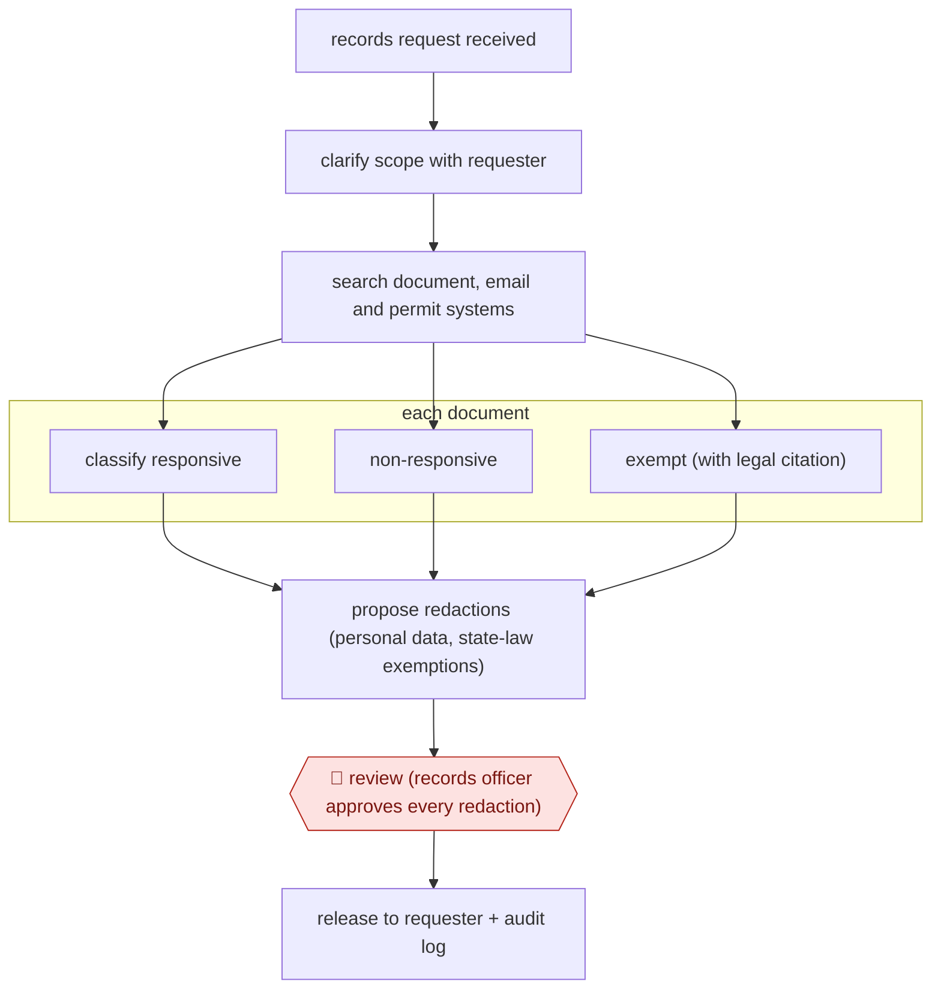

# Exemption-cited records redaction

`ORG › GOV › CIVIC` · checkpointed · evidence B · **draft: needs a reference example** ([how to add one](../../../../../CONTRIBUTING.md#1-add-an-example-run))

**Shape:** `records request received → clarify scope with requester → search document, email and permit systems → each document: classify responsive | non-responsive | exempt (with legal citation) → propose redactions (personal data, state-law exemptions) → 🛑 review (records officer approves every redaction) → release to requester + audit log`
**Variants:** `common-sense-ai` · `atea-masking-service`

<!-- shape diagram: generated by scripts/build_diagrams.py from `shape`; don't edit -->

<!-- end shape diagram -->

## Background

Public bodies such as councils and agencies are legally required to hand over their records when a member of the public asks for them (in the US under public-records and FOIA laws, in Sweden under its public-access principle). Before anything is released, staff must find every record the request covers, which may sit in document, email and permit systems, decide for each document whether it is covered, and black out whatever the law protects, such as personal data, noting the legal basis. With thousands of documents this is slow and repetitive. The agent searches, sorts each document and proposes the blackouts with the legal citation. A records officer still approves every blackout, because a missed piece of personal data is a privacy breach, over-blacking withholds what the public is entitled to see, and under the Swedish regulator's guidance it is the official who decides what is confidential.

**Terms:**
- **Public-records request (FOIA)**: a request to a public body for copies of its records.
- **Responsive**: covered by what the request asks for; non-responsive records are left out.
- **Exempt (exemption)**: covered by the request but protected from release by a specific legal rule.
- **Redaction**: blacking out the protected parts of a document before release.
- **Personal data (direct and indirect identifiers)**: information that names a person or could point to them.
- **Records officer**: the member of staff responsible for deciding what is released.
- **DPIA**: data protection impact assessment, a written risk check required before processing personal data in a new way.

## Build it with an agent

**Form:** `skill`. A records officer handles one request at a time and stays in the conversation; many documents in one request can be sorted by built-in subagents in parallel inside the same skill.

**You need:** the request text; read-only access to the systems that hold the records (document management, email, permits) through MCP connectors, limited to what the request concerns; a reference file with the exemptions of your jurisdiction and the redaction rules, and the legal citation for each; a place for the agent's working copies, separate from the originals and from any release folder; a setup approved for personal data, ideally one that deletes documents when the task ends. Give the agent no mail tool and no write access to the release folder.

| Step | Built as |
|---|---|
| records request received → clarify scope with requester | The officer gives the skill the request. The skill drafts clarifying questions for the officer to send. The public chat that the vendor puts in front of requesters is not part of this build. |
| search document, email and permit systems | The skill searches each connected system and writes the list of candidate documents to a results file. |
| each document: classify responsive \| non-responsive \| exempt (with legal citation) | Built-in subagents take batches of documents and return a table: document, class, exemption cited. They may cite only exemptions in the reference file. A document that fits none is marked "unsure" for the officer. |
| propose redactions (personal data, state-law exemptions) | The agent writes each proposed redaction as an entry (document, page, text, reason, citation) and produces marked-up working copies. Originals are never changed. |
| 🛑 review (records officer approves every redaction) → release to requester + audit log | See Checkpoints. A hook appends every tool call to the audit log. |

**Checkpoints:** `review`: the skill ends by listing every proposed redaction and every exempt or unsure document with its citation, then stops. The officer approves, changes or rejects each one. Release is not built: the agent has no mail tool and a permission rule denies writes to the release folder, so the officer assembles and sends the package from the approved list.

**Since the sources:** Sources date from 2024-12 to 2025-12; the vendor product page is undated. Source 1 is a vendor page, source 2 is a regulator's summary (the PDF opened but did not return readable text, so it was not re-read), and source 3 is a news article, partly behind a paywall. None shows the agent's steps in detail. This build is a design for one request handled by one officer. It leaves out the vendor's automatic release of routine requests, which skips review, and its payment and identity features. No performance claim is made.

*A design based on this entry's steps and the tool documentation as of 2026-11, not a reported run.*

## Steps

*As reported by the sources.*

1. Intake: an AI chat asks the requester to clarify vague requests before staff see them [[1]](#sources).
2. The agent searches the agency's document management, Outlook/SharePoint, permitting and other systems for responsive records and routes parts of the request to the right departments [[1]](#sources).
3. The agent classifies each document as responsive, non-responsive, or exempt, with the legal citation for the exemption [[1]](#sources).
4. The agent proposes redactions: personal data (direct and indirect identifiers) and content covered by the jurisdiction's rules, using templates per service area in the Swedish municipal version [[1]](#sources)[[2]](#sources)[[3]](#sources).
5. 🛑 **Review**: the responsible official checks and approves every proposed redaction before release; under the Swedish regulator's guidance the tool is 'purely an aid' and the official decides what is confidential [[1]](#sources)[[2]](#sources).
6. Records go to the requester; the system keeps a log of what was searched, returned and withheld [[1]](#sources).

**Output:** A redacted release package for the requester, plus an audit trail of searches, withholdings and exemptions.
**Failure modes → guards:** Missed personal data or over-redaction → official reviews every redaction, DPIA and logging recommended by the data protection authority [2]. Vendor auto-fulfilment of 'routine' requests skips review → configure which request types may auto-release, and keep sensitive ones on full review [1]. Personal data processed by vendor → restricted environment where documents are deleted after the task [3].
**How it differs:** AWF-0082 Model-triaged records release (closest): that bulk-classifies archived cables for declassification, with humans taking only 'unsure' records and sampling model calls. This handles one incoming request end to end (search, exemption classification, redaction), and a person approves every redaction; the deliverable is a redacted release for one requester.

## Public runs

Coverage as of 2026-11-13: **Weak**: only anonymous, vendor-linked or journalist-told accounts. Collected and re-checked in [Third collection pass](../../../../../research/2026-11-third-pass.md).

- [Common Sense AI, Los Altos Hills request](https://www.commonsensetech.ai/products/public-records) (undated). One large municipal request triaged and redaction-prepared, few documents left for close review. "Los Altos Hills brought us 8,483 documents in one request. We saved them 99 hours and $7,900 of staff time, leaving only 30 documents requiring close human review.". *First-hand: vendor; confidence: med.*
- [Techtidningen, Ronneby kommun](https://techtidningen.se/blev-tre-ganger-snabbare-ronneby-gick-fran-papper-och-penna-till-ai-pa-sex-manader/) (2025-12-08). Municipality adopts Lidingö/Atea masking tool; upload, AI suggestions, case handler reviews. "Nu har man infört ett AI-baserat system som gör att det går tre gånger snabbare.". *First-hand: interview; confidence: med.*

## Sources

1. Common Sense AI, Public Records product page (vendor). https://www.commonsensetech.ai/products/public-records
2. Integritetsskyddsmyndigheten (IMY), Disclosure of Public Records Using AI, regulatory sandbox English summary, 2024-12-18. https://www.imy.se/globalassets/dokument/rapporter/english-summary-disclosure-of-public-records-using-ai.pdf
3. Agnes Alvang, Techtidningen, ”Blev tre gånger snabbare”: Ronneby gick från papper och penna till AI på sex månader, 2025-12-08. https://techtidningen.se/blev-tre-ganger-snabbare-ronneby-gick-fran-papper-och-penna-till-ai-pa-sex-manader/
