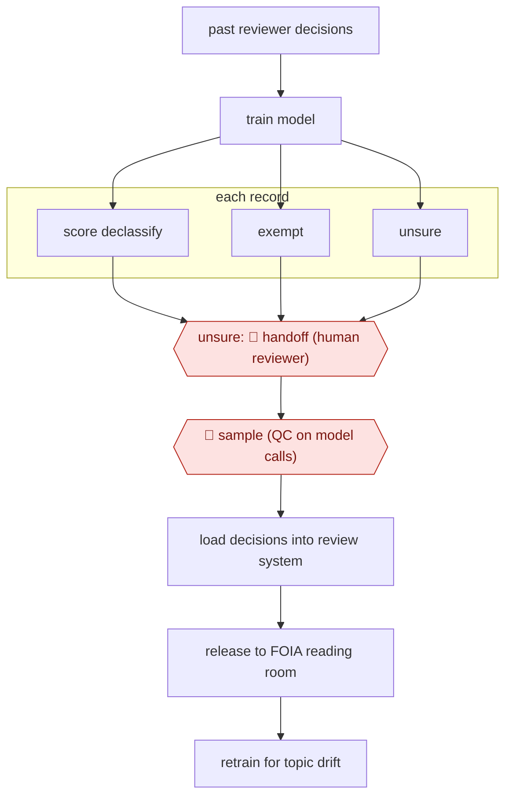

# Model-triaged records release

`ORG › GOV › CIVIC` · sampled · evidence A · **draft: needs a reference example** ([how to add one](../../../../../CONTRIBUTING.md#1-add-an-example-run))

**Shape:** `past reviewer decisions → train model → each record: score declassify | exempt | unsure → unsure: 🛑 handoff (human reviewer) → 🛑 sample (QC on model calls) → load decisions into review system → release to FOIA reading room → retrain for topic drift`
**How it differs:** AWF-0005 Alert enrich and adjudicate (SECOPS) also routes on confidence, but it decides on security alerts. Here the deliverable is legally reviewed public records released under declassification/FOIA, with QC sampling. None close.
**Variants:** `state-dept-ips-declass`

<!-- shape diagram: generated by scripts/build_diagrams.py from `shape`; don't edit -->

<!-- end shape diagram -->

## Steps
1. Pick one uniform record type (diplomatic cables in eRecords) whose earlier human declassification decisions can serve as labels [[1]](#sources).
2. Train a model on those decisions (declassify vs exempt from declassification). In the pilot the training data was 1995–96 cable decisions and the model was run on the 1997 cables [[1]](#sources)[[2]](#sources).
3. Score each cable into likely declassify, likely exempt, or needs manual review [[2]](#sources).
4. 🛑 **Handoff**: cables the model is unsure of go to human reviewers [[1]](#sources).
5. 🛑 **Sample**: humans run quality control checks on model output and re-label training data as needed [[1]](#sources).
6. Load model predictions into the review system, then publish declassified cables proactively in the FOIA reading room (case S-2023-00002, released monthly) [[1]](#sources).
7. Retrain and monitor for topic drift. Staff keep reviewing the training data as world events change what is sensitive [[1]](#sources)[[2]](#sources).

**Output:** Declassified historical records published monthly to State's FOIA reading room. Exemptions go on to NARA transfer or further review.
**Failure modes → guards:** Topic drift makes past decisions a poor guide → humans watch for drift and retrain. Opaque calls → be ready to explain how the AI reached a result. Messy FOIA data spread across 3 systems → data readiness work comes first [[1]](#sources). Confidence thresholds are not published [[2]](#sources).

## Public runs

Coverage as of 2026-11-06: **Strong**: a first-hand, detailed run that matches most of the shape. Collected and re-checked in [New workflows for empty categories](../../../../../research/2026-11-new-workflows.md).

- [US Department of State, AI Pilot Results](https://transforming-classification.blogs.archives.gov/wp-content/uploads/sites/10/2024/07/State-AI-Pilot-Results-June-24-2024.pdf) (2024-06-24). Cable declassification pilot to full deployment, humans kept in the loop by design; cables released to the FOIA reading room. "Reduced volume for humans to review (by 80%)"; "450,000 cables reviewed by AI". *First-hand: yes; confidence: high.*

## Sources

1. US Department of State (A/GIS/IPS), AI Pilot Results, 2024-06-24. https://transforming-classification.blogs.archives.gov/wp-content/uploads/sites/10/2024/07/State-AI-Pilot-Results-June-24-2024.pdf
2. FedScoop (sponsored by Microsoft Federal), How the State Department used AI and machine learning to revolutionize records management, 2024-05-16. https://fedscoop.com/how-the-state-department-used-ai-and-machine-learning-to-revolutionize-records-management/
