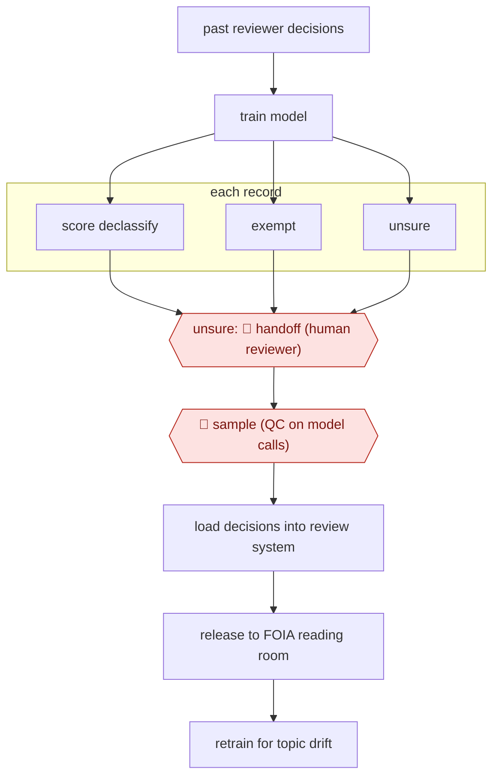

# Model-triaged records release

`ORG › GOV › CIVIC` · sampled · evidence A · **draft: needs a reference example** ([how to add one](../../../../../CONTRIBUTING.md#1-add-an-example-run))

**Shape:** `past reviewer decisions → train model → each record: score declassify | exempt | unsure → unsure: 🛑 handoff (human reviewer) → 🛑 sample (QC on model calls) → load decisions into review system → release to FOIA reading room → retrain for topic drift`
**Variants:** `state-dept-ips-declass`

<!-- shape diagram: generated by scripts/build_diagrams.py from `shape`; don't edit -->

<!-- end shape diagram -->

## Background

Governments mark sensitive records as classified, and after a set time a reviewer has to decide whether each record can now be released to the public or must stay closed. Where the volume is in the hundreds of thousands of documents, as with diplomatic cables (the formal messages between a foreign ministry and its embassies), people reading every record one by one cannot keep up. Here a model sorts each record into likely release, likely exempt (protected by a legal rule) or unsure, so reviewers read only the unsure ones and check a sample of the rest. A person still decides the unsure records and checks the model's calls, because releasing something that should have stayed closed cannot be undone and the agency is legally responsible for the release.

**Terms:**
- **Declassification**: removing a record's classified status so it can be released.
- **Exempt (exemption)**: protected from release by a specific legal rule, so it stays closed or goes to further review.
- **FOIA reading room**: the public website where an agency posts records it has released under the Freedom of Information Act (FOIA).
- **Cable**: a formal diplomatic message, here the record type being reviewed.
- **Labels**: the past human decisions (release or exempt) that a model is trained on.
- **QC (quality control) sampling**: a person re-checks a share of the model's confident calls to see if it is wrong.
- **Topic drift**: events change what counts as sensitive, so old decisions stop being a good guide.
- **NARA**: the US National Archives and Records Administration, which receives records that stay closed.

## Build it with an agent

**Form:** `service`. The work runs in batches over a large archive and people see only the unsure records and a sample, so it is a run started by a scheduler, not a conversation. Whether a general agent can match the trained model the source used is not shown: this build replaces it with agents that read each record against written guidance.

**You need:** a copy of the records for the batch in an environment approved for classified or sensitive material, never a general one; the past reviewer decisions with their reasons, as a file of examples; the written review guidance and exemption rules as a reference file; read access to the review system for the records and write access only to a "predicted" field; a store outside the conversation for each record's call, reviewer corrections and sample results; two queues, one for unsure records and one for the sample.

| Step | Built as |
|---|---|
| past reviewer decisions → train model | No training. A script picks a few past decisions of the same record type and topic and the skill puts them in front of the agent as examples. A trained classifier, if you have one, is called as a script. |
| each record: score declassify \| exempt \| unsure | A dynamic workflow gives each record to subagents that return a call, the rule relied on and a one-line reason. Records where two agents disagree, or where no rule clearly applies, are scored unsure. |
| unsure: 🛑 handoff (human reviewer) | The record goes to the unsure queue with the reasons both agents gave. |
| 🛑 sample (QC on model calls) | A fixed share of confident calls is copied to the sample queue. A reviewer's verdict is written to the store. |
| load decisions into review system → release to FOIA reading room | A connector writes the predicted call into the review system. Publication is done by staff. |
| retrain for topic drift | Reviewer corrections are added to the examples file. The rate at which reviewers overrule the agent is kept in the store, and a person decides when to revise the guidance. |

**Checkpoints:** `handoff`: the unsure queue is the only route by which those records proceed, and the agent has no way to mark one as released. `sample`: the sample is drawn by the run's script, not chosen by the agent, and results feed the override rate. The agent has no publish tool, and a permission rule denies writes to the reading room or any release field, so nothing is released unless staff act.

**Since the sources:** Sources date from 2024-05 to 2024-06. A search in 2026-11 found one newer account, [Federal News Network](https://federalnewsnetwork.com/federal-insights/2026/05/agencies-look-to-ai-automation-amid-growth-in-digital-records/) (2026-05), in which a State Department official says AI tools are already used for declassification review and that cable declassification work is expected to grow five-fold; it describes no steps. The PDF in source 1 opened but did not return readable text, so its figures were not re-read here. The source used a model trained on past decisions that sorts records into three groups; this build uses a general agent reading each record against written guidance, which the sources do not test, and the sources say nothing about how well a general agent would do this. No performance claim is made.

*A design based on this entry's steps and the tool documentation as of 2026-11, not a reported run.*

## Steps

*As reported by the sources.*

1. The team picks one uniform record type (diplomatic cables in eRecords) whose earlier human declassification decisions can serve as labels [[1]](#sources).
2. The team trains a model on those decisions (declassify vs exempt from declassification). In the pilot the training data was 1995–96 cable decisions and the model was run on the 1997 cables [[1]](#sources)[[2]](#sources).
3. The model scores each cable into likely declassify, likely exempt, or needs manual review [[2]](#sources).
4. 🛑 **Handoff**: cables the model is unsure of go to human reviewers [[1]](#sources).
5. 🛑 **Sample**: humans run quality control checks on model output and re-label training data as needed [[1]](#sources).
6. The team loads model predictions into the review system, then publishes declassified cables proactively in the FOIA reading room (case S-2023-00002, released monthly) [[1]](#sources).
7. The team retrains the model and monitors for topic drift. Staff keep reviewing the training data as world events change what is sensitive [[1]](#sources)[[2]](#sources).

**Output:** Declassified historical records published monthly to State's FOIA reading room. Exemptions go on to NARA transfer or further review.
**Failure modes → guards:** Topic drift makes past decisions a poor guide → humans watch for drift and retrain. Opaque calls → be ready to explain how the AI reached a result. Messy FOIA data spread across 3 systems → data readiness work comes first [[1]](#sources). Confidence thresholds are not published [[2]](#sources).
**How it differs:** AWF-0005 Alert enrich and adjudicate (SECOPS) also routes on confidence, but it decides on security alerts. Here the deliverable is legally reviewed public records released under declassification/FOIA, with QC sampling. None close.

## Public runs

Coverage as of 2026-11-06: **Strong**: a first-hand, detailed run that matches most of the shape. Collected and re-checked in [New workflows for empty categories](../../../../../research/2026-11-new-workflows.md).

- [US Department of State, AI Pilot Results](https://transforming-classification.blogs.archives.gov/wp-content/uploads/sites/10/2024/07/State-AI-Pilot-Results-June-24-2024.pdf) (2024-06-24). Cable declassification pilot to full deployment, humans kept in the loop by design; cables released to the FOIA reading room. "Reduced volume for humans to review (by 80%)"; "450,000 cables reviewed by AI". *First-hand: yes; confidence: high.*

## Sources

1. US Department of State (A/GIS/IPS), AI Pilot Results, 2024-06-24. https://transforming-classification.blogs.archives.gov/wp-content/uploads/sites/10/2024/07/State-AI-Pilot-Results-June-24-2024.pdf
2. FedScoop (sponsored by Microsoft Federal), How the State Department used AI and machine learning to revolutionize records management, 2024-05-16. https://fedscoop.com/how-the-state-department-used-ai-and-machine-learning-to-revolutionize-records-management/
