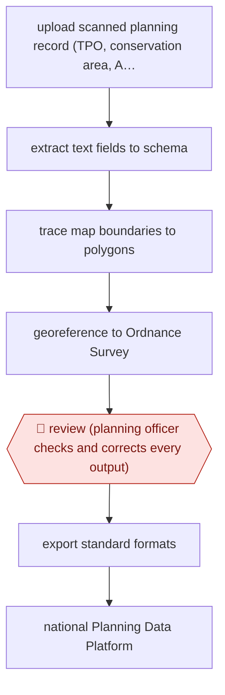

# Officer-checked planning data extraction

`ORG › GOV › CIVIC` · assist · evidence A · **draft: needs a reference example** ([how to add one](../../../../../CONTRIBUTING.md#1-add-an-example-run))

**Shape:** `upload scanned planning record (TPO, conservation area, Article 4) → extract text fields to schema → trace map boundaries to polygons → georeference to Ordnance Survey → 🛑 review (planning officer checks and corrects every output) → export standard formats → national Planning Data Platform`
**How it differs:** AWF-0082 Model-triaged records release. There a classifier decides declassification, only unsure records go to humans and QC is sampled. Here the deliverable is a structured geospatial dataset built from scanned planning records, and an officer reviews and corrects every output before export. Different deliverable and a full review instead of sampling.
**Variants:** `extract`

<!-- shape diagram: generated by scripts/build_diagrams.py from `shape`; don't edit -->

<!-- end shape diagram -->

## Background

A local authority holds decades of planning decisions on paper: tree preservation orders, conservation area designations, directions that restrict what may be built without permission. Each is a scanned document with a text and a map, and the map is the part that matters most, because a boundary drawn on a photocopy decides whether a particular tree or building is protected. Councils need those records as data — machine-readable, georeferenced, publishable nationally — and rekeying them by hand is the kind of work that never gets funding. This workflow reads the scan: the text fields go into the authority's schema, the map's boundary is traced into a polygon and aligned to national mapping coordinates, and the officer who owns the record checks and corrects every field and every boundary before it is exported. The review is full, not sampled, even though the tool's accuracy is already high, because the output is a legal designation published nationally: an officer's correction is the authority's statement that the boundary is right, and that statement cannot be made by a model with a good average.

**Terms:**
- **TPO** (tree preservation order): a designation protecting specific trees, with a map.
- **conservation area**: a designated area where demolition and alteration need consent.
- **Article 4 direction**: an order removing some permitted development rights in an area.
- **schema**: the defined fields and types the authority's data must conform to.
- **polygon**: the vector boundary of a designated area, as stored in a GIS.
- **georeferencing**: aligning a scanned map to real-world coordinates.
- **ground control point**: a feature visible on both the scan and the reference map, used to align them.
- **IoU** (intersection over union): how much two polygons overlap, used to score boundary accuracy.

## Build it with an agent

**Form:** `skill`. One planning officer works one record at a time and signs off its every field and boundary; the extraction is a set of tools the officer runs, not a service that runs without them.

**You need:** the scanned records and the authority's schema; an extraction path for text that returns each field with the region of the page it came from; a boundary-tracing step using vision and segmentation, with the scan's resolution good enough to trace; the national mapping reference for georeferencing, and the control points to align to; a review interface where the officer sees the scan, the field and the polygon side by side; and the export formats for both the council's own systems and the national platform. The agent must not export: the export is the officer's act, and the designation is theirs.

| Step | Built as |
|---|---|
| upload scanned planning record | The officer uploads and the Skill reads the page structure — title, dates, decision text, map sheet — so the extraction knows what it is looking at rather than guessing fields from a wall of text. |
| extract text fields to schema | Extraction with structured output, every value carrying the page region it came from; a field it cannot read is left empty for the officer rather than filled with a plausible date. |
| trace map boundaries to polygons | Segmentation over the map sheet produces the polygon, and the Skill states which marking it traced, since a photocopy often carries several. |
| georeference to Ordnance Survey | Control points are matched against the national mapping, the transform is applied, and the residual error is reported — the officer needs to know whether the shape moved by a metre or by fifty. |
| 🛑 review (planning officer checks and corrects every output) | The review is per field and per boundary, not per record: the officer sees the value, its source region and the polygon over the base map, corrects what is wrong, and their correction is the version of record. |
| export standard formats → national platform | Export is a separate act with the officer's credentials; the run has no publishing path, which is what keeps the designation the authority's statement rather than the tool's. |

**Checkpoints:** `review`: a full review of every output, deliberately, even though most need only minor edits — because the failure that matters is not the average error but a single published boundary that puts a protected tree outside its own order. The build makes the review feasible rather than nominal: each value arrives with its source region and each polygon over the base map, so the officer is checking a claim, not re-reading the document.

**Since the sources:** Sources date from 2025-06 and 2026-06: two first-hand accounts from the department that built it, both opened this month. What has changed since: the service has gone from an alpha to every council in England, and the published detail has shifted from accuracy to review load — the 2026 account says officers review all outputs and that in around two thirds of cases only minor edits were needed. That is the number a build like this should plan around: a full review is affordable only if most items are quick, so the interface's job is to make the easy two thirds fast and put the officer's attention on the third that needs it.

*A design based on this entry's steps and the tool documentation as of 2026-11, not a reported run.*

## Steps

*As reported by the sources.*

1. A planning officer signs in with a GOV.UK email and uploads a PDF or scanned record, such as a Tree Preservation Order, Conservation Area or Article 4 Direction [[1]](#sources).
2. An LLM pulls dates, locations and decisions into the Digital Planning platform's schemas, using structured outputs [[2]](#sources).
3. Vision-language models with OpenCV and SAM trace the map boundaries into polygons [[2]](#sources).
4. The system finds ground control points against Ordnance Survey maps and aligns each polygon to real-world coordinates [[2]](#sources).
5. 🛑 **Review**: officers 'review everything that Extract produces, check the output and makes corrections' [[1]](#sources).
6. Officers export the data in standardised formats for their own systems and the national Planning Data Platform [[1]](#sources).

**Output:** Georeferenced, schema-conformant planning datasets in the council's systems and on the public Planning Data Platform.
**Failure modes → guards:** Boundary misalignment → IoU and centre-distance checks in the alpha, plus officer correction. Misread dates (94% correct in the alpha) → the officer checks every field. Over-trust once accuracy looks high → review of all outputs, not samples.

## Public runs

Coverage as of 2026-11-06: **Strong**: a first-hand, detailed run that matches most of the shape. Collected and re-checked in [Second collection pass](../../../../../research/2026-11-second-pass.md).

- [MHCLG, Extract live for every council](https://mhclgdigital.blog.gov.uk/2026/06/17/extract-is-here-ai-powered-planning-data-for-every-council-in-england/) (2026-06-17). Live service: 50 councils using it; officers review all outputs; most needed only minor edits. "In around two thirds of cases, only minor edits were needed before the data was ready to use". *First-hand: yes; confidence: high.*
- [MHCLG, Extract alpha](https://mhclgdigital.blog.gov.uk/2025/06/12/extract-using-ai-to-unlock-historic-planning-data/) (2025-06-12). Alpha accuracy on text, dates and boundaries; cost and time per record. "The system identified dates correctly 94% of the time.". *First-hand: yes; confidence: med.*

## Sources

1. MHCLG Digital Planning team, Extract is here: AI-powered planning data for every council in England, 2026-06-17. https://mhclgdigital.blog.gov.uk/2026/06/17/extract-is-here-ai-powered-planning-data-for-every-council-in-england/
2. Jenny Colebourn, Steve Messer, Gavin Edwards (MHCLG), Extract: using AI to unlock historic planning data, 2025-06-12. https://mhclgdigital.blog.gov.uk/2025/06/12/extract-using-ai-to-unlock-historic-planning-data/
