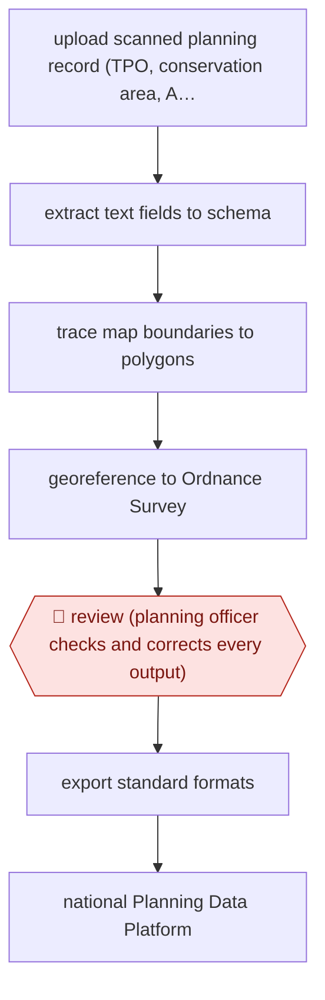

# Officer-checked planning data extraction

`ORG › GOV › CIVIC` · assist · evidence A · **draft: needs a reference example** ([how to add one](../../../../../CONTRIBUTING.md#1-add-an-example-run))

**Shape:** `upload scanned planning record (TPO, conservation area, Article 4) → extract text fields to schema → trace map boundaries to polygons → georeference to Ordnance Survey → 🛑 review (planning officer checks and corrects every output) → export standard formats → national Planning Data Platform`
**How it differs:** AWF-0082 Model-triaged records release. There a classifier decides declassification, only unsure records go to humans and QC is sampled. Here the deliverable is a structured geospatial dataset built from scanned planning records, and an officer reviews and corrects every output before export. Different deliverable and a full review instead of sampling.
**Variants:** `extract`

<!-- shape diagram: generated by scripts/build_diagrams.py from `shape`; don't edit -->

<!-- end shape diagram -->

## Steps
1. A planning officer signs in with a GOV.UK email and uploads a PDF or scanned record, such as a Tree Preservation Order, Conservation Area or Article 4 Direction [[1]](#sources).
2. An LLM pulls dates, locations and decisions into the Digital Planning platform's schemas, using structured outputs [[2]](#sources).
3. Vision-language models with OpenCV and SAM trace the map boundaries into polygons [[2]](#sources).
4. The system finds ground control points against Ordnance Survey maps and aligns each polygon to real-world coordinates [[2]](#sources).
5. 🛑 **Review**: officers 'review everything that Extract produces, check the output and makes corrections' [[1]](#sources).
6. Officers export the data in standardised formats for their own systems and the national Planning Data Platform [[1]](#sources).

**Output:** Georeferenced, schema-conformant planning datasets in the council's systems and on the public Planning Data Platform.
**Failure modes → guards:** Boundary misalignment → IoU and centre-distance checks in the alpha, plus officer correction. Misread dates (94% correct in the alpha) → the officer checks every field. Over-trust once accuracy looks high → review of all outputs, not samples.

## Public runs

Coverage as of 2026-11-06: **Strong**: a first-hand, detailed run that matches most of the shape. Collected and re-checked in [Second collection pass](../../../../../research/2026-11-second-pass.md).

- [MHCLG, Extract live for every council](https://mhclgdigital.blog.gov.uk/2026/06/17/extract-is-here-ai-powered-planning-data-for-every-council-in-england/) (2026-06-17). Live service: 50 councils using it; officers review all outputs; most needed only minor edits. "In around two thirds of cases, only minor edits were needed before the data was ready to use". *First-hand: yes; confidence: high.*
- [MHCLG, Extract alpha](https://mhclgdigital.blog.gov.uk/2025/06/12/extract-using-ai-to-unlock-historic-planning-data/) (2025-06-12). Alpha accuracy on text, dates and boundaries; cost and time per record. "The system identified dates correctly 94% of the time.". *First-hand: yes; confidence: med.*

## Sources

1. MHCLG Digital Planning team, Extract is here: AI-powered planning data for every council in England, 2026-06-17. https://mhclgdigital.blog.gov.uk/2026/06/17/extract-is-here-ai-powered-planning-data-for-every-council-in-england/
2. Jenny Colebourn, Steve Messer, Gavin Edwards (MHCLG), Extract: using AI to unlock historic planning data, 2025-06-12. https://mhclgdigital.blog.gov.uk/2025/06/12/extract-using-ai-to-unlock-historic-planning-data/
