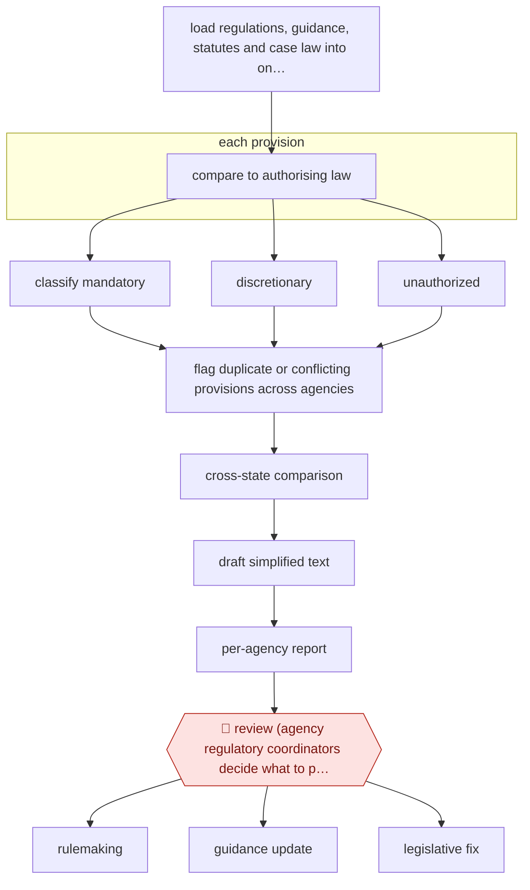

# Statute-mapped regulatory review

`ORG › GOV › POLICY` · checkpointed · evidence A · **draft: needs a reference example** ([how to add one](../../../../../CONTRIBUTING.md#1-add-an-example-run))

**Shape:** `load regulations, guidance, statutes and case law into one database → each provision: compare to authorising law → classify mandatory | discretionary | unauthorized → flag duplicate or conflicting provisions across agencies → cross-state comparison → draft simplified text → per-agency report → 🛑 review (agency regulatory coordinators decide what to pursue) → rulemaking | guidance update | legislative fix`
**How it differs:** AWF-0080 Theme sign-off consultation analysis (closest in class): that analyses public responses to a consultation. This audits the existing body of regulation against statute and outputs per-agency cut/simplify recommendations; the checkpoint is an agency decision on each recommendation, not a theme sign-off plus sampled mapping.
**Variants:** `vulcan-technologies`

<!-- shape diagram: generated by scripts/build_diagrams.py from `shape`; don't edit -->

<!-- end shape diagram -->

## Background

A state's administrative code is a body of rules built up over decades by dozens of agencies, and parts of it have drifted from the laws that authorised them: a fee raised above what the statute allows, a requirement that survives the repeal of its parent act, two agencies regulating the same activity with slightly different thresholds. Nobody wrote it that way on purpose; it accumulates. Finding it means reading every provision beside the law that authorises it, which is a job measured in years of lawyer time and therefore never done. This workflow does the reading at scale: the code, the guidance, the statutes and the case law are loaded into one searchable base, split into provisions, and each provision is classified against its authorising law as mandatory, discretionary or unauthorised; duplicates and conflicts are flagged within and across agencies, other states are compared, and shorter plain-language rewrites are drafted. Every one of those classifications is a legal argument, so the output is a report per agency and the decision on what to pursue is the agency's, not the tool's — the coordinator and the agency's lawyers decide, and the change then goes through rulemaking, a guidance revision or a request for legislation.

**Terms:**
- **administrative code**: the compiled regulations of a state's executive agencies.
- **provision**: one discrete requirement within a regulation, which is the unit of analysis here.
- **authorising statute**: the law that gives an agency the power to make a given rule.
- **mandatory / discretionary / unauthorised**: required by statute, permitted but optional, or beyond what the statute allows.
- **duplication**: the same requirement in more than one regulation or guidance document.
- **rulemaking**: the formal process of changing a regulation.
- **guidance**: a non-binding document that explains how an agency reads its rules.
- **heat map**: a visual ranking of where attention will pay, used here to pick candidates for closer review.

## Build it with an agent

**Form:** `project`. The corpus of laws and rules, the classification schema and the per-agency report templates have to persist and stay consistent across a months-long audit over thousands of provisions — standing knowledge plus a fan-out of parallel workers, which is a project with a repository and a workflow, not a one-off skill run.

**You need:** the code, guidance, statutes and case law as text, with citation metadata and the version in force; a split of the code into discrete provisions, each with its citation; a scraper that tracks later changes, or the audit goes stale while it runs; the statutory-authority schema, so a classification is a field with a citation rather than a paragraph; the report template per agency; and the cross-state comparison corpus. The agent must not amend a regulation or send anything to an agency as a decision: the report is advice, and the classification of statutory authority is a legal opinion it is not qualified to give.

| Step | Built as |
|---|---|
| load regulations, guidance, statutes and case law | An ingestion pass into one searchable store, with the version in force recorded per document, because an audit against a superseded statute is worse than no audit. |
| each provision: compare to authorising law | A Dynamic workflow fans out over provisions: each worker gets one provision and the statutory provisions that could authorise it, and must return a classification with the citations it relied on. |
| classify mandatory / discretionary / unauthorized | Every classification carries its reasoning and citation; a worker that cannot find clear authority returns "unclear" rather than unauthorised, since the difference is legally material. |
| flag duplicate or conflicting provisions | A second pass clusters provisions by requirement across agencies, which is the only way to see duplication that no single provision reveals. |
| cross-state comparison → draft simplified text | Comparisons are drawn only where the other state's text is in the corpus, and rewrites are drafts labelled as such — a rewrite is a proposal to the agency, not a change. |
| per-agency report | The Skill assembles one report per agency: the counts, the provisions, the recommendations and the suggested language. |
| 🛑 review (agency regulatory coordinators decide what to pursue) | Each agency's coordinator and lawyers read their report and choose; the build has no path into rulemaking, guidance or a legislative request, so a classification cannot become a change without a person deciding. |

**Checkpoints:** `review`: the classification is a roadmap, not a verdict — the agency and its lawyers decide, and the sources say the agency would not rely exclusively on the analysis. The build protects that in two ways: the "unclear" category exists so the tool is not forced to make a legal call it cannot make, and every recommendation carries the citations that produced it, so a reviewer can reject it in seconds.

**Since the sources:** Sources date from 2025-07 to 2026-04: the programme director's own account, a vendor interview, and an independent write-up. The director's account was opened this month; the other two were not re-opened on this pass. What has changed since: nothing found that supersedes the account, and the entry's own caution still holds — the pilot ran at the end of a wider manual programme, so the headline 35.7% reduction cannot be attributed to the AI review. That is the number most likely to be misquoted from this entry, and the sources are consistent that the classification work was one input among several.

*A design based on this entry's steps and the tool documentation as of 2026-11, not a reported run.*

## Steps

*As reported by the sources.*

1. The vendor gathers the state administrative code (regulations of all 66 executive branch agencies), guidance documents, and state and federal statutes and case law into one database and splits regulations into discrete provisions; an agentic scraper tracks later changes to law and rules [[1]](#sources)[[2]](#sources)[[3]](#sources).
2. Specialised agents run concurrently: each regulatory requirement is compared with the law that authorises it and classified as mandatory, discretionary, or unauthorized (e.g. cites a repealed statute, or charges a fee above what the statute allows) [[1]](#sources)[[2]](#sources).
3. Agents flag provisions addressed by more than one regulation or guidance document, within and across agencies, and draft shorter plain-language rewrites [[1]](#sources).
4. Targeted cross-state comparisons benchmark requirements (e.g. training hours for a licence) against other states; the ORM director also describes AI cost-benefit heat maps to pick regulations for closer scrutiny [[1]](#sources)[[2]](#sources).
5. ORM compiles findings into a report for each agency: a snapshot of mandatory/discretionary/unauthorized requirements, recommendations to consolidate, eliminate or simplify, and suggested code language [[1]](#sources).
6. 🛑 **Review**: each agency reviews the findings and decides which changes to pursue, set aside, or study further; agency officials 'decide what additional cuts they may be able to make' [[1]](#sources)[[4]](#sources). Changes then go through rulemaking, a guidance update, or a request for a legislative fix for mandatory provisions [[2]](#sources).

**Output:** Per-agency regulatory reduction report; agency-approved changes go into the rulemaking or guidance-revision pipeline. Executive Order 51 makes AI review part of the four-yearly periodic review.
**Failure modes → guards:** AI misreads statutory authority → classification is only a roadmap; agency coordinators and lawyers decide, and the ORM director says agencies would not rely exclusively on AI analysis. Impact hard to attribute → the pilot ran at the end of a broader manual programme, so headline reductions are not AI-only (say so when citing numbers).

## Public runs

Coverage as of 2026-11-13: **Strong**: a first-hand, detailed run that matches most of the shape. Collected and re-checked in [Third collection pass](../../../../../research/2026-11-third-pass.md).

- [Reeve T. Bull (ORM director), Yale JREG](https://www.yalejreg.com/nc/ai-empowered-regulatory-reform-spreading-the-virginia-model-by-reeve-t-bull/) (2026-02-12). Director's own account of the pilot: classify vs statute, cross-state comparison, consolidation, heat maps. "around 20 seconds for a very preliminary cost-benefit analysis and 15-20 minutes for a more thorough cost-benefit analysis". *First-hand: yes; confidence: high.*
- [Reason, Virginia is using AI to identify illegal and redundant regulations](https://reason.com/2025/07/23/virginia-is-using-ai-to-identify-illegal-and-redundant-regulations/) (2025-07-23). Vendor CEO describes pilot contract and thousands of concurrent agents. "$150,000, three-month-long pilot trial with ORM from May 1 to August 1". *First-hand: interview; confidence: med.*
- [Reboot Democracy, How Virginia Used AI](https://rebootdemocracy.ai/blog/ai-regulation-case-study-virginia) (2026-04-28). Five-phase pilot; agencies decide; results not separable from wider programme. "Reduced total statewide regulatory requirements by 35.7 percent" (whole four-year initiative, not AI-only). *First-hand: interview; confidence: med.*

## Sources

1. Dane Gambrell, Reboot Democracy, Rethinking Regulation: How Virginia Used AI to Streamline Its Regulatory Code, 2026-04-28. https://rebootdemocracy.ai/blog/ai-regulation-case-study-virginia
2. Reeve T. Bull, Yale Journal on Regulation (Notice & Comment), AI-Empowered Regulatory Reform: Spreading the Virginia Model, 2026-02-12. https://www.yalejreg.com/nc/ai-empowered-regulatory-reform-spreading-the-virginia-model-by-reeve-t-bull/
3. Jack Nicastro, Reason, Virginia is using AI to identify illegal and redundant regulations, 2025-07-23. https://reason.com/2025/07/23/virginia-is-using-ai-to-identify-illegal-and-redundant-regulations/
4. Jahd Khalil, WHRO/VPM, Youngkin turns to AI firm in quest to cut 35% of state regulations, 2025-09-26. https://www.whro.org/virginia-government/2025-09-26/youngkin-turns-to-ai-firm-in-quest-to-cut-35-of-state-regulations
5. Chris Teale, Route Fifty, Inside Virginia's AI-driven streamlining of regulations, 2025-08-22. https://www.route-fifty.com/artificial-intelligence/2025/08/inside-virginias-ai-driven-streamlining-regulations/407631/
