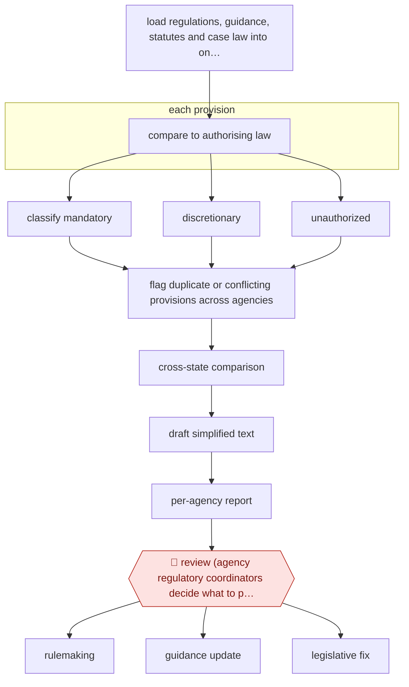

# Statute-mapped regulatory review

`ORG › GOV › POLICY` · checkpointed · evidence A · **draft: needs a reference example** ([how to add one](../../../../../CONTRIBUTING.md#1-add-an-example-run))

**Shape:** `load regulations, guidance, statutes and case law into one database → each provision: compare to authorising law → classify mandatory | discretionary | unauthorized → flag duplicate or conflicting provisions across agencies → cross-state comparison → draft simplified text → per-agency report → 🛑 review (agency regulatory coordinators decide what to pursue) → rulemaking | guidance update | legislative fix`
**How it differs:** AWF-0080 Theme sign-off consultation analysis (closest in class): that analyses public responses to a consultation. This audits the existing body of regulation against statute and outputs per-agency cut/simplify recommendations; the checkpoint is an agency decision on each recommendation, not a theme sign-off plus sampled mapping.
**Variants:** `vulcan-technologies`

<!-- shape diagram: generated by scripts/build_diagrams.py from `shape`; don't edit -->

<!-- end shape diagram -->

## Steps
1. The vendor gathers the state administrative code (regulations of all 66 executive branch agencies), guidance documents, and state and federal statutes and case law into one database and splits regulations into discrete provisions; an agentic scraper tracks later changes to law and rules [[1]](#sources)[[2]](#sources)[[3]](#sources).
2. Specialised agents run concurrently: each regulatory requirement is compared with the law that authorises it and classified as mandatory, discretionary, or unauthorized (e.g. cites a repealed statute, or charges a fee above what the statute allows) [[1]](#sources)[[2]](#sources).
3. Agents flag provisions addressed by more than one regulation or guidance document, within and across agencies, and draft shorter plain-language rewrites [[1]](#sources).
4. Targeted cross-state comparisons benchmark requirements (e.g. training hours for a licence) against other states; the ORM director also describes AI cost-benefit heat maps to pick regulations for closer scrutiny [[1]](#sources)[[2]](#sources).
5. ORM compiles findings into a report for each agency: a snapshot of mandatory/discretionary/unauthorized requirements, recommendations to consolidate, eliminate or simplify, and suggested code language [[1]](#sources).
6. 🛑 **Review**: each agency reviews the findings and decides which changes to pursue, set aside, or study further; agency officials 'decide what additional cuts they may be able to make' [[1]](#sources)[[4]](#sources). Changes then go through rulemaking, a guidance update, or a request for a legislative fix for mandatory provisions [[2]](#sources).

**Output:** Per-agency regulatory reduction report; agency-approved changes go into the rulemaking or guidance-revision pipeline. Executive Order 51 makes AI review part of the four-yearly periodic review.
**Failure modes → guards:** AI misreads statutory authority → classification is only a roadmap; agency coordinators and lawyers decide, and the ORM director says agencies would not rely exclusively on AI analysis. Impact hard to attribute → the pilot ran at the end of a broader manual programme, so headline reductions are not AI-only (say so when citing numbers).

## Public runs

Coverage as of 2026-11-13: **Strong**: a first-hand, detailed run that matches most of the shape. Collected and re-checked in [Third collection pass](../../../../../research/2026-11-third-pass.md).

- [Reeve T. Bull (ORM director), Yale JREG](https://www.yalejreg.com/nc/ai-empowered-regulatory-reform-spreading-the-virginia-model-by-reeve-t-bull/) (2026-02-12). Director's own account of the pilot: classify vs statute, cross-state comparison, consolidation, heat maps. "around 20 seconds for a very preliminary cost-benefit analysis and 15-20 minutes for a more thorough cost-benefit analysis". *First-hand: yes; confidence: high.*
- [Reason, Virginia is using AI to identify illegal and redundant regulations](https://reason.com/2025/07/23/virginia-is-using-ai-to-identify-illegal-and-redundant-regulations/) (2025-07-23). Vendor CEO describes pilot contract and thousands of concurrent agents. "$150,000, three-month-long pilot trial with ORM from May 1 to August 1". *First-hand: interview; confidence: med.*
- [Reboot Democracy, How Virginia Used AI](https://rebootdemocracy.ai/blog/ai-regulation-case-study-virginia) (2026-04-28). Five-phase pilot; agencies decide; results not separable from wider programme. "Reduced total statewide regulatory requirements by 35.7 percent" (whole four-year initiative, not AI-only). *First-hand: interview; confidence: med.*

## Sources

1. Dane Gambrell, Reboot Democracy, Rethinking Regulation: How Virginia Used AI to Streamline Its Regulatory Code, 2026-04-28. https://rebootdemocracy.ai/blog/ai-regulation-case-study-virginia
2. Reeve T. Bull, Yale Journal on Regulation (Notice & Comment), AI-Empowered Regulatory Reform: Spreading the Virginia Model, 2026-02-12. https://www.yalejreg.com/nc/ai-empowered-regulatory-reform-spreading-the-virginia-model-by-reeve-t-bull/
3. Jack Nicastro, Reason, Virginia is using AI to identify illegal and redundant regulations, 2025-07-23. https://reason.com/2025/07/23/virginia-is-using-ai-to-identify-illegal-and-redundant-regulations/
4. Jahd Khalil, WHRO/VPM, Youngkin turns to AI firm in quest to cut 35% of state regulations, 2025-09-26. https://www.whro.org/virginia-government/2025-09-26/youngkin-turns-to-ai-firm-in-quest-to-cut-35-of-state-regulations
5. Chris Teale, Route Fifty, Inside Virginia's AI-driven streamlining of regulations, 2025-08-22. https://www.route-fifty.com/artificial-intelligence/2025/08/inside-virginias-ai-driven-streamlining-regulations/407631/
