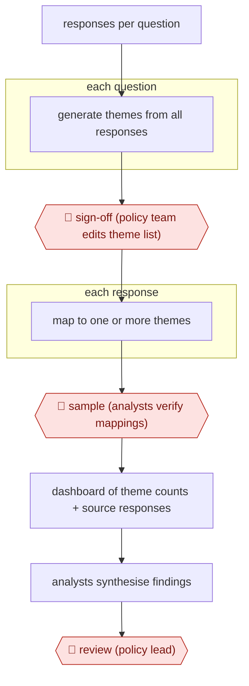

# Theme sign-off consultation analysis

`ORG › GOV › POLICY` · checkpointed · evidence A · **draft: needs a reference example** ([how to add one](../../../../../CONTRIBUTING.md#1-add-an-example-run))

**Shape:** `responses per question → each question: generate themes from all responses → 🛑 sign-off (policy team edits theme list) → each response: map to one or more themes → 🛑 sample (analysts verify mappings) → dashboard of theme counts + source responses → analysts synthesise findings → 🛑 review (policy lead)`
**How it differs:** AWF-0030 Issue-tree research builds a hypothesis-driven research brief. This workflow classifies a fixed public corpus against a theme list a person signs off, and analysts sample the mappings. Different deliverable and checkpoints.
**Variants:** `iai-consult`

<!-- shape diagram: generated by scripts/build_diagrams.py from `shape`; don't edit -->

<!-- end shape diagram -->

## Background

A consultation puts a proposal to the public and asks a handful of open questions, and the answers come back as free text: tens of thousands of web-form entries and emails, many near-duplicates from a campaign template, many one line long, a few containing the only technically informed objection anyone raised. Someone then has to say what the responses said. The cheap method is to read a sample and generalise, which is fast and permanently open to the charge that the sample missed the point; the thorough method is to read all of it and code every response against a theme list, which runs to analyst-weeks and is the reason samples became the norm. This workflow splits the job differently: the machine reads every response and proposes both the themes and the assignments, while people keep the parts that are actually judgement — which themes count, whether the assignments hold up against the text, and what the findings are. The theme list is signed off before any mapping happens, because a list invented by a model and never seen by the policy team would quietly decide what the consultation was about, and no later review would catch it.

**Terms:**
- **consultation**: a formal public exercise in which a government publishes a proposal and invites written responses to set questions.
- **free-text response**: an answer the respondent typed, as opposed to a tick-box or a campaign form letter.
- **theme**: one topic that a group of responses shares, as defined by the analysis.
- **mapping**: assigning a response to one or more themes; also called coding.
- **sign-off**: the policy team's approval of the theme list, which has to happen before mapping starts.
- **double review**: two analysts coding the same responses, used to measure how far two people agree.
- **F1**: one score balancing precision and recall, used here to compare a tool's mapping with a person's.
- **equality analysis**: checking whether error rates differ between groups of respondents.
- **dashboard**: the review interface that shows theme counts beside the responses behind them.

## Build it with an agent

**Form:** `service`. Consultations arrive from many teams on their own timetables, each one a batch of tens of thousands of responses that is processed, written up and then discarded; nobody maintains a per-consultation asset afterwards, and the corpus is far past what a conversation can hold. That is unattended batch processing with three gates where a person takes over, which is a service — not a skill run inside one team's session, and not a project with a standing corpus.

**You need:** the responses exported per question, with a stable respondent ID and nothing in the text beyond what the consultation already collects; the question set as asked, since themes are generated per question and a re-worded question produces a different list; the policy team available to sign off the theme list inside the consultation timetable, because mapping cannot start until they have; a review interface that shows a response's text beside the themes proposed for it, since an analyst cannot tick a mapping they cannot read; a sampling rule fixed before the run (how many per question, how many double-reviewed), or the agreement figures afterwards mean nothing; and the published-analysis template. The agent must not write the findings and must not rule on whether a theme list is adequate: both belong to analysts and the policy lead.

| Step | Built as |
|---|---|
| responses per question | An import per question, with duplicates from campaign templates flagged rather than merged, because the count of identical responses is itself a finding. |
| each question: generate themes from all responses | Topic modelling over the whole set rather than a sample, returning a deliberately over-long list: sign-off can delete a theme, but nobody can sign off a theme that was never proposed. |
| 🛑 sign-off (policy team edits theme list) | The run stops and presents the list per question for the policy team to add, merge, rename or delete; the signed-off version is fixed as a file the mapping reads, so later edits are visible as changes. |
| each response: map to one or more themes | A Dynamic workflow fans out over batches of responses, each worker returning theme IDs plus the phrase it relied on, so a reviewer can check a mapping against the text instead of taking it on trust. |
| 🛑 sample (analysts verify mappings) | Sampling follows the rule fixed in advance, and the interface records every tick and untick, which is what produces the human-vs-human baseline to judge the tool against. |
| dashboard of theme counts + source responses | Counts are computed from the recorded assignments, never from a model's own summary of them, and every count links back to the responses behind it. |
| analysts synthesise findings | See Checkpoints: the synthesis is written by people from the dashboard, and a response flagged as fitting no theme is routed back to the theme list rather than absorbed into the nearest one. |
| 🛑 review (policy lead) | The build has no path from the analysis into the government response; the lead reads the themes and the sorting before any of it is used, which is the step the sources say always happens. |

**Checkpoints:** `sign-off`: the theme list is the consultation's definition of its own subject, so it is approved by the team that ran the consultation, and the mapping step reads the approved file rather than regenerating themes. `sample`: analysts re-code responses they can read in full, and the double-reviewed subset gives a human-to-human agreement figure — without it, an agreement score for the tool has no scale. `review`: officials read the themes and how responses were sorted before the analysis feeds the government response, and the build cannot publish, so the checkpoint is a real gate rather than a notification.

**Since the sources:** Sources date from 2025-05 to 2026-02, with the runs themselves in 2025: two i.AI evaluations, a GOV.UK press release, and the Scottish Government evaluation report. The two evaluation PDFs, the press release and the report were not re-opened this pass; a [GOV.UK Consult page](https://www.gov.uk/government/publications/consult-register-your-interest/consult-ai-tool), a [written parliamentary answer](https://questions-statements.parliament.uk/written-questions/detail/2026-10-09/33320) and a [vendor benchmarks page](https://www.blits.ai/ai-use-cases/public-consultation-response-analysis) were opened this month. What has changed since: access is now the binding constraint rather than capability — the GOV.UK page of 2026-07-22 says demand exceeds capacity and runs a waitlist ahead of a full cross-government rollout planned for 2027, so a team cannot simply adopt this in 2026. A written answer of 2026-10-30 puts Consult among the tools in production use, with Consult, Extract, Minute and Parlex together recording more than 1,000 sign-ins a week — a figure for the four tools, not for Consult alone. A second operational build now exists: the Department for Transport's Consultation Analysis Tool, built with the Alan Turing Institute, proposes themes with an ensemble of models, has people validate the theme set on a random sample, then maps every response, and reports 200,000 responses and over 8,000,000 words analysed, 92% raw agreement with human coders and an F1 of 0.75 in blind evaluation, with no evidence of systematic bias on the three questions tested and ethnicity differences under 3 percentage points favouring minority groups. Its own caution is the one this entry needs: without human validation of the theme set it found only about 75% of the human themes, which is the argument for the sign-off step rather than a footnote to it. Two figures here stay modelled rather than measured — the DfT's 50–70% saving is a counterfactual against full manual coding, as is the IWC run's £240 and 22 expert hours. The latest practice detail remains the IWC one: a median of 16 seconds per response reviewed, and reviewers adding a "New theme" on 12% of responses.

*A design based on this entry's steps and the tool documentation as of 2026-11, not a reported run.*

## Steps

*As reported by the sources.*

1. Load the free-text responses for each consultation question into Consult (i.AI). It runs topic modelling over all responses, not a sample, and proposes a long list of themes per question [[1]](#sources).
2. 🛑 **Sign-off**: the policy team running the consultation reviews the generated theme list per question and can add, edit or remove themes before mapping starts [[1]](#sources).
3. An LLM maps every response to one or more of the signed-off themes [[1]](#sources).
4. 🛑 **Sample**: analysts open single responses in the review interface and tick or untick themes. In the DWP evaluation 125 reviewers checked up to 5,000 responses per question, and 1,000 per question were double-reviewed to measure how far two people agree [[1]](#sources). In the first live use (Scottish Government), experts reviewed every response [[2]](#sources).
5. Check for missing themes: reviewers can flag that a response fits no theme, which shows when the signed-off list missed a large group of responses [[1]](#sources).
6. Policymakers use the dashboard (theme frequencies plus the original responses) to write up the findings [[1]](#sources)[[2]](#sources).
7. 🛑 **Review**: officials always review the themes and how responses were sorted before the analysis feeds the government response [[2]](#sources).

**Output:** A per-question theme framework with counts and linked responses, used to write the published consultation analysis and government response.
**Failure modes → guards:** Signed-off theme list misses a big group of responses → reviewers flag 'no theme fits' and the list is revisited. Bias across respondent groups → equality analysis by self-reported disability status (none found in the DWP run) [[1]](#sources). Over-trust in mappings → double review sets the human-vs-human baseline (F1 0.710) to compare Consult against (F1 0.816) [[1]](#sources).

## Public runs

Coverage as of 2026-11-06: **Strong**: a first-hand, detailed run that matches most of the shape. Collected and re-checked in [New workflows for empty categories](../../../../../research/2026-11-new-workflows.md). More runs added in [Third collection pass](../../../../../research/2026-11-third-pass.md).

- [i.AI, Consult Evaluation: DWP Pathways to Work](https://assets.publishing.service.gov.uk/media/68f63fe01c9076042263f0bd/evaluation-report.pdf) (2025-08-27). Live DWP consultation: 125 reviewers checked Consult's theme mappings; compared with human-vs-human agreement. "The reviewer made no changes to Consult's mapped themes for 73% of responses.". *First-hand: yes; confidence: high.*
- [GOV.UK, Humphrey AI tool reviews consultation responses](https://www.gov.uk/government/news/government-built-humphrey-ai-tool-reviews-responses-to-consultation-for-first-time-in-bid-to-save-millions) (2025-05-14). Scottish Government cosmetics consultation, over 2,000 responses, six questions; experts refined themes and reviewed every response. "an F1 score (a common measure of alignment for AI tools) of 0.76". *First-hand: yes; confidence: med.*
- [i.AI, Consult Evaluation: Independent Water Commission Call for Evidence](https://ai.gov.uk/evaluations/consult-evaluation-independent-water-commission-call-for-evidence/) (2025-10). Third live use; 50,000+ responses; two reviewer groups compared with Consult. "for 64%–69% of responses, reviewers made no changes to Consult’s theme suggestions". *First-hand: yes; confidence: high.*
- [GOV.UK, Ground-breaking use of AI saves taxpayers’ money](https://www.gov.uk/government/news/ground-breaking-use-of-ai-saves-taxpayers-money-and-delivers-greater-government-efficiency) (2025-10-16). Cost and expert checking time for the IWC run. "The AI tool categorised responses into themes in around 2 hours, costing £240 and experts only needed 22 hours to check the results.". *First-hand: yes; confidence: high.*

## Sources

1. Incubator for AI (i.AI), Consult Evaluation: DWP's Pathways to Work consultation, 2025-08-27. https://assets.publishing.service.gov.uk/media/68f63fe01c9076042263f0bd/evaluation-report.pdf
2. GOV.UK press release, Government-built Humphrey AI tool reviews responses to consultation for first time in bid to save millions, 2025-05-14. https://www.gov.uk/government/news/government-built-humphrey-ai-tool-reviews-responses-to-consultation-for-first-time-in-bid-to-save-millions
3. i.AI, Evaluating Consult: An AI Tool for Enhanced Public Consultation Analysis (Scottish Government NSCP evaluation). https://ai.gov.uk/blogs/evaluating-consult-an-ai-tool-for-enhanced-public-consultation-analysis
4. i.AI, Scot Gov NSCP Evaluation Report. https://digitalgovernmenthub.org/wp-content/uploads/2026/02/Scot_Gov_NSCP_Evaluation_Report.pdf
5. GOV.UK, Consult: AI tool (waitlist ahead of a 2027 cross-government rollout), 2026-07-22. https://www.gov.uk/government/publications/consult-register-your-interest/consult-ai-tool
6. UK Parliament, Written question UIN 33320, Electronic Government: Artificial Intelligence, answered 2026-10-30. https://questions-statements.parliament.uk/written-questions/detail/2026-10-09/33320
7. Department for Transport and the Alan Turing Institute, Consultation Analysis Tool evaluation, as summarised in a benchmarks page. https://www.blits.ai/ai-use-cases/public-consultation-response-analysis
