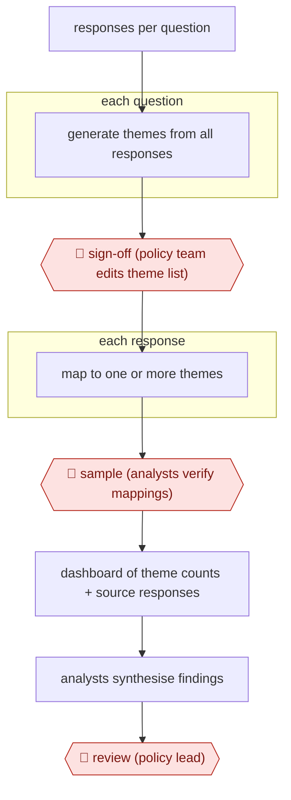

# Theme sign-off consultation analysis

`ORG › GOV › POLICY` · checkpointed · evidence A · **draft: needs a reference example** ([how to add one](../../../../../CONTRIBUTING.md#1-add-an-example-run))

**Shape:** `responses per question → each question: generate themes from all responses → 🛑 sign-off (policy team edits theme list) → each response: map to one or more themes → 🛑 sample (analysts verify mappings) → dashboard of theme counts + source responses → analysts synthesise findings → 🛑 review (policy lead)`
**How it differs:** AWF-0030 Issue-tree research builds a hypothesis-driven research brief. This workflow classifies a fixed public corpus against a theme list a person signs off, and analysts sample the mappings. Different deliverable and checkpoints.
**Variants:** `iai-consult`

<!-- shape diagram: generated by scripts/build_diagrams.py from `shape`; don't edit -->

<!-- end shape diagram -->

## Steps
1. Load the free-text responses for each consultation question into Consult (i.AI). It runs topic modelling over all responses, not a sample, and proposes a long list of themes per question [[1]](#sources).
2. 🛑 **Sign-off**: the policy team running the consultation reviews the generated theme list per question and can add, edit or remove themes before mapping starts [[1]](#sources).
3. An LLM maps every response to one or more of the signed-off themes [[1]](#sources).
4. 🛑 **Sample**: analysts open single responses in the review interface and tick or untick themes. In the DWP evaluation 125 reviewers checked up to 5,000 responses per question, and 1,000 per question were double-reviewed to measure how far two people agree [[1]](#sources). In the first live use (Scottish Government), experts reviewed every response [[2]](#sources).
5. Check for missing themes: reviewers can flag that a response fits no theme, which shows when the signed-off list missed a large group of responses [[1]](#sources).
6. Policymakers use the dashboard (theme frequencies plus the original responses) to write up the findings [[1]](#sources)[[2]](#sources).
7. 🛑 **Review**: officials always review the themes and how responses were sorted before the analysis feeds the government response [[2]](#sources).

**Output:** A per-question theme framework with counts and linked responses, used to write the published consultation analysis and government response.
**Failure modes → guards:** Signed-off theme list misses a big group of responses → reviewers flag 'no theme fits' and the list is revisited. Bias across respondent groups → equality analysis by self-reported disability status (none found in the DWP run) [[1]](#sources). Over-trust in mappings → double review sets the human-vs-human baseline (F1 0.710) to compare Consult against (F1 0.816) [[1]](#sources).

## Public runs

Coverage as of 2026-11-06: **Strong**: a first-hand, detailed run that matches most of the shape. Collected and re-checked in [New workflows for empty categories](../../../../../research/2026-11-new-workflows.md).

- [i.AI, Consult Evaluation: DWP Pathways to Work](https://assets.publishing.service.gov.uk/media/68f63fe01c9076042263f0bd/evaluation-report.pdf) (2025-08-27). Live DWP consultation: 125 reviewers checked Consult's theme mappings; compared with human-vs-human agreement. "The reviewer made no changes to Consult's mapped themes for 73% of responses.". *First-hand: yes; confidence: high.*
- [GOV.UK, Humphrey AI tool reviews consultation responses](https://www.gov.uk/government/news/government-built-humphrey-ai-tool-reviews-responses-to-consultation-for-first-time-in-bid-to-save-millions) (2025-05-14). Scottish Government cosmetics consultation, over 2,000 responses, six questions; experts refined themes and reviewed every response. "an F1 score (a common measure of alignment for AI tools) of 0.76". *First-hand: yes; confidence: med.*

## Sources

1. Incubator for AI (i.AI), Consult Evaluation: DWP's Pathways to Work consultation, 2025-08-27. https://assets.publishing.service.gov.uk/media/68f63fe01c9076042263f0bd/evaluation-report.pdf
2. GOV.UK press release, Government-built Humphrey AI tool reviews responses to consultation for first time in bid to save millions, 2025-05-14. https://www.gov.uk/government/news/government-built-humphrey-ai-tool-reviews-responses-to-consultation-for-first-time-in-bid-to-save-millions
