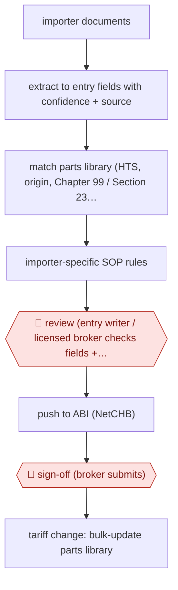

# Broker-reviewed entry prep

`ORG › LOG › CUSTOMS` · checkpointed · evidence A · **draft: needs a reference example** ([how to add one](../../../../../CONTRIBUTING.md#1-add-an-example-run))

**Shape:** `importer documents → extract to entry fields with confidence + source → match parts library (HTS, origin, Chapter 99 / Section 232 stacking) → importer-specific SOP rules → 🛑 review (entry writer / licensed broker checks fields + confidence) → push to ABI (NetCHB) → 🛑 sign-off (broker submits) → tariff change: bulk-update parts library`
**Variants:** `cervo` · `avathon`

<!-- shape diagram: generated by scripts/build_diagrams.py from `shape`; don't edit -->

<!-- end shape diagram -->

## Background

Every shipment that enters the United States needs a customs entry: a filing to US Customs and Border Protection that says what the goods are, where they were made and what duty is owed. The importer (the company bringing the goods in) sends its invoices and packing lists to a customs broker, a person licensed by the government to file for it, and an entry writer at the brokerage keys the data into the filing system. Each product line needs a tariff code, a country of origin and, where trade measures apply, extra duty codes that change at short notice, so entries are slow to prepare and a wrong code can bring a penalty. The agent reads the documents, proposes every field with its source, and applies the brokerage's stored product records and the importer's own rules. An entry writer checks the fields, and only the licensed broker submits the entry, because the broker is legally responsible for what is filed.

**Terms:**
- **Customs entry (CBP form 7501)**: the filing that declares imported goods and the duty owed.
- **Customs broker, entry writer**: the licensed professional who files entries for importers; the brokerage employee who prepares them for the broker.
- **HTS code**: the Harmonized Tariff Schedule code that classifies a product and sets its base duty rate.
- **Origin split**: a single product made in several countries has its value and weight divided between them, and each part can carry different duty.
- **Chapter 99, Section 232 / 301 / 122 stacking**: extra duties imposed under separate US trade measures. Each has its own code, and several can apply to one product on top of the base duty, so they are "stacked".
- **Parts library**: the brokerage's stored record for each product (tariff code, origin, extra-duty treatment), reused so a repeat shipment gets the same answer.
- **SOP rules**: an importer's standing instructions for how its entries are prepared, such as document quirks or classification choices.
- **ABI, NetCHB**: the Automated Broker Interface is the electronic channel through which a broker's software sends entries to US Customs; NetCHB is the brokerage software named in the sources.

## Build it with an agent

**Form:** `skill`. An entry writer prepares one entry at a time and stays in the conversation, so one skill that holds the procedure, the parts library and the importer rules as reference files is enough.

**You need:** the importer's commercial documents (invoice, packing list and the like) as files; the parts library as a spreadsheet or CSV beside the skill, with its source and last-updated date on each row; one rules file per importer; a setup your brokerage has approved for importers' commercial data (a source reports that its team could not put such data into general-purpose AI tools). Give the agent no connection to the ABI or to US Customs.

| Step | Built as |
|---|---|
| importer documents → extract to entry fields with confidence + source | The skill's first instruction: read each document and fill a table of field, value, source document and page, and confidence. A field it cannot find is marked missing, never guessed. |
| match parts library (HTS, origin, Chapter 99 / Section 232 stacking) | The skill looks each item up in the parts library file and copies its codes and duty treatment. An item not in the file is marked for the entry writer instead of classified from memory. |
| importer-specific SOP rules | The skill opens `rules/<importer>.md` and applies it; where a rule overrides the library, the table says so. |
| 🛑 review (entry writer / licensed broker checks fields + confidence) → push to ABI (NetCHB) → 🛑 sign-off (broker submits) | See Checkpoints. |
| tariff change: bulk-update parts library | A second skill: given a notice of a rule change, it writes a proposed copy of the library with every changed row marked, and the person approves the copy before it replaces the file. |

**Checkpoints:** `review`: the skill ends by presenting the field table with the low-confidence, missing and rule-overridden fields listed first, then stops; the entry writer corrects it and approves. Only then does the skill write the values out in a form the entry writer loads or keys into their own ABI software. `sign-off`: the agent has no ABI or filing connector, so the licensed broker submits from their own system.

**Since the sources:** Sources date from 2025-10 to 2026-10; the three Cervo case studies are undated. The C.H. Robinson press release could not be opened in 2026-11, so its use here rests on the entry text. The sources describe vendor products: a document extractor, a live parts library with bulk editing, an agent studio for importer rules and an ABI connection. This build covers the same steps with files and a skill, and leaves out the product's screens, its ABI link and its tariff simulator. Confidence per field is a judgement the model reports about its own reading, not the vendor's scoring, and the entry writer should check against the source shown. No newer account was needed: the newest source is from 2026-10.

*A design based on this entry's steps and the tool documentation as of 2026-11, not a reported run.*

## Steps

*As reported by the sources.*

1. The agent ingests the importer's commercial documents and extracts the entry data, with a confidence level and a source for each field [[2]](#sources)[[3]](#sources).
2. The agent applies the dynamic parts library (HTS codes, origin splits, Section 232/301/122 stacking) and the importer-specific SOP rules set up in the vendor's agent studio [[1]](#sources)[[2]](#sources).
3. 🛑 **Review**: entry writers review entries in the tool before pushing them to their ABI, seeing 'confidence levels and source data for each field' [[3]](#sources).
4. 🛑 **Sign-off**: brokers stay 'fully in control of review and submission' via NetCHB [[2]](#sources).
5. When rules change, the parts library is bulk-updated ahead of effective dates [[3]](#sources).

**Output:** Customs entry (CBP form 7501) filed by the licensed broker.
**Failure modes → guards:** Tariff rules change faster than parts data → mass parts-library updates. Misclassification penalties → broker review of every entry; Krenz & Hannan audits moved to 100% of entries.

**Recent practice (2026):**
- Document intake: incoming documents (over four dozen types from shippers, carriers and government agencies) are split, classified and attached to their shipment, and the system requests any missing document before extraction completes (C.H. Robinson, 2026-10-26). [[5]](#sources)

**How it differs:** Closest in shape is AWF-0041 Review-ready 1040 prep (extract with confidence → preparer review → senior signs). It fails the swap test: the deliverable is a customs filing with tariff-stacking logic and a maintained parts library, signed by a licensed customs broker.

## Public runs

Coverage as of 2026-11-13: **Strong**: a first-hand, detailed run that matches most of the shape. Updated in [Third collection pass](../../../../../research/2026-11-third-pass.md).

- [Cervo, Krenz & Hannan](https://usecervo.com/case-studies/krenz-and-hannan) (n.d.). Freight forwarder and broker; quotes from its import department manager. "15 - 60+ minutes per entry → 5 - 10 minutes". *First-hand: vendor; confidence: med.*
- [Cervo, M. J. Carrillo](https://usecervo.com/case-studies/m-j-carrillo) (n.d.). Border brokerage; quotes from its licensed broker and VP of operations. "70%+ of monthly shipments processed through Cervo within four weeks of go-live". *First-hand: vendor; confidence: med.*
- [Cervo, EMD Customs](https://usecervo.com/case-studies/emd-customs) (n.d.). Three-person brokerage. "75% reduction in processing time". *First-hand: vendor; confidence: low.*
- [C.H. Robinson, Debuts Lean AI for Ocean Shipping, Air Freight and Customs](https://ir.chrobinson.com/news/press-releases/news-details/2026/C-H--Robinson-Debuts-Lean-AI-for-Ocean-Shipping-Air-Freight-and-Customs/default.aspx) (2026-10-26). Customs agents split, classify and attach documents, extract data, chase missing docs; brokers keep validation. "So far, time spent has been reduced 23%, allowing the company’s customs brokers to focus on critical validation and compliance steps.". *First-hand: yes; confidence: high.*

## Sources

1. Cervo AI, EMD Customs case study. https://usecervo.com/case-studies/emd-customs
2. Cervo AI, Krenz & Hannan case study. https://usecervo.com/case-studies/krenz-and-hannan
3. Cervo AI, M. J. Carrillo case study. https://usecervo.com/case-studies/m-j-carrillo
4. Avathon, AI-Powered Classification for Global Trade Management (Livingston International), 2025-10-09. https://avathon.com/resources/avathon-launches-ai-powered-classification-for-global-trade-management/
5. C.H. Robinson, C.H. Robinson Debuts Lean AI for Ocean Shipping, Air Freight and Customs, 2026-10-26. https://ir.chrobinson.com/news/press-releases/news-details/2026/C-H--Robinson-Debuts-Lean-AI-for-Ocean-Shipping-Air-Freight-and-Customs/default.aspx
