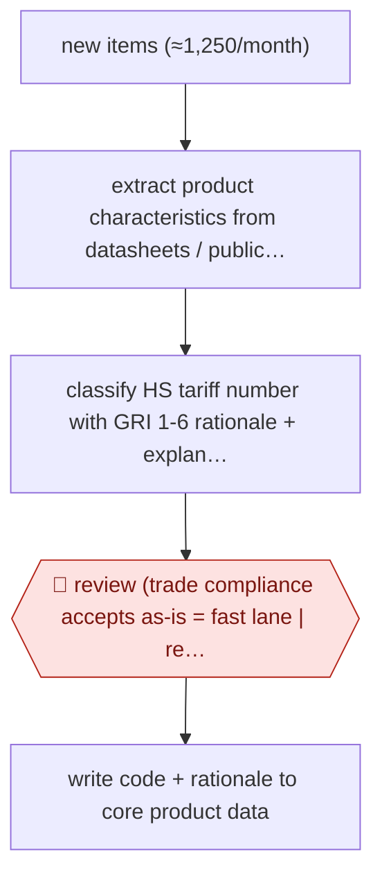

# Fast-lane tariff classification

`ORG › LOG › CUSTOMS` · checkpointed · evidence B · **draft: needs a reference example** ([how to add one](../../../../../CONTRIBUTING.md#1-add-an-example-run))

**Shape:** `new items (≈1,250/month) → extract product characteristics from datasheets / public sources → classify HS tariff number with GRI 1-6 rationale + explanatory/chapter notes → 🛑 review (trade compliance accepts as-is = fast lane | reworks) → write code + rationale to core product data`
**Variants:** `traide-ai`

<!-- shape diagram: generated by scripts/build_diagrams.py from `shape`; don't edit -->

<!-- end shape diagram -->

## Background

Before goods cross a border, each product needs a tariff number from the Harmonized System, the international list of codes that customs uses to set duty and apply import rules. A distributor that stocks thousands of electronics products must give every new item a number before it ships. A classifier reads the product's datasheet, pulls out the features that matter and works through a fixed set of interpretation rules to reach a number, and two people reading the same datasheet can reach different numbers. The agent extracts the features, proposes the number and writes out the reasoning step by step. A trade compliance specialist still checks each suggestion, because the number is a declaration to customs that the company answers for, and items with thin product data need a classifier's judgement.

**Terms:**
- **HS tariff number**: the code from the Harmonized System that classifies a product for customs.
- **GRI 1-6**: the six General Rules of Interpretation, applied in order, that decide where a product belongs in the Harmonized System.
- **Explanatory notes, chapter notes**: the official texts that explain what each heading and chapter covers.
- **SKU**: one distinct product the company stocks and sells.
- **Core product data (master data)**: the company's central record for each product, which later customs entries draw from.
- **Trade compliance and customs team, classifier**: the staff who own classification decisions; a classifier does the rework on items the agent could not settle.
- **Fast lane**: a suggestion accepted as it stands, with no rework.

## Build it with an agent

**Form:** `service`. New items arrive as a monthly stream of about 1,250 and go to a review queue, so the agent starts without anyone at the keyboard and people see each suggestion later.

**You need:** a feed or export of new items from the product data system; read access to datasheets and the public product pages the extraction may use; the Harmonized System text, explanatory notes and chapter notes as reference files beside the skill; a store outside the conversation for each item's extracted features, proposal and status; a review queue (a ticket board or shared sheet) that trade compliance works through. Give the agent no write access to the core product data.

| Step | Built as |
|---|---|
| new items (≈1,250/month) | A cloud scheduled task, or your own scheduler running `claude -p` or an Agent SDK program, picks up items not yet in the store. |
| extract product characteristics from datasheets / public sources | A skill reads each datasheet and records the features, each with its source; subagents can take items in parallel. Missing features are listed, not filled in. |
| classify HS tariff number with GRI 1-6 rationale + explanatory/chapter notes | The same skill follows the rules in order, consults the reference files and writes the rationale, citing notes by their headings. |
| 🛑 review (trade compliance accepts as-is = fast lane \| reworks) | See Checkpoints. |
| write code + rationale to core product data | A small script, not the agent, writes the code and rationale for accepted items to the product data system. |

**Checkpoints:** `review`: each item and its rationale go to the review queue. The agent has no tool that writes to the core product data, so nothing enters it until a person accepts; the script that writes reads only items marked accepted. Items with missing or vague product data are marked for a classifier instead of getting a proposal. Accepts and rework outcomes are recorded in the store.

**Since the sources:** The single source is a vendor success story dated 2025-10-16, and its one public run is the same page. A search in 2026-11 found vendor material only, including traide's current undated homepage, which still describes classification by the GRI steps with an audit trail; no newer first-hand account was found as of 2026-11. The source describes a vendor platform; this build replaces it with a skill, reference files and a review queue, and leaves out the platform's own interface and its connection to the product data system. The share of items accepted as they stand is the vendor's reported figure and says nothing about this build.

*A design based on this entry's steps and the tool documentation as of 2026-11, not a reported run.*

## Steps

*As reported by the sources.*

1. New items arriving each month are queued for classification; the vendor's platform extracts the relevant core product data from product datasheets or public sources automatically [[1]](#sources).
2. The platform proposes a Harmonized System (HS) tariff number and explains each classification step under GRI 1-6, citing explanatory notes and chapter notes [[1]](#sources).
3. 🛑 **Review**: the trade compliance and customs team checks each suggestion; at Ingram Micro up to 80% go through the 'fast lane' (accepted without manual rework), the rest are reworked by a classifier [[1]](#sources).
4. The accepted classification and its rationale are written into the company's existing core product data, so later entries reuse it [[1]](#sources).

**Output:** A classified product master (tariff number + documented rationale per item) that customs entries draw from.
**Failure modes → guards:** Classification depends on who reads the datasheet → standardized extraction and GRI-step rationale make results processor-independent [1]. Vague or incomplete product data → item leaves the fast lane for manual rework [1].

**How it differs:** Closest AWF-0148 Broker-reviewed entry prep: that builds a shipment entry from importer documents and matches an existing parts library, with broker sign-off before ABI filing. This builds the parts library itself, per new SKU, before any shipment; the deliverable is a master-data classification and the checkpoint is a per-item accept/rework by trade compliance, not an entry sign-off.

## Public runs

Coverage as of 2026-11-13: **Weak**: only anonymous, vendor-linked or journalist-told accounts. Collected and re-checked in [Third collection pass](../../../../../research/2026-11-third-pass.md).

- [traide AI, Ingram Micro success story](https://traide.ai/en/success-stories/standardisiert-statt-subjektiv-wie-ingram-micro-mit-traide-ai-die-produktklassifizierung-vereinheitlichte) (2025-10-16). Ingram Micro Distribution GmbH classifies ~1,250 new items a month; quotes Senior Manager Trade Compliance & Customs. "Reduction of classification time from approximately 30 minutes to 5-8 minutes per item". *First-hand: vendor; confidence: med.*

## Sources

1. traide AI, Over 80% time savings through AI: Ingram Micro relies on traide AI for transparent and consistent product classification, 2025-10-16. https://traide.ai/en/success-stories/standardisiert-statt-subjektiv-wie-ingram-micro-mit-traide-ai-die-produktklassifizierung-vereinheitlichte
