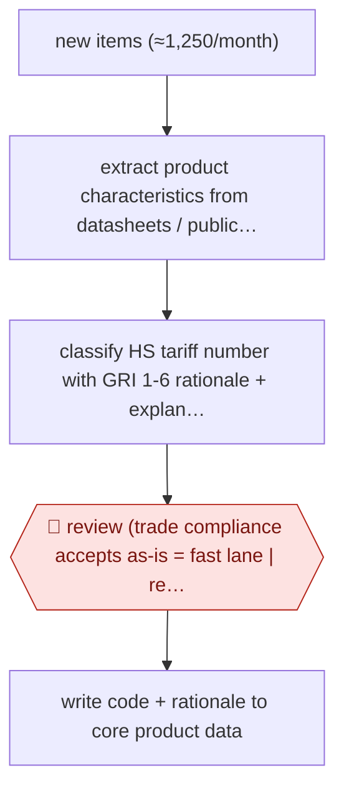

# Fast-lane tariff classification

`ORG › LOG › CUSTOMS` · checkpointed · evidence B · **draft: needs a reference example** ([how to add one](../../../../../CONTRIBUTING.md#1-add-an-example-run))

**Shape:** `new items (≈1,250/month) → extract product characteristics from datasheets / public sources → classify HS tariff number with GRI 1-6 rationale + explanatory/chapter notes → 🛑 review (trade compliance accepts as-is = fast lane | reworks) → write code + rationale to core product data`
**How it differs:** Closest AWF-0148 Broker-reviewed entry prep: that builds a shipment entry from importer documents and matches an existing parts library, with broker sign-off before ABI filing. This builds the parts library itself, per new SKU, before any shipment; the deliverable is a master-data classification and the checkpoint is a per-item accept/rework by trade compliance, not an entry sign-off.
**Variants:** `traide-ai`

<!-- shape diagram: generated by scripts/build_diagrams.py from `shape`; don't edit -->

<!-- end shape diagram -->

## Steps
1. New items arriving each month are queued for classification; the platform extracts the relevant core product data from product datasheets or public sources automatically [[1]](#sources).
2. It proposes a Harmonized System tariff number and explains each classification step under GRI 1-6, citing explanatory notes and chapter notes [[1]](#sources).
3. 🛑 **Review**: the trade compliance and customs team checks each suggestion; at Ingram Micro up to 80% go through the 'fast lane' (accepted without manual rework), the rest are reworked by a classifier [[1]](#sources).
4. The accepted classification and its rationale are written into the existing core data management, so later entries reuse it [[1]](#sources).

**Output:** A classified product master (tariff number + documented rationale per item) that customs entries draw from.
**Failure modes → guards:** Classification depends on who reads the datasheet → standardized extraction and GRI-step rationale make results processor-independent [1]. Vague or incomplete product data → item leaves the fast lane for manual rework [1].

## Public runs

Coverage as of 2026-11-13: **Weak**: only anonymous, vendor-linked or journalist-told accounts. Collected and re-checked in [Third collection pass](../../../../../research/2026-11-third-pass.md).

- [traide AI, Ingram Micro success story](https://traide.ai/en/success-stories/standardisiert-statt-subjektiv-wie-ingram-micro-mit-traide-ai-die-produktklassifizierung-vereinheitlichte) (2025-10-16). Ingram Micro Distribution GmbH classifies ~1,250 new items a month; quotes Senior Manager Trade Compliance & Customs. "Reduction of classification time from approximately 30 minutes to 5-8 minutes per item". *First-hand: vendor; confidence: med.*

## Sources

1. traide AI, Over 80% time savings through AI: Ingram Micro relies on traide AI for transparent and consistent product classification, 2025-10-16. https://traide.ai/en/success-stories/standardisiert-statt-subjektiv-wie-ingram-micro-mit-traide-ai-die-produktklassifizierung-vereinheitlichte
