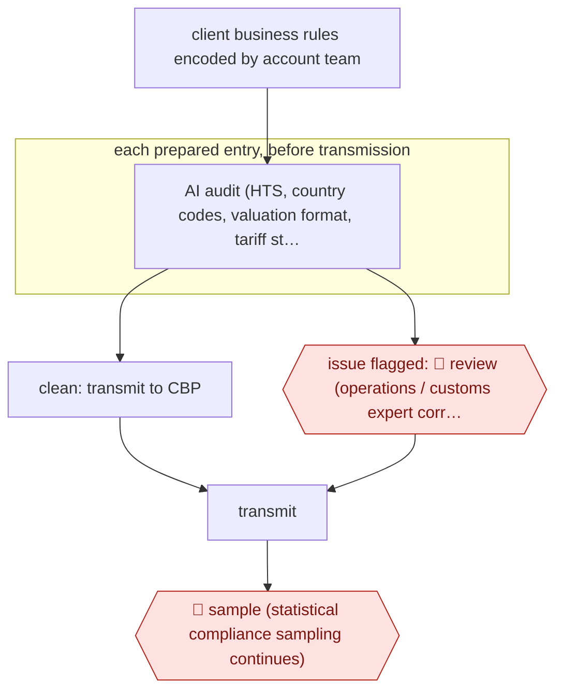

# Pre-transmission entry audit

`ORG › LOG › CUSTOMS` · sampled · evidence A · **draft: needs a reference example** ([how to add one](../../../../../CONTRIBUTING.md#1-add-an-example-run))

**Shape:** `client business rules encoded by account team → each prepared entry, before transmission: AI audit (HTS, country codes, valuation format, tariff stacking, client rules) → clean: transmit to CBP | issue flagged: 🛑 review (operations / customs expert corrects) → transmit → 🛑 sample (statistical compliance sampling continues)`
**How it differs:** AWF-0148 (Broker-reviewed entry prep) builds the entry and has a broker review and sign off every one. Here the input is an already prepared entry, a human sees only the flagged ones, and statistical sampling stays in place: the autonomy is sampled, not checkpointed, and the deliverable is a pre-filing audit verdict. AWF-0210 classifies new items, a different deliverable.
**Variants:** `flexport-ai-business-rules-engine`

<!-- shape diagram: generated by scripts/build_diagrams.py from `shape`; don't edit -->

<!-- end shape diagram -->

## Steps
1. Account team encodes each client's business rules (SOP-level filing instructions) into the platform's AI business-rules engine [[2]](#sources).
2. Every customs entry is checked in real time before it is filed, against regulatory requirements and the client's rules. This covers 100% of entries, where the old practice was human compliance review of roughly 5–10% after the fact [[1]](#sources)[[3]](#sources)[[4]](#sources).
3. The checks catch errors like a wrong HTS chapter (t-shirts with horse prints filed as live horses), one-letter country-code slips (TW vs TV) and comma-versus-period valuation mistakes that throw the value off by orders of magnitude. Petersen calls it an 'AI-powered spell check' [[1]](#sources).
4. 🛑 **Review**: entries with issues are flagged to operations before the entry is finalized. The customs expert corrects them and then the entry is transmitted. Clean entries pass straight through [[2]](#sources)[[1]](#sources).
5. 🛑 **Sample**: post-filing statistical sampling continues alongside the AI audit ('we also do that kind of statistical sampling') [[1]](#sources).
6. Track the entry error rate as the outcome metric. Flexport reports 1.8% → 0.2% within about a month of the October 2024 launch [[3]](#sources)[[4]](#sources).

**Output:** Corrected entries transmitted to CBP, plus a lower post-entry correction load. The same engine also backs a retrospective audit service for other brokers' entries (ACE ES-003 data, 115+ stacking rules, PSC vs protest split) [5].
**Failure modes → guards:** Rules lag tariff changes (53 changes in 2025 per Petersen) → keep the rule set updated centrally and check it against every entry. Over-flagging buries operations → flag only rule or regulatory breaches and pass clean entries through. Classification correctness itself is not checked by the retrospective audit [5] → keep classification review upstream (AWF-0210 / 0148).

## Public runs

Coverage as of 2026-11-13: **Partial**: first-hand runs that cover part of the shape or put checkpoints elsewhere. Collected and re-checked in [Fourth collection pass](../../../../../research/2026-11-fourth-pass.md).

- [The Loadstar, Flexport doubles down on AI](https://theloadstar.com/flexport-doubles-down-on-ai-and-enterprise-shippers-as-it-moves-beyond-start-up-phase/) (2026-03-04). CEO on Flexport's own pre-submission AI audit of customs entries and the error-rate change. "Our error rate went from 1.8% to 0.2%,". *First-hand: interview; confidence: high.*
- [Flexport, Fall Technology Release Live Broadcast](https://webinars.flexport.com/on-demand/67f98b79-c979-47f1-8ef4-7d4db4105768) (2025). CEO describes reviewing all entries before filing, with examples of errors caught; experts still file. "we're reviewing 100% of entries for accuracy and we're doing it before we file the entry not after the fact". *First-hand: yes; confidence: med.*
- [Ryan Petersen, LinkedIn post on broker audits](https://www.linkedin.com/posts/rpetersen_importers-can-now-use-flexports-ai-to-audit-activity-7433969743616987136-RPDg) (2026-03-01). First two importers run through the retrospective audit. "revealed mistakes on 14% and 85% of their customs entries in 2025". *First-hand: yes; confidence: med.*

## Sources

1. Flexport (Ryan Petersen), Fall Technology Release Live Broadcast, 2025. https://webinars.flexport.com/on-demand/67f98b79-c979-47f1-8ef4-7d4db4105768
2. Flexport, Customs Technology Suite (Compliance Audit; AI Business Rules Engine). https://www.flexport.com/technology/customs-suite/
3. The Loadstar, Flexport doubles down on AI and enterprise shippers as it moves beyond start-up, 2026-03-04. https://theloadstar.com/flexport-doubles-down-on-ai-and-enterprise-shippers-as-it-moves-beyond-start-up-phase/
4. TBPN Digest, Flexport CEO Ryan Petersen declares 'code red' on AI, 2026-03-24. https://www.tbpndigest.com/story/2026-03-24/flexport-ceo-ryan-petersen-declares-code-red-on-ai-custom-broker-error-rate-cut-10x-new-tariff-refund-product-in-the-works
5. Flexport, Audit your broker – Entry compliance analysis (FAQ). https://tariffs.flexport.com/audit
