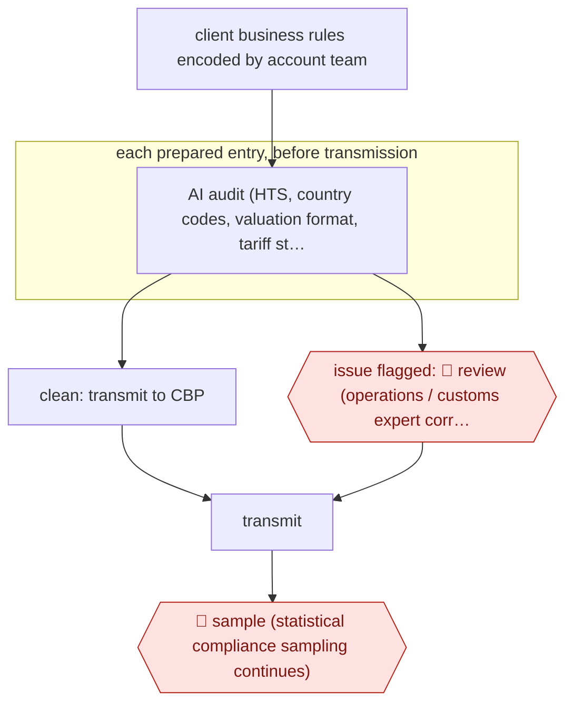

# Pre-transmission entry audit

`ORG › LOG › CUSTOMS` · sampled · evidence A · **draft: needs a reference example** ([how to add one](../../../../../CONTRIBUTING.md#1-add-an-example-run))

**Shape:** `client business rules encoded by account team → each prepared entry, before transmission: AI audit (HTS, country codes, valuation format, tariff stacking, client rules) → clean: transmit to CBP | issue flagged: 🛑 review (operations / customs expert corrects) → transmit → 🛑 sample (statistical compliance sampling continues)`
**Variants:** `flexport-ai-business-rules-engine`

<!-- shape diagram: generated by scripts/build_diagrams.py from `shape`; don't edit -->

<!-- end shape diagram -->

## Background

A customs entry is the filing a customs broker sends to US Customs and Border Protection (CBP) to declare imported goods and the duty owed. Staff prepare it from the importer's documents, and a mistake in it, such as a wrong tariff code, a mistyped country code or a misplaced decimal in the value, can mean overpaid duty, penalties or a later correction. Traditionally a compliance team checks only a small share of entries, and after they have been filed. Here the agent checks every prepared entry before it is transmitted, against the tariff rules and the client's own filing instructions. Clean entries go on; entries with a problem go to a customs expert, who corrects them. People still own the correction, because the filing is the broker's legal statement, and a continuing statistical sample of entries keeps the agent's own accuracy under check.

**Terms:**
- **Customs entry, CBP**: the filing that declares imported goods, and US Customs and Border Protection, which receives it.
- **Customs broker, account team**: the licensed professional who files for importers; the brokerage staff who manage a client's relationship and know its standing instructions.
- **HTS code**: the Harmonized Tariff Schedule code that classifies a product and sets its duty; its first two digits are the chapter, the broad product group.
- **Valuation format**: how the declared value is written (decimal separator, currency, units); a comma where a period belongs can change the value by orders of magnitude.
- **Tariff stacking**: several extra duties applying to one product on top of the base duty, each with its own code.
- **Business rules (SOP-level filing instructions)**: a client's standing instructions for how its entries must be filed.
- **Statistical sampling**: having an expert re-check a randomly chosen share of entries after filing, to measure the error rate.
- **ACE**: the US Customs system in which an importer can see the entry data filed under its account; the source calls the data file it uses ES-003.
- **PSC, protest**: a post-summary correction is a change filed after an entry; a protest is a formal challenge to a customs decision about an entry.

## Build it with an agent

**Form:** `service`. Entries arrive one after another from the entry preparation system, nobody is at the keyboard when each is checked, and people see only the entries flagged to them and the sample.

**You need:** read access to each prepared entry in the form the filing system can export; one rules file per client, written and kept up to date by the account team; the current tariff reference material (tariff schedule text, the extra-duty codes and their effective dates) as files someone maintains; a store outside the conversation for each entry's verdict and the later outcome; two queues, one for flagged entries and one for the sample. Do not rely on the model's memory for current tariff rules. Give the agent no connection to CBP and no write access to the filing system beyond recording its verdict.

| Step | Built as |
|---|---|
| client business rules encoded by account team | One Markdown rules file per client, in plain sentences the account team can edit. A change to a file goes through the team's normal review. |
| each prepared entry, before transmission: AI audit (HTS, country codes, valuation format, tariff stacking, client rules) | A skill checks one entry against the tariff reference files and that client's rules file. A script handles the mechanical checks (country code exists, value is well formed); the agent checks the rest, such as HTS chapter against the product description and stacking. Each finding cites the rule. The entry system starts the run through `claude -p` or an Agent SDK program, or a cloud scheduled task polls a queue of entries awaiting audit. |
| clean: transmit to CBP | The agent writes the verdict "clean" to the store. The entry system, not the agent, transmits entries that carry a clean verdict. |
| issue flagged: 🛑 review (operations / customs expert corrects) | The entry, each finding and the rule behind it go to the expert queue. The entry stays on hold until a person marks it corrected. |
| transmit | The entry system, outside the agent. |
| 🛑 sample (statistical compliance sampling continues) | A fixed share of entries, including clean ones, is copied to a second-expert queue after filing. Outcomes are recorded and the rules are revised from them. |

**Checkpoints:** `review`: a flagged entry is held in the expert queue and the agent has no tool to release or transmit it; the entry system sends only entries with a clean verdict or a person's correction. `sample`: chosen by a random draw in a script, not by the agent, so the agent cannot decide which of its own verdicts get checked. The sample's findings are how the team learns whether the audit misses errors.

**Since the sources:** Sources date from 2025 to 2026-03; two are undated. The retrospective-audit FAQ (source 5) could not be opened in 2026-11, so statements based on it rest on the entry text. All of them are Flexport's own or reports of its CEO's statements, and the error-rate figures are its own claims. The source describes a vendor's rules engine inside a platform; this build reaches the same steps with rules files, a skill and a queue, and leaves out the engine itself and the retrospective service for other brokers' entries. The sources report tariff rules changing 53 times in 2025, so a person must keep the reference files current; an audit run on stale files fails quietly. No newer account was needed: the newest source is from 2026-03.

*A design based on this entry's steps and the tool documentation as of 2026-11, not a reported run.*

## Steps

*As reported by the sources.*

1. The account team encodes each client's business rules (SOP-level filing instructions) into the vendor platform's AI business-rules engine [[2]](#sources).
2. The AI audit checks every customs entry in real time before it is filed, against regulatory requirements and the client's rules. This covers 100% of entries, where the old practice was human compliance review of roughly 5–10% after the fact [[1]](#sources)[[3]](#sources)[[4]](#sources).
3. The audit catches errors like a wrong HTS chapter (t-shirts with horse prints filed as live horses), one-letter country-code slips (TW vs TV) and comma-versus-period valuation mistakes that throw the value off by orders of magnitude. Flexport's CEO, Ryan Petersen, calls it an 'AI-powered spell check' [[1]](#sources).
4. 🛑 **Review**: entries with issues are flagged to operations before the entry is finalized. A customs expert corrects them and then the entry is transmitted. Clean entries pass straight through [[2]](#sources)[[1]](#sources).
5. 🛑 **Sample**: post-filing statistical sampling continues alongside the AI audit ('we also do that kind of statistical sampling') [[1]](#sources).
6. The entry error rate is the outcome metric. Flexport reports 1.8% → 0.2% within about a month of the October 2024 launch [[3]](#sources)[[4]](#sources).

**Output:** Corrected entries transmitted to CBP, plus a lower post-entry correction load. The same engine also backs a retrospective audit service for other brokers' entries (ACE ES-003 data, 115+ stacking rules, PSC vs protest split) [5].
**Failure modes → guards:** Rules lag tariff changes (53 changes in 2025 per Petersen) → keep the rule set updated centrally and check it against every entry. Over-flagging buries operations → flag only rule or regulatory breaches and pass clean entries through. Classification correctness itself is not checked by the retrospective audit [5] → keep classification review upstream (AWF-0210 / 0148).

**How it differs:** AWF-0148 (Broker-reviewed entry prep) builds the entry and has a broker review and sign off every one. Here the input is an already prepared entry, a human sees only the flagged ones, and statistical sampling stays in place: the autonomy is sampled, not checkpointed, and the deliverable is a pre-filing audit verdict. AWF-0210 classifies new items, a different deliverable.

## Public runs

Coverage as of 2026-11-13: **Partial**: first-hand runs that cover part of the shape or put checkpoints elsewhere. Collected and re-checked in [Fourth collection pass](../../../../../research/2026-11-fourth-pass.md).

- [The Loadstar, Flexport doubles down on AI](https://theloadstar.com/flexport-doubles-down-on-ai-and-enterprise-shippers-as-it-moves-beyond-start-up-phase/) (2026-03-04). CEO on Flexport's own pre-submission AI audit of customs entries and the error-rate change. "Our error rate went from 1.8% to 0.2%,". *First-hand: interview; confidence: high.*
- [Flexport, Fall Technology Release Live Broadcast](https://webinars.flexport.com/on-demand/67f98b79-c979-47f1-8ef4-7d4db4105768) (2025). CEO describes reviewing all entries before filing, with examples of errors caught; experts still file. "we're reviewing 100% of entries for accuracy and we're doing it before we file the entry not after the fact". *First-hand: yes; confidence: med.*
- [Ryan Petersen, LinkedIn post on broker audits](https://www.linkedin.com/posts/rpetersen_importers-can-now-use-flexports-ai-to-audit-activity-7433969743616987136-RPDg) (2026-03-01). First two importers run through the retrospective audit. "revealed mistakes on 14% and 85% of their customs entries in 2025". *First-hand: yes; confidence: med.*

## Sources

1. Flexport (Ryan Petersen), Fall Technology Release Live Broadcast, 2025. https://webinars.flexport.com/on-demand/67f98b79-c979-47f1-8ef4-7d4db4105768
2. Flexport, Customs Technology Suite (Compliance Audit; AI Business Rules Engine). https://www.flexport.com/technology/customs-suite/
3. The Loadstar, Flexport doubles down on AI and enterprise shippers as it moves beyond start-up, 2026-03-04. https://theloadstar.com/flexport-doubles-down-on-ai-and-enterprise-shippers-as-it-moves-beyond-start-up-phase/
4. TBPN Digest, Flexport CEO Ryan Petersen declares 'code red' on AI, 2026-03-24. https://www.tbpndigest.com/story/2026-03-24/flexport-ceo-ryan-petersen-declares-code-red-on-ai-custom-broker-error-rate-cut-10x-new-tariff-refund-product-in-the-works
5. Flexport, Audit your broker – Entry compliance analysis (FAQ). https://tariffs.flexport.com/audit
