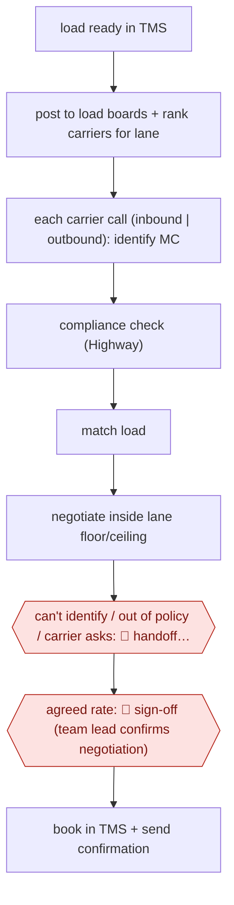

# Carrier-call booking agent

`ORG › LOG › FREIGHT` · checkpointed · evidence B · **draft: needs a reference example** ([how to add one](../../../../../CONTRIBUTING.md#1-add-an-example-run))

**Shape:** `load ready in TMS → post to load boards + rank carriers for lane → each carrier call (inbound | outbound): identify MC → compliance check (Highway) → match load → negotiate inside lane floor/ceiling → can't identify / out of policy / carrier asks: 🛑 handoff (rep, with context) → agreed rate: 🛑 sign-off (team lead confirms negotiation) → book in TMS + send confirmation`
**How it differs:** Closest AWF-0150 Email-to-order freight agents: that is the shipper side (emails → quotes/orders/appointments, sampled with exception handoff). This is the carrier-procurement side: a live voice negotiation whose deliverable is a booked carrier at an agreed rate, with a per-booking team-lead confirmation. Also differs from AWF-0153 (missed-pickup recovery calls, not booking).
**Variants:** `ten8` · `happyrobot` · `parade-codriver`

<!-- shape diagram: generated by scripts/build_diagrams.py from `shape`; don't edit -->

<!-- end shape diagram -->

## Steps
1. When a load goes ready in the TMS, the agent posts it to the relevant load boards, ranks the brokerage's carrier network for the lane and starts outbound email and voice outreach in parallel; inbound carrier calls on posted loads are answered 24/7 [[2]](#sources).
2. On each call the agent identifies the carrier by MC number, checks eligibility in the brokerage's compliance tool (Highway at Fura and Circle), and looks up the load by origin/destination or reference ID [[1]](#sources)[[2]](#sources)[[3]](#sources)[[4]](#sources).
3. It shares load details and negotiates the rate inside the floor and ceiling the brokerage sets per lane, integrated with the pricing algorithm [[1]](#sources)[[2]](#sources). Fraud signals (dispatcher names, email domains, banking changes) are cross-checked in the background [[2]](#sources)[[3]](#sources).
4. 🛑 **Handoff**: the call transfers to a rep, with the MC number and a context summary, when the carrier or load can't be identified, required load fields are missing, the carrier asks for a human, or the quote meets the brokerage's transfer conditions (e.g. at or below the Book Now / Max rate) [[2]](#sources)[[4]](#sources).
5. 🛑 **Sign-off**: at Fura the agent hands the finished negotiation to a team lead for confirmation before booking [[1]](#sources).
6. The agent books the load and writes every data point back to the TMS; operators keep rate parameters, detention disputes and judgment loads [[2]](#sources)[[3]](#sources).

**Output:** A booked load (carrier, agreed rate, rate confirmation) in the TMS, plus call logs and captured quotes for loads not booked.
**Failure modes → guards:** Double-brokering / fraud attempts → background compliance and fraud checks (three caught in Fura's first month) [2]. Carrier hangs up on AI voice or noisy line → offer transfer [4]. Agent agrees to a bad rate → floor/ceiling set by humans per lane and team-lead confirmation [1][2].

## Public runs

Coverage as of 2026-11-13: **Weak**: only anonymous, vendor-linked or journalist-told accounts. Collected and re-checked in [Third collection pass](../../../../../research/2026-11-third-pass.md).

- [FreightWaves, Fura Freight: Next Year, Our AI Agent Will Book 90% of Loads](https://www.freightwaves.com/news/fura-freight-next-year-our-ai-agent-will-book-90-of-loads) (2026-11-11). CEO says agent Donna does compliance to booking; team lead confirms the finished negotiation. "Donna, now handles more than 40% of the company’s load bookings". *First-hand: interview; confidence: high.*
- [Ten8, Fura Freight case study results](https://www.ten8.ai/blog/fura-freight-case-study-results) (2026-04-03). Inbound voice, MC verification, negotiation inside per-lane floor/ceiling; edge cases escalate. "Carrier calls answered | 60% | 100%". *First-hand: vendor; confidence: med.*
- [HappyRobot, Circle Logistics case study](https://happyrobot.ai/blog/circle-logistics-x-happyrobot-case-study) (2026-02-25). Inbound carrier sales pilot grew into quote-to-cash; integrated with Transport Pro, DAT, Truckstop, Highway. "18% of all freight booked with zero human touch". *First-hand: vendor; confidence: med.*

## Sources

1. FreightWaves Staff, Fura Freight: Next Year, Our AI Agent Will Book 90% of Loads (interview with CEO Jeff Dangelo), 2026-11-11. https://www.freightwaves.com/news/fura-freight-next-year-our-ai-agent-will-book-90-of-loads
2. Ivan Tsybaev, Ten8, How Fura Freight answered 100% of carrier calls without adding headcount, 2026-04-03. https://www.ten8.ai/blog/fura-freight-case-study-results
3. Carlos Becker, HappyRobot, Circle Logistics x HappyRobot: Case Study, 2026-02-25. https://happyrobot.ai/blog/circle-logistics-x-happyrobot-case-study
4. Parade, CoDriver Voice (help center), 2025-04-03. https://help.parade.ai/en/articles/11028596-codriver-voice
