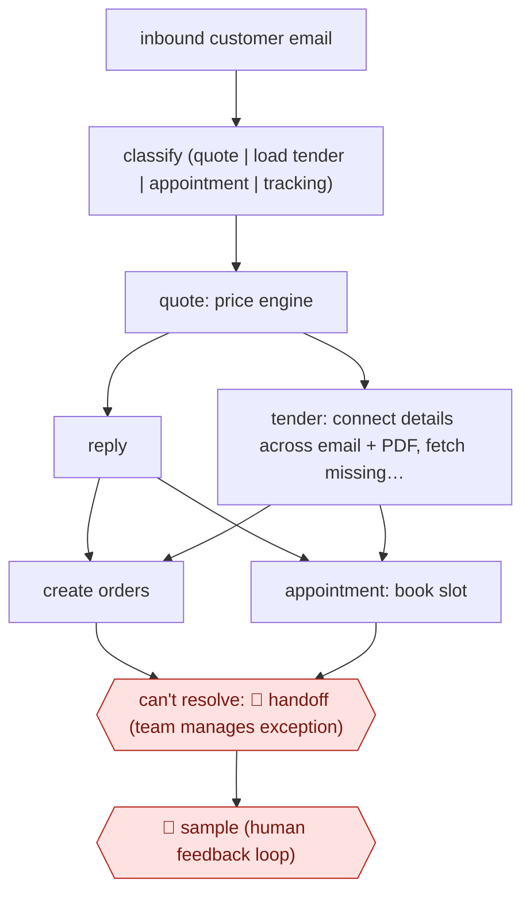

# Email-to-order freight agents

`ORG › LOG › FREIGHT` · sampled · evidence A · **draft: needs a reference example** ([how to add one](../../../../../CONTRIBUTING.md#1-add-an-example-run))

**Shape:** `inbound customer email → classify (quote | load tender | appointment | tracking) → quote: price engine → reply | tender: connect details across email + PDF, fetch missing info → create orders | appointment: book slot → can't resolve: 🛑 handoff (team manages exception) → 🛑 sample (human feedback loop)`
**Variants:** `langgraph` · `azure-openai`

<!-- shape diagram: generated by scripts/build_diagrams.py from `shape`; don't edit -->

<!-- end shape diagram -->

## Background

Companies that ship goods (shippers) often still ask their freight company for service by email: what it would cost to move a load, an offer of a load for the carrier to take on (a load tender), or a request to fix a pickup or delivery time. Someone has to open each email, work out what is wanted, look up a price or key the details into the transport system, and reply, and the email can wait hours in a queue. The agent reads each email, decides what kind of request it is and handles the routine ones: it sends a quote, creates the order or books the time slot. Requests it cannot resolve go to a manager, and people check a sample of the agent's sorting, because a mis-sorted email produces a wrong quote or order without anyone noticing. A person is still needed because an order commits money and trucks, and a vague request needs someone who knows the customer.

**Terms:**
- **Shipper**: the company that has goods to move and asks for the service.
- **Quote**: a price for moving a load, here taken from the freight company's own pricing tool (the sources call theirs the Dynamic Pricing Engine).
- **Load tender**: a shipper's offer of a load for the freight company to accept, which becomes an order in its system.
- **Truckload, LTL, intermodal, air**: a load that fills a truck; less-than-truckload, where several shippers' goods share a truck; moves that combine rail and truck; and moves by air.
- **Appointment**: a fixed time slot to pick up or deliver a load at a site.
- **Transport system (TMS)**: the freight company's record of orders, loads and bookings.
- **Exception queue**: the list of cases the agent could not resolve, worked by managers.

## Build it with an agent

**Form:** `service`. Emails arrive all day, nobody is at the keyboard when one is handled, and people see only the exception queue and a sample.

**You need:** read access to the mailbox that receives customer emails, and a way to send replies through the tool described below; access to the pricing tool; access to the transport system to create orders and book appointments; a customer-history file or table the agent may read; a store outside the conversation recording each email, its label and what was done; an exception queue and a sample queue that managers work. Customers' emails and attachments hold commercial data, so use a setup the company has approved for them.

| Step | Built as |
|---|---|
| inbound customer email → classify (quote \| load tender \| appointment \| tracking) | Each new email starts a run through `claude -p` or an Agent SDK program, or a cloud scheduled task polls the mailbox. A skill labels the email; one email can carry several requests. The label and the reason go to the store. |
| quote: price engine → reply | The skill reads the request and calls a script around the pricing tool. A reply tool builds the message from the pricing tool's result and sends it, so the agent cannot type a price. |
| tender: connect details across email + PDF, fetch missing info → create orders | The skill reads the email and its attachments into a table of order fields. Missing fields are looked up in the customer-history file and the transport system. A script checks the table before the order tool creates the order. Subagents can take the loads of a multi-load tender in parallel. |
| appointment: book slot | The skill extracts the site, date and window and calls the booking tool. |
| can't resolve: 🛑 handoff (team manages exception) | The email, the table so far and what was tried go to the exception queue. Emails labelled tracking also go there, because the sources' steps give no handling for them. |
| 🛑 sample (human feedback loop) | A script copies a fixed share of labelled emails, with what the agent did, to the sample queue. Wrong labels become examples in the skill. |

**Checkpoints:** `handoff`: a missing or conflicting field the history cannot settle, a failed check or a low-confidence label sends the email to the exception queue with no order created and no reply sent. The order and booking tools are called only after the script's checks pass, so an incomplete order cannot be created. `sample`: the sample queue is filled by a script's random draw, not by the agent. Sample results are the only measure of how often the agent's labelling is wrong.

**Since the sources:** Sources date from 2024-10 to 2026-03; one is undated in the catalog. The 2026-03 press release (source 6) could not be opened in 2026-11, so the entry text stands for it. All are the company's own releases and blog or reports of it by partners and the trade press. They describe a proprietary system built on a vendor's cloud AI services; this build reaches the same steps with a skill, connectors and queues, and leaves out the company's pricing engine and its large customer knowledge base, which you must supply yourself. Speed and volume figures in the sources are theirs, not claims about this build. No newer account was needed: the newest source is from 2026-03.

*A design based on this entry's steps and the tool documentation as of 2026-11, not a reported run.*

## Steps

*As reported by the sources.*

1. The agent classifies incoming emails by request type, including truckload, less-than-truckload (LTL), intermodal and air [[1]](#sources)[[3]](#sources).
2. Quotes: the agent reads the request, queries the Dynamic Pricing Engine and replies [[2]](#sources).
3. Load tenders: the agent connects details across the email and attachments (including handwritten PDF notes), detects and fetches missing data, and creates orders; 20 loads are processed in parallel [[1]](#sources).
4. Appointments: the agent extracts details and locks in pickup or delivery slots [[1]](#sources).
5. 🛑 **Handoff**: workflows are built 'so that if something doesn't go right, that's what our managers work on' [[4]](#sources).
6. 🛑 **Sample**: a 'human feedback loop' on classification [[3]](#sources).

**Output:** Orders, quotes and appointments written into the transport system.
**Failure modes → guards:** Ambiguous tenders ('I have a load for Tuesday') → customer-history context fills the gaps. Unhandled cases → exception queue for managers.

**Recent practice (2026):**
- Classify: one email can be routed to both truckload and LTL quoting when it asks for both (C.H. Robinson, 2025-04-16). [[5]](#sources)

**How it differs:** AWF-0021 Procedure agent answers customers and performs authenticated transactions. Here there is no conversation: email is turned into operational records, and people handle only exceptions.

## Public runs

Coverage as of 2026-11-06: **Strong**: a first-hand, detailed run that matches most of the shape. Collected and re-checked in [Second collection pass](../../../../../research/2026-11-second-pass.md). More runs added in [Third collection pass](../../../../../research/2026-11-third-pass.md).

- [C.H. Robinson, freight lifecycle press release](https://www.chrobinson.com/en-us/about-us/newsroom/press-releases/2024/generative-ai-for-freight-shipment-lifecycle/) (2024-10-31). Quotes, tenders and appointments automated from email. "The tech is turning emails into 5,500 shipment orders a day, achieved in 90 seconds.". *First-hand: yes; confidence: high.*
- [C.H. Robinson, AI performs over 3 million shipping tasks](https://www.chrobinson.com/en-us/about-us/newsroom/press-releases/2025/ai-performs-over-three-million-shipping-tasks/) (2025-04-16). Orders agent extended from biggest truckload customers to SMB and LTL email tenders. "over 5,200 customers are getting their loads accepted in under 90 seconds". *First-hand: yes; confidence: high.*
- [C.H. Robinson, More Than 100 Trillion Data Points Fuel C.H. Robinson’s Leadership in Agentic Supply Chains](https://ir.chrobinson.com/news/press-releases/news-details/2026/More-Than-100-Trillion-Data-Points-Fuel-C-H--Robinsons-Leadership-in-Agentic-Supply-Chains/default.aspx) (2026-03-11). Company's own analysis of truckload shipments handled by AI orders + appointments workflows. "up to 23% faster speed to market for customer shipments". *First-hand: yes; confidence: med.*

## Sources

1. C.H. Robinson, press release: generative AI for freight shipment lifecycle, 2024-10-31. https://www.chrobinson.com/en-us/about-us/newsroom/press-releases/2024/generative-ai-for-freight-shipment-lifecycle/
2. Mike Neill, C.H. Robinson, How C.H. Robinson ensures ROI from agentic AI, 2026-01-06. https://www.chrobinson.com/en-us/resources/blog/how-chrobinson-ensures-roi-from-agentic-ai/
3. Microsoft, C.H. Robinson customer story. https://www.microsoft.com/en/customers/story/19575-ch-robinson-azure-ai-studio
4. Victoria Kickham, DC Velocity, Putting artificial intelligence to work, 2025-01-23. https://www.dcvelocity.com/technology/artificial-intelligence/putting-artificial-intelligence-to-work
5. C.H. Robinson, At C.H. Robinson, Artificial Intelligence Has Now Performed Over 3 Million Shipping Tasks, 2025-04-16. https://www.chrobinson.com/en-us/about-us/newsroom/press-releases/2025/ai-performs-over-three-million-shipping-tasks/
6. C.H. Robinson, More Than 100 Trillion Data Points Fuel C.H. Robinson’s Leadership in Agentic Supply Chains, 2026-03-11. https://ir.chrobinson.com/news/press-releases/news-details/2026/More-Than-100-Trillion-Data-Points-Fuel-C-H--Robinsons-Leadership-in-Agentic-Supply-Chains/default.aspx
