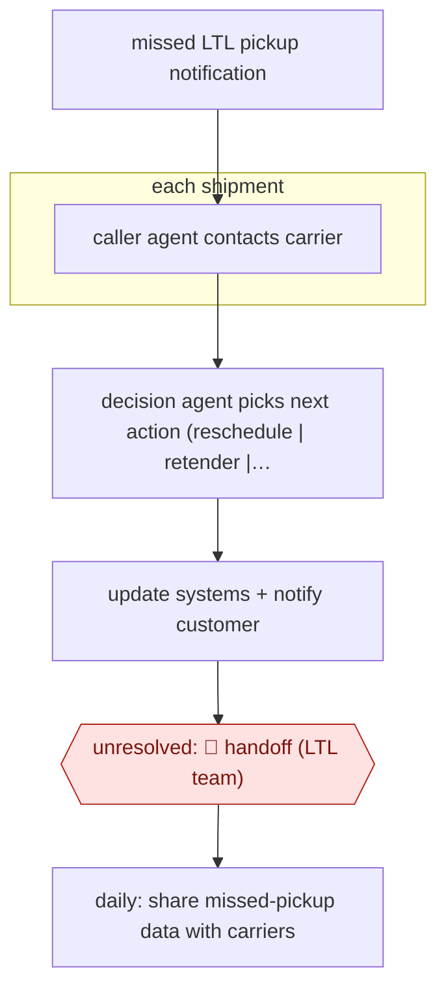

# Missed-pickup call-and-decide

`ORG › LOG › FREIGHT` · sampled · evidence A · **draft: needs a reference example** ([how to add one](../../../../../CONTRIBUTING.md#1-add-an-example-run))

**Shape:** `missed LTL pickup notification → each shipment: caller agent contacts carrier → decision agent picks next action (reschedule | retender | confirm already picked up) → update systems + notify customer → unresolved: 🛑 handoff (LTL team) → daily: share missed-pickup data with carriers`

<!-- shape diagram: generated by scripts/build_diagrams.py from `shape`; don't edit -->

<!-- end shape diagram -->

## Background

In less-than-truckload (LTL) shipping, one truck collects freight from many shippers on the same round and takes it to a terminal, where it is sorted onto other trucks. When a pickup does not happen as planned, because the freight was not ready, the truck was late or the pickup happened but nobody recorded it, the freight can be delayed, and sending another truck to a pickup that has already been made wastes a trip. A logistics company that books LTL freight for many customers used to have people check carrier websites, phone carriers, record the answers, tell customers and, failing that, send the shipment out again for collection. Here one agent contacts the carrier and a second agent decides what to do next, and many shipments are worked at once. A person still takes the cases the agents cannot settle, because a wrong decision sends a truck out or leaves a customer's freight sitting.

**Terms:**
- **LTL (less-than-truckload)**: freight that shares a truck with other shippers' goods.
- **Missed pickup**: a pickup that did not happen as planned, or whose completion was not recorded.
- **Carrier**: the trucking company that collects and moves the freight.
- **Terminal**: a carrier's depot where freight is brought together and sorted onto other trucks.
- **Retender**: offering the shipment to a carrier again so another truck is sent.

## Build it with an agent

**Form:** `platform`. The carrier is contacted by phone, a live voice conversation that a general agent cannot hold, so a voice-agent platform has to do it. The decision, the system updates, the customer notice and the daily data can be run by a general agent as a `service`.

**You need:** a notification feed or queue of missed-pickup events from the shipping system; a voice-agent platform that can place calls to carriers, or, for carriers that answer by email, a mail connector; read and write access to the shipping system for status updates and retenders; a way to notify customers; a store outside the conversation recording each shipment's contacts, answers and decision; a queue for the LTL team. Check your obligations on call recording and on telling the other party they are speaking to an AI before any call is placed.

| Step | Built as |
|---|---|
| missed LTL pickup notification | Each event starts a run through `claude -p` or an Agent SDK program, or a cloud scheduled task polls the feed. One run per shipment, in parallel. |
| each shipment: caller agent contacts carrier | The voice platform places the call and returns a structured answer: picked up, will pick up (when), or cannot say. The answer and the time are written to the store. |
| decision agent picks next action (reschedule \| retender \| confirm already picked up) | A skill, run by a subagent for each shipment, reads the carrier's recorded answer and applies the company's rules for the three actions. A script refuses a retender when no carrier answer is recorded for the shipment. |
| update systems + notify customer | Tools write the outcome to the shipping system and send the customer notice. |
| unresolved: 🛑 handoff (LTL team) | The shipment, the contacts so far and the reason go to the LTL team's queue. |
| daily: share missed-pickup data with carriers | A cloud scheduled task builds a daily file per carrier from the store, with shipment status facts only and no customer or pricing data, and puts it where the carrier data feed reads from. |

**Checkpoints:** `handoff`: the skill sends a shipment to the LTL team when the carrier gives no usable answer, the answers conflict or no rule covers the case, and takes no further action on it. The retender tool is the costly one, because it sends a truck, so it refuses to run without a recorded carrier answer and a decision from the skill; that rule lives in a script or a `PreToolUse` hook and not only in the skill's text.

**Since the sources:** Sources date from 2026-01-26; both are the company's release and a trade-press article repeating it. They say one agent calls carriers and another decides, and they report 100 calls and decisions at once, but they do not show how either agent is built, nor how shipments reach the LTL team; the handoff here is an inference from the 95% automation figure. The split into a calling step and a deciding step is kept in this build because only the calling step needs the voice platform. The reported share of checks automated is the company's own figure, not a claim about this build. No newer account was needed: the newest source is from 2026-01.

*A design based on this entry's steps and the tool documentation as of 2026-11, not a reported run.*

## Steps

*As reported by the sources.*

1. The agent is notified automatically when a pickup doesn't happen as planned [[1]](#sources)[[2]](#sources).
2. One agent phones or contacts the carrier; a second agent decides the next action; together they make '100 calls and 100 decisions simultaneously' [[1]](#sources).
3. The company's systems are updated and customers are notified; previously people checked carrier websites, called, recorded updates and retendered [[1]](#sources)[[2]](#sources).
4. 🛑 **Handoff**: the share not automated (95% of checks are) stays with the team; the sources don't describe this routing in detail [[1]](#sources).
5. The company shares missed-pickup data with carriers daily [[2]](#sources).

**Output:** Each missed pickup resolved or escalated, plus a daily carrier data feed.
**Failure modes → guards:** Wrong retender sends a truck to freight that isn't ready → the agent confirms status with the carrier first. Note: the handoff path is only implied by the source.

**How it differs:** AWF-0005 Alert enrich and adjudicate closes benign alerts automatically. Here the agent acts in the world (outbound carrier calls, retendering), and the deliverable is a resolved shipment, not a verdict.

## Public runs

Coverage as of 2026-11-06: **Strong**: a first-hand, detailed run that matches most of the shape. Collected and re-checked in [Second collection pass](../../../../../research/2026-11-second-pass.md).

- [C.H. Robinson, missed LTL pickups](https://www.chrobinson.com/en-us/about-us/newsroom/press-releases/2026/chrobinson-lean-ai-agents-for-ltl-pickup-efficiency/) (2026-01-26). Scaled across LTL customers; hundreds of shipments a day. "95% of checks on missed LTL pickups have been automated, saving over 350 hours of manual work per day.". *First-hand: yes; confidence: high.*

## Sources

1. C.H. Robinson, launches AI agents to combat missed LTL pickups, 2026-01-26. https://www.chrobinson.com/en-us/about-us/newsroom/press-releases/2026/chrobinson-lean-ai-agents-for-ltl-pickup-efficiency/
2. Mary O'Connell, FreightWaves, How C.H. Robinson is using AI to fix LTL's missed pickup problem, 2026-01-26. https://www.freightwaves.com/news/how-c-h-robinson-is-using-ai-to-fix-ltls-missed-pickup-problem
