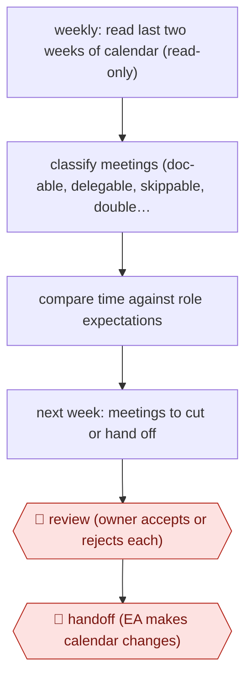

# Calendar time audit

`ORG › XFN › INBOX` · assist · evidence A · **draft: needs a reference example** ([how to add one](../../../../../CONTRIBUTING.md#1-add-an-example-run))

**Shape:** `weekly: read last two weeks of calendar (read-only) → classify meetings (doc-able, delegable, skippable, double-booked, context switches) → compare time against role expectations → next week: meetings to cut or hand off → 🛑 review (owner accepts or rejects each) → 🛑 handoff (EA makes calendar changes)`
**Variants:** `claude-code` · `cursor` · `google-calendar-api`

<!-- shape diagram: generated by scripts/build_diagrams.py from `shape`; don't edit -->

<!-- end shape diagram -->

## Background

An executive's calendar fills with meetings whose value nobody checks: some could have been a shared document, some a colleague could attend instead, some come from people the executive does not know. Looking back over a fortnight to see where the time went, and deciding what to drop next week, is slow, so it rarely happens. Here the agent reads the calendar, sorts the meetings, compares the pattern with what the person's role is meant to spend time on, and proposes cuts and hand-offs. The owner decides each one, because only they know which meetings matter politically or personally. An executive assistant then changes the calendar, because the agent is given no right to edit it or to write to other people.

**Terms:**
- **EA (executive assistant)**: the person who manages an executive's calendar and correspondence.
- **Delegable meeting**: one a director or teammate could attend instead and report back on.
- **Double-booking**: two meetings held in the same time slot.
- **Context switching**: moving between unrelated topics so often that no block of time is left for focused work.
- **Read-only access**: a connection that can look at the calendar but cannot create, move or delete events.

## Build it with an agent

**Form:** `skill`. One person runs the audit about once a week and stays in the conversation to accept or reject each suggestion, so one skill is enough.

**You need:** read-only access to the owner's calendar through a calendar connector (MCP server); a short context file describing the owner's role and what that role should spend time on; the names of the people who could cover recurring meetings. Do not give the agent a calendar write scope or a mail connector.

| Step | Built as |
|---|---|
| weekly: read last two weeks of calendar (read-only) | The owner starts the skill, which reads two weeks of events through the read-only connector. |
| classify meetings (doc-able, delegable, skippable, double-booked, context switches) | The skill's own instructions, with the five categories defined in a reference file; the agent tags each event. |
| compare time against role expectations | The skill compares hours per category with the role description in the context file. |
| next week: meetings to cut or hand off | The agent reads next week's events and lists each with a reason and, for hand-offs, who could cover. |
| 🛑 review (owner accepts or rejects each) → 🛑 handoff (EA makes calendar changes) | See Checkpoints. |

**Checkpoints:** `review`: the skill presents the list and stops; the owner marks each item accepted or rejected. `handoff`: the skill ends by writing the accepted items as a note for the EA; the calendar connection is read-only, so the agent cannot make the changes, and the EA does so in the calendar.

**Since the sources:** Sources date from 2025-11 to 2025-12. Both describe one executive running this herself, with Claude Code agents and a local app of her own; no tool beyond a read-only calendar permission is needed for the audit. The sources' 'Brutal Truth' module is a prompt instruction, reproduced here only as the role comparison. The sources' runs are interviews and a podcast write-up, so the build above is a design, not a reported setup. This build leaves out the email triage that appears alongside the audit in the sources; see AWF-0031.

*A design based on this entry's steps and the tool documentation as of 2026-11, not a reported run.*

## Steps

*As reported by the sources.*

1. The owner connects Google Calendar read-only and Gmail without send rights, through official APIs. The token sits in a git-ignored .env file. Context files describe the owner's role and style [[1]](#sources)[[2]](#sources).
2. The owner prompts the agent to analyse how the last two weeks were spent [[2]](#sources).
3. The agent flags meetings that could be a doc or Slack update, meetings a director or teammate could cover, meetings from unknown organizers or with unclear agendas, double-bookings and heavy context switching [[1]](#sources)[[2]](#sources).
4. A 'Brutal Truth' module, a set of instructions the owner gave the agent, compares the time pattern with the role's expectations and calls out work below the level of the role [[1]](#sources).
5. The agent looks at next week and suggests meetings to cut [[2]](#sources).
6. 🛑 **Review**: the owner treats the output as a first pass and accepts or rejects each recommendation [[2]](#sources).
7. 🛑 **Handoff**: the owner gives the findings to her EA, who makes the calendar changes. The agent has no write access to the calendar [[1]](#sources)[[2]](#sources).

**Output:** A time-allocation audit and a next-week cut and delegate list, handed to the EA, who changes the calendar.
**Failure modes → guards:** Recommendations that ignore context (some meetings matter politically) → owner accepts or rejects each item. Agent acting on others' calendars → read-only calendar scope and no send permission. Data a meeting needs is missing (e.g. a link) → owner corrects and refines the prompt; she suggests running an agent '3 or 4 times' before it is dialed in.
**How it differs:** AWF-0031 Daily inbox triage. That runs daily over email, calendar and DMs and produces drafted replies and a top-5 brief, with a person sending every message. Here the deliverable is a retrospective audit of how time was spent plus a forward cut and delegate plan. It runs weekly, and its checkpoint is a review then a handoff to an EA, not per-message sending.

## Public runs

Coverage as of 2026-11-06: **Partial**: first-hand runs that cover part of the shape or put checkpoints elsewhere. Collected and re-checked in [Second collection pass](../../../../../research/2026-11-second-pass.md).

- [Aakash Gupta interview with Rachel Wolan](https://www.aakashg.com/ai-product-leadership-rachel-wolan-claude-code-cursor/) (2025-11-24). Webflow CPO runs a calendar analysis about weekly and shares the output with her EA. "I asked to look at the last two weeks and I said, can you analyze my calendar, like how I spent my time?". *First-hand: interview; confidence: med.*
- [How I AI, Rachel Wolan](https://chatprd.ai/how-i-ai/webflow-cpo-ai-chief-of-staff-adoption-playbook) (2025-12-29). Same system with read-only calendar and no send permission; flags async, delegate and decline candidates. "Her agent helps manage a 500+ email backlog". *First-hand: interview; confidence: med.*

## Sources

1. Claire Vo, How I AI: Webflow CPO Rachel Wolan's AI Chief of Staff & Org Adoption Playbook, 2025-12-29. https://chatprd.ai/how-i-ai/webflow-cpo-ai-chief-of-staff-adoption-playbook
2. Aakash Gupta, AI product leadership with Rachel Wolan (Claude Code, Cursor), 2025-11-24. https://www.aakashg.com/ai-product-leadership-rachel-wolan-claude-code-cursor/
