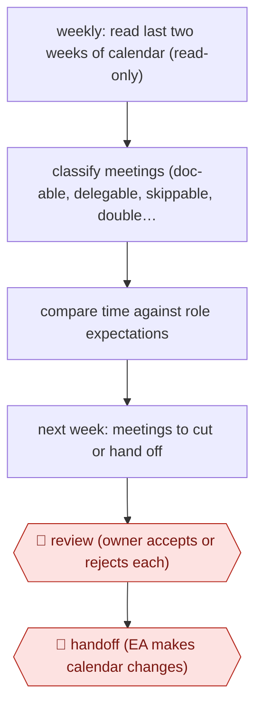

# Calendar time audit

`ORG › XFN › INBOX` · assist · evidence A · **draft: needs a reference example** ([how to add one](../../../../../CONTRIBUTING.md#1-add-an-example-run))

**Shape:** `weekly: read last two weeks of calendar (read-only) → classify meetings (doc-able, delegable, skippable, double-booked, context switches) → compare time against role expectations → next week: meetings to cut or hand off → 🛑 review (owner accepts or rejects each) → 🛑 handoff (EA makes calendar changes)`
**How it differs:** AWF-0031 Daily inbox triage. That runs daily over email, calendar and DMs and produces drafted replies and a top-5 brief, with a person sending every message. Here the deliverable is a retrospective audit of how time was spent plus a forward cut and delegate plan. It runs weekly, and its checkpoint is a review then a handoff to an EA, not per-message sending.
**Variants:** `claude-code` · `cursor` · `google-calendar-api`

<!-- shape diagram: generated by scripts/build_diagrams.py from `shape`; don't edit -->

<!-- end shape diagram -->

## Steps
1. Connect Google Calendar read-only and Gmail without send rights, through official APIs. The token sits in a git-ignored .env file. Context files describe the owner's role and style [[1]](#sources)[[2]](#sources).
2. Prompt the agent to analyse how the last two weeks were spent [[2]](#sources).
3. The agent flags meetings that could be a doc or Slack update, meetings a director or teammate could cover, meetings from unknown organizers or with unclear agendas, double-bookings and heavy context switching [[1]](#sources)[[2]](#sources).
4. A 'Brutal Truth' module compares the time pattern with the role's expectations and calls out work below the level of the role [[1]](#sources).
5. The agent looks at next week and suggests meetings to cut [[2]](#sources).
6. 🛑 **Review**: the owner treats the output as a first pass and accepts or rejects each recommendation [[2]](#sources).
7. 🛑 **Handoff**: the owner gives the findings to her EA, who makes the calendar changes. The agent has no write access to the calendar [[1]](#sources)[[2]](#sources).

**Output:** A time-allocation audit and a next-week cut and delegate list, handed to the EA, who changes the calendar.
**Failure modes → guards:** Recommendations that ignore context (some meetings matter politically) → owner accepts or rejects each item. Agent acting on others' calendars → read-only calendar scope and no send permission. Data a meeting needs is missing (e.g. a link) → owner corrects and refines the prompt; she suggests running an agent '3 or 4 times' before it is dialed in.

## Public runs

Coverage as of 2026-11-06: **Partial**: first-hand runs that cover part of the shape or put checkpoints elsewhere. Collected and re-checked in [Second collection pass](../../../../../research/2026-11-second-pass.md).

- [Aakash Gupta interview with Rachel Wolan](https://www.aakashg.com/ai-product-leadership-rachel-wolan-claude-code-cursor/) (2025-11-24). Webflow CPO runs a calendar analysis about weekly and shares the output with her EA. "I asked to look at the last two weeks and I said, can you analyze my calendar, like how I spent my time?". *First-hand: interview; confidence: med.*
- [How I AI, Rachel Wolan](https://chatprd.ai/how-i-ai/webflow-cpo-ai-chief-of-staff-adoption-playbook) (2025-12-29). Same system with read-only calendar and no send permission; flags async, delegate and decline candidates. "Her agent helps manage a 500+ email backlog". *First-hand: interview; confidence: med.*

## Sources

1. Claire Vo, How I AI: Webflow CPO Rachel Wolan's AI Chief of Staff & Org Adoption Playbook, 2025-12-29. https://chatprd.ai/how-i-ai/webflow-cpo-ai-chief-of-staff-adoption-playbook
2. Aakash Gupta, AI product leadership with Rachel Wolan (Claude Code, Cursor), 2025-11-24. https://www.aakashg.com/ai-product-leadership-rachel-wolan-claude-code-cursor/
