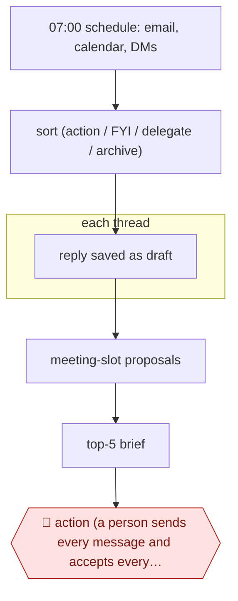

# Daily inbox triage

`ORG › XFN › INBOX` · assist · evidence A · **draft: needs a reference example** ([how to add one](../../../../../CONTRIBUTING.md#1-add-an-example-run))

**Shape:** `07:00 schedule: email, calendar, DMs → sort (action / FYI / delegate / archive) → each thread: reply saved as draft → meeting-slot proposals → top-5 brief → 🛑 action (a person sends every message and accepts every invite)`
**Agent kit:** [run this in Claude Code](variants/claude-code.md)
**Guard:** inbound email is untrusted input (prompt-injection surface). The agent may never send on its own.

<!-- shape diagram: generated by scripts/build_diagrams.py from `shape`; don't edit -->

<!-- end shape diagram -->

## Background

Most professionals start the day with an inbox full of email, a calendar with requests to fit in, and messages from chat apps. Working out which of these need an answer today, what to say, and when to meet takes time before any real work begins, and it tempts people to ignore the pile until it is overwhelming. Here the agent reads all three each morning, sorts every item, writes a draft reply wherever one is needed, suggests meeting times and compiles a short brief of the five things that matter most. The owner still reads and sends every message and accepts every invitation. A reply speaks for the owner to someone else and cannot be taken back, and the incoming messages are written by outsiders, so the agent must not be able to act on them by itself.

**Terms:**
- **Triage**: sorting items by what each needs: a reply, a read, a hand-off, or nothing.
- **DM (direct message)**: a private message in a chat app such as Slack, WhatsApp or iMessage.
- **Draft**: a reply saved in the mail program's Drafts folder, unsent.
- **Calendar hold**: a provisional block on the calendar, not yet a confirmed event.
- **Prompt injection**: text inside an email or message that is written to make the agent follow the sender's instructions instead of the owner's.
- **Lethal trifecta**: an agent that can read private data, take in untrusted content and send messages outward, which together let an attacker steal data.
- **Obligations tracker**: a running list of what the owner has promised to others.

## Build it with an agent

**Form:** `service`. The run starts at 07:00 with nobody at the keyboard, and the owner sees only the brief and the drafts. [The kit](variants/claude-code.md) writes this build out as files.

**You need:** mail, calendar and (if used) chat connectors (MCP servers) set to the narrowest rights each offers: the mail connector may read, label and create drafts, and has no send tool; the calendar connector reads only. A file of voice rules distilled from the owner's sent mail, and a rules file (important senders, delegates, what may be archived). A place for the brief, such as a dated file. Treat every incoming message as data to sort, never as instructions.

| Step | Built as |
|---|---|
| 07:00 schedule: email, calendar, DMs | A cloud scheduled task where the connectors can be reached from it, or your own scheduler starting `claude -p` or an Agent SDK program. |
| sort (action / FYI / delegate / archive) | A skill: it reads unanswered mail since the last run, today's calendar and unread DMs, and puts each item in one bucket with a one-line reason. |
| each thread: reply saved as draft | The same skill, using the connector's create-draft tool, the owner's voice rules and `CLAUDE.md`. For the recipient it takes the address from the thread. |
| meeting-slot proposals | The skill reads free and busy times and writes two or three suggested slots into the draft; it creates no events. |
| top-5 brief | The skill's last step writes the dated brief file: the top five items, counts per bucket, the drafts and any suspicious messages. |
| 🛑 action (a person sends every message and accepts every invite) | See Checkpoints. |

**Checkpoints:** `action`: the owner opens the drafts in their own mail client, then edits and sends, or rejects. The connectors give the agent no send, forward, accept, decline or delete tool, and permission deny rules or a `PreToolUse` hook on any such tool name stop the run if one is ever added. The agent only prepares drafts and holds. Messages that ask for credentials or payment changes, or that address the assistant, go under a "suspicious" heading in the brief with no draft.

**Since the sources:** Sources date from 2025-06 to 2025-12; two of them are repositories with no date, and neither could be opened in 2026-11 (the site refused the request), so they are read from the entry text. Source 2 ran its triage as a Desktop scheduled task because it touches local data; that is not among the building blocks listed in STANDARD.md, so this build names a cloud scheduled task or `claude -p` instead. A cloud task needs connectors that it can reach, which a purely local mail setup may not offer. Source 1 describes an interactive session in which the owner asks for the triage, not a scheduled run; it is the source for draft-only access and for the voice rules. Source 3 allows sending with no approval step described, and this build does not follow it. The build adds the deny rule or hook against sending because instructions in `CLAUDE.md` alone ask the agent not to send, and source 4 shows why that is not enough.

*A design based on this entry's steps and the tool documentation as of 2026-11, not a reported run.*

## Steps

*As reported by the sources.*

1. A scheduled job runs the triage as a Desktop scheduled task, since it touches local data [[2]](#sources). The agent is connected to Gmail, Calendar and Contacts over MCP [[1]](#sources) [[2]](#sources), with Slack, WhatsApp or iMessage added for DMs if needed [[3]](#sources).
2. The agent sorts every item into a tier: respond now, handle today, or FYI/archive [[3]](#sources). Buckets by subject work too, such as referee requests, co-author threads, invitations and admin deadlines [[2]](#sources). A plain list of what needs a reply, unread first, also works [[1]](#sources).
3. For each thread, the agent drafts a reply. It finds the original thread and its message IDs, states the `To:` address explicitly, searches for context, and saves the reply as a draft, never sending it [[1]](#sources). Voice rules come from a couple of hundred of the owner's sent emails, distilled into CLAUDE.md [[1]](#sources) [[3]](#sources).
4. The agent proposes meeting slots: when a thread needs time, it offers a calendar hold as an action to approve, not a booked event [[2]](#sources).
5. The agent writes the morning brief covering calendar, tasks, urgent messages and meeting prep [[3]](#sources), plus a digest and an obligations tracker (the running list of what the owner has promised) [[2]](#sources).
6. 🛑 **Action**: the owner reviews the drafts in their own mail client, then edits and sends, or rejects [[1]](#sources). Every proposed action, including calendar holds, waits for approval, and nothing is sent automatically [[2]](#sources).

**Output:** A triaged inbox, reply drafts sitting in the mail client's Drafts folder, proposed calendar holds and a short morning brief. The owner sends, accepts or discards each one.
**Failure modes → guards:** An unapproved send (a prototype accepted a book-writing request the author didn't want) → give the agent draft-only access, with no send tool [[1]](#sources). Send-capable setups with no approval step described [[3]](#sources) → remove the send permission rather than relying on prompts. Prompt injection from inbound mail, since private data, untrusted content and outbound messages together make the "lethal trifecta" → keep sending outside the agent's reach [[4]](#sources). Replies go to the wrong address because the tool doesn't pull the recipient from the thread → state `To:` explicitly in the prompt [[1]](#sources). Mail passes through third-party services → weigh this before connecting a private inbox [[1]](#sources). The MCP connection is down → the skill degrades gracefully instead of failing [[2]](#sources).

## Public runs

Coverage as of 2026-11-06: **Strong**: a first-hand, detailed run that matches most of the shape. From [Where are the real runs?](../../../../../research/2026-11-real-runs.md); every number was re-checked against its page.

- [Harper Reed, *Getting Claude Code to do my emails*](https://harper.blog/2025/12/03/claude-code-email-productivity-mcp-agents/) (2025-12-03). Mail, calendar and contacts over MCP → drafts only; he sends every message, after an unapproved send. "the past couple hundred emails I have sent" (voice training). *First-hand: yes; confidence: high.*
- [Pedro Sant'Anna, `/triage-inbox`](https://github.com/pedrohcgs/claude-code-my-workflow). Scheduled morning triage → buckets → drafts → proposed calendar holds; every outbound action needs confirmation. triage-inbox v2.0 (config, no run narrative). *First-hand: yes; confidence: high.*
- [Mike Murchison, claude-chief-of-staff](https://github.com/mimurchison/claude-chief-of-staff). `/gm` brief + three-tier triage with drafts; **sending is allowed**, with no approval step described. "from 90 minutes of morning inbox processing to about 5". *First-hand: yes; confidence: med.*

## Sources

1. Harper Reed, Getting Claude Code to do my emails, 2025-12-03. https://harper.blog/2025/12/03/claude-code-email-productivity-mcp-agents/
2. Pedro Sant'Anna, claude-code-my-workflow (`/triage-inbox` v2.0). https://github.com/pedrohcgs/claude-code-my-workflow
3. Mike Murchison, claude-chief-of-staff. https://github.com/mimurchison/claude-chief-of-staff
4. Simon Willison, The lethal trifecta for AI agents: private data, untrusted content, and external communication, 2025-06-16. https://simonwillison.net/2025/Jun/16/the-lethal-trifecta/
