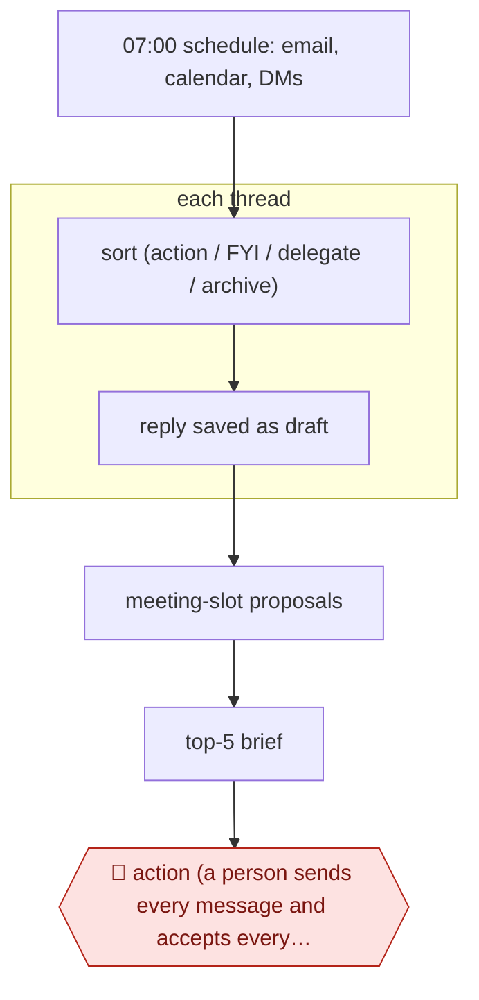

# Daily inbox triage

`ORG › XFN › INBOX` · assist · evidence A · **draft: needs a reference example** ([how to add one](../../../../../CONTRIBUTING.md#1-add-an-example-run))

**Shape:** `07:00 schedule: email, calendar, DMs → sort (action / FYI / delegate / archive) → each thread: reply saved as draft → meeting-slot proposals → top-5 brief → 🛑 action (a person sends every message and accepts every invite)`
**Guard:** inbound email is untrusted input (prompt-injection surface). The agent may never send on its own.

<!-- shape diagram: generated by scripts/build_diagrams.py from `shape`; don't edit -->

<!-- end shape diagram -->

## Public runs

Coverage as of 2026-11-06: **Strong**: a first-hand, detailed run that matches most of the shape. From [Where are the real runs?](../../../../../research/2026-11-real-runs.md); every number was re-checked against its page.

- [Harper Reed, *Getting Claude Code to do my emails*](https://harper.blog/2025/12/03/claude-code-email-productivity-mcp-agents/) (2025-12-03). Mail, calendar and contacts over MCP → drafts only; he sends every message, after an unapproved send. "the past couple hundred emails I have sent" (voice training). *First-hand: yes; confidence: high.*
- [Pedro Sant'Anna, `/triage-inbox`](https://github.com/pedrohcgs/claude-code-my-workflow). Scheduled morning triage → buckets → drafts → proposed calendar holds; every outbound action needs confirmation. triage-inbox v2.0 (config, no run narrative). *First-hand: yes; confidence: high.*
- [Mike Murchison, claude-chief-of-staff](https://github.com/mimurchison/claude-chief-of-staff). `/gm` brief + three-tier triage with drafts; **sending is allowed**, with no approval step described. "from 90 minutes of morning inbox processing to about 5". *First-hand: yes; confidence: med.*

