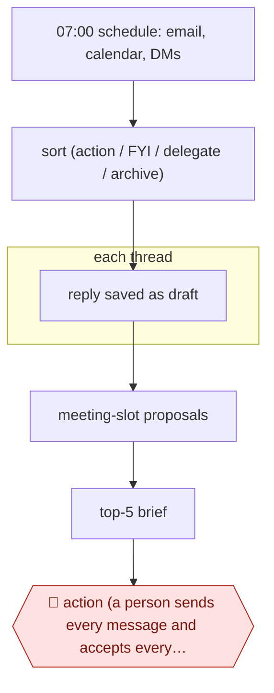

# Daily inbox triage

`ORG › XFN › INBOX` · assist · evidence A · **draft: needs a reference example** ([how to add one](../../../../../CONTRIBUTING.md#1-add-an-example-run))

**Shape:** `07:00 schedule: email, calendar, DMs → sort (action / FYI / delegate / archive) → each thread: reply saved as draft → meeting-slot proposals → top-5 brief → 🛑 action (a person sends every message and accepts every invite)`
**Agent kit:** [run this in Claude Code](variants/claude-code.md)
**Guard:** inbound email is untrusted input (prompt-injection surface). The agent may never send on its own.

<!-- shape diagram: generated by scripts/build_diagrams.py from `shape`; don't edit -->

<!-- end shape diagram -->

## Steps
1. On a schedule, run triage as a Desktop scheduled task, since it touches local data [[2]](#sources). Connect Gmail, Calendar and Contacts over MCP [[1]](#sources) [[2]](#sources), and add Slack, WhatsApp or iMessage for DMs if needed [[3]](#sources).
2. Sort every item into a tier: respond now, handle today, or FYI/archive [[3]](#sources). Domain buckets work too, such as referee requests, co-author threads, invitations and admin deadlines [[2]](#sources). A plain list of what needs a reply, unread first, also works [[1]](#sources).
3. Each thread: draft a reply. Find the original thread and its message IDs, state the `To:` address explicitly, search for context, and save the reply as a draft, never sending it [[1]](#sources). Voice rules come from a couple of hundred of the owner's sent emails, distilled into CLAUDE.md [[1]](#sources) [[3]](#sources).
4. Propose meeting slots: when a thread needs time, offer a calendar hold as an action to approve, not a booked event [[2]](#sources).
5. Write the morning brief covering calendar, tasks, urgent messages and meeting prep [[3]](#sources), plus a digest and an obligations tracker [[2]](#sources).
6. 🛑 **Action**: the owner reviews the drafts in their own mail client, then edits and sends, or rejects [[1]](#sources). Every proposed action, including calendar holds, waits for approval, and nothing is sent automatically [[2]](#sources).

**Output:** A triaged inbox, reply drafts sitting in the mail client's Drafts folder, proposed calendar holds and a short morning brief. The owner sends, accepts or discards each one.
**Failure modes → guards:** An unapproved send (a prototype accepted a book-writing request the author didn't want) → give the agent draft-only access, with no send tool [[1]](#sources). Send-capable setups with no approval step described [[3]](#sources) → remove the send permission rather than relying on prompts. Prompt injection from inbound mail, since private data, untrusted content and outbound messages together make the "lethal trifecta" → keep sending outside the agent's reach [[4]](#sources). Replies go to the wrong address because the tool doesn't pull the recipient from the thread → state `To:` explicitly in the prompt [[1]](#sources). Mail passes through third-party services → weigh this before connecting a private inbox [[1]](#sources). The MCP connection is down → the skill degrades gracefully instead of failing [[2]](#sources).

## Public runs

Coverage as of 2026-11-06: **Strong**: a first-hand, detailed run that matches most of the shape. From [Where are the real runs?](../../../../../research/2026-11-real-runs.md); every number was re-checked against its page.

- [Harper Reed, *Getting Claude Code to do my emails*](https://harper.blog/2025/12/03/claude-code-email-productivity-mcp-agents/) (2025-12-03). Mail, calendar and contacts over MCP → drafts only; he sends every message, after an unapproved send. "the past couple hundred emails I have sent" (voice training). *First-hand: yes; confidence: high.*
- [Pedro Sant'Anna, `/triage-inbox`](https://github.com/pedrohcgs/claude-code-my-workflow). Scheduled morning triage → buckets → drafts → proposed calendar holds; every outbound action needs confirmation. triage-inbox v2.0 (config, no run narrative). *First-hand: yes; confidence: high.*
- [Mike Murchison, claude-chief-of-staff](https://github.com/mimurchison/claude-chief-of-staff). `/gm` brief + three-tier triage with drafts; **sending is allowed**, with no approval step described. "from 90 minutes of morning inbox processing to about 5". *First-hand: yes; confidence: med.*

## Sources

1. Harper Reed, Getting Claude Code to do my emails, 2025-12-03. https://harper.blog/2025/12/03/claude-code-email-productivity-mcp-agents/
2. Pedro Sant'Anna, claude-code-my-workflow (`/triage-inbox` v2.0). https://github.com/pedrohcgs/claude-code-my-workflow
3. Mike Murchison, claude-chief-of-staff. https://github.com/mimurchison/claude-chief-of-staff
4. Simon Willison, The lethal trifecta for AI agents: private data, untrusted content, and external communication, 2025-06-16. https://simonwillison.net/2025/Jun/16/the-lethal-trifecta/
