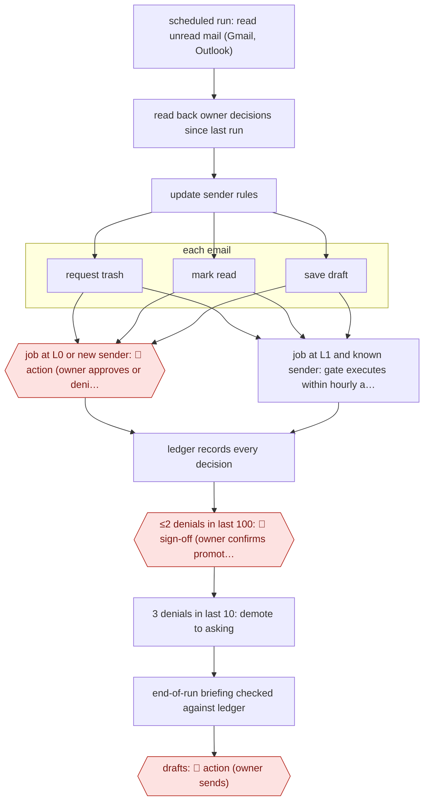

# Ledger-earned inbox actions

`ORG › XFN › INBOX` · checkpointed · evidence A · **draft: needs a reference example** ([how to add one](../../../../../CONTRIBUTING.md#1-add-an-example-run))

**Shape:** `scheduled run: read unread mail (Gmail, Outlook) → read back owner decisions since last run → update sender rules → each email: request trash | mark read | save draft → job at L0 or new sender: 🛑 action (owner approves or denies on phone) | job at L1 and known sender: gate executes within hourly and daily caps → ledger records every decision → ≤2 denials in last 100: 🛑 sign-off (owner confirms promotion) → 3 denials in last 10: demote to asking → end-of-run briefing checked against ledger → drafts: 🛑 action (owner sends)`
**How it differs:** Closest is AWF-0031 Daily inbox triage (assist: a person sends every message, accepts every invite, and the agent only drafts). Here the agent acts on the mailbox through a gate, and each action type earns autonomy from the owner's decision record, with promotion sign-off and automatic demotion. The checkpoint arrangement and autonomy differ, and so does the deliverable (inbox actually cleaned, not a brief plus drafts). AWF-0145 is a calendar audit, not email.
**Variants:** `claude-scheduled-task` · `gmail` · `outlook`

<!-- shape diagram: generated by scripts/build_diagrams.py from `shape`; don't edit -->

<!-- end shape diagram -->

## Steps
1. A scheduled Claude job reads unread mail in Gmail and Outlook a few times a day. For each email it chooses one of three jobs: trash, mark read, or save a draft reply. It cannot send and holds no mailbox keys [[1]](#sources).
2. Every requested change goes to a gate that holds the only credentials. At L0, every request waits. 🛑 **Action**: the owner approves or denies on their phone [[1]](#sources).
3. A ledger records each decision, kept separately per job per mailbox. Only explicit approvals, denials or 'marked wrong' count; silence counts for nothing [[1]](#sources).
4. 🛑 **Sign-off**: a job becomes eligible to move up a level when no more than 2 of the owner's last 100 decisions on it were denials, and the owner confirms the move. At L1, routine requests (e.g. trash from a previously approved sender) go through alone; new senders still wait. 3 denials in the last 10 sends the job back to asking [[1]](#sources).
5. Every job has per-hour and per-day limits at every level [[1]](#sources).
6. At the start of each run the agent reads back decisions and notes since its last run and turns them into rules (e.g. leave a sender unread). It also learns from mail the owner sends and from edits to its drafts [[1]](#sources).
7. Each run ends with a briefing on what it looked at, did and is waiting on. The gate checks the counts against the ledger. 🛑 **Action**: drafts are capped at L2, so the owner always sends replies [[1]](#sources).

**Output:** An inbox where earned jobs (so far trash) run alone and the rest wait for approval, plus a per-job ledger that sets each job's autonomy level.
**Failure modes → guards:** One global trust setting would be wrong for most jobs → per-job ledger with promotion and demotion rules. Runaway volume → per-hour and per-day caps ('37 Gmail trash requests were held back by a cap'). Briefing drifting from reality → gate cross-checks counts. Rare jobs (drafts) never reach a 100-decision bar → owner plans to scale the bar to job frequency.

## Public runs

Coverage as of 2026-11-13: **Strong**: a first-hand, detailed run that matches most of the shape. Collected and re-checked in [Fourth collection pass](../../../../../research/2026-11-fourth-pass.md).

- [Tushar Sachdev, The email agent](https://ctolayer.substack.com/p/the-email-agent) (2026-11-03). Gmail trash promoted to L1 Oct 10; mark read stays gated at 89% approval. "the agent has trashed 546 Gmail emails without asking, and I have marked none of them wrong". *First-hand: yes; confidence: high.*

## Sources

1. Tushar Sachdev, The email agent (The Execution Layer), 2026-11-03. https://ctolayer.substack.com/p/the-email-agent
