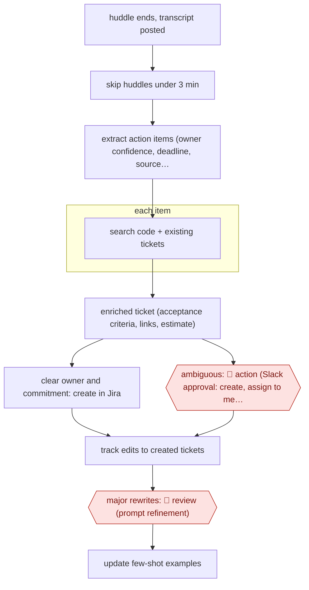

# Confidence-routed meeting tickets

`ORG › XFN › MEET` · sampled · evidence A · **draft: needs a reference example** ([how to add one](../../../../../CONTRIBUTING.md#1-add-an-example-run))

**Shape:** `huddle ends, transcript posted → skip huddles under 3 min → extract action items (owner confidence, deadline, source quote) → each item: search code + existing tickets → enriched ticket (acceptance criteria, links, estimate) → clear owner and commitment: create in Jira | ambiguous: 🛑 action (Slack approval: create, assign to me, modify, discard) → track edits to created tickets → major rewrites: 🛑 review (prompt refinement) → update few-shot examples`
**Variants:** `n8n` · `jira` · `slack-huddles` · `granola`

<!-- shape diagram: generated by scripts/build_diagrams.py from `shape`; don't edit -->

<!-- end shape diagram -->

## Background

After a team meeting, someone has to turn what was agreed into tickets in the team's tracker, each with an owner, a deadline and enough detail for someone else to start work. It is a chore done in the gap between meetings, so tasks are dropped or written up so thinly that the context is lost. Here the agent reads the meeting transcript, pulls out the action items, looks in the code and existing tickets for context and writes the ticket. Items with a clear owner and a clear commitment become tickets directly. Items where the owner is unclear or the timing vague wait for a person to approve them, because a ticket with the wrong owner sends someone else's work to the wrong person and a casual remark ("we should probably...") may not be a commitment at all.

**Terms:**
- **Huddle**: a short, informal audio call in a chat app such as Slack, which can post a transcript afterwards.
- **Action item**: a task someone agreed to do during the meeting.
- **Ticket**: a record of one piece of work in a tracker such as Jira, with an owner and a status.
- **Acceptance criteria**: the conditions the work must meet to count as done.
- **Story points**: a team's rough estimate of how big a piece of work is.
- **Few-shot examples**: a handful of worked examples placed in the prompt to show the agent what is, and is not, an action item for this team.
- **Owner confidence**: how sure the extraction is about who owns an item: stated outright (explicit), inferred (implied) or not mentioned (unassigned).

## Build it with an agent

**Form:** `service`. A run starts when a transcript is posted, with nobody at the keyboard, and people see only the approval cards for ambiguous items and the notices about rewritten tickets.

**You need:** a way to start a run when a transcript lands in the designated channel, such as a Slack event handled by a workflow tool or a small webhook; connectors (MCP servers) for the chat app, to read the transcript and post approval cards, and for the tracker, to search tickets and create them; read access to the code repository; the team roster, for resolving names; a file of few-shot examples kept under version control. Transcripts hold what people said in a meeting: keep the run to channels whose members already see them.

| Step | Built as |
|---|---|
| huddle ends, transcript posted → skip huddles under 3 min | The trigger starts a `claude -p` or Agent SDK run only when the huddle lasted 3 minutes or more; the roster is passed in. |
| extract action items (owner confidence, deadline, source quote) | A skill that holds the extraction schema and the few-shot examples and returns structured items. |
| each item: search code + existing tickets → enriched ticket (acceptance criteria, links, estimate) | Built-in subagents, one per item, search the repository and the tracker through the connector and return a ticket draft. |
| clear owner and commitment: create in Jira \| ambiguous: 🛑 action | A script, not the agent, decides by the owner-confidence field. It creates the clear tickets and posts each ambiguous one as a Slack card. See Checkpoints. |
| track edits to created tickets | A second scheduled job (a cloud scheduled task, or `claude -p` from your own scheduler) compares each created ticket with its later state. |
| major rewrites: 🛑 review (prompt refinement) → update few-shot examples | A Slack notice to the prompt's maintainer, who edits the examples file. |

**Checkpoints:** `action`: an ambiguous item is posted as a Slack card with four choices (create as it is, assign to me, modify, discard) and nothing is created until a person picks one. Only the script holds the ticket-creation credential for these items; the agent can post the card and cannot create the ticket. `review`: when the comparison finds a major rewrite, the maintainer gets a notice and changes the prompt or the examples; the agent does not change its own examples.

**Since the sources:** Sources date from 2025-12 to 2026-10. Source 1 builds the pipeline with a workflow tool (n8n) calling a language model; this build uses a general agent with the same extraction schema and few-shot examples, and puts the routing in a script. Source 2 describes a different arrangement: a TPM pastes a transcript into an internal app, and every suggested ticket is reviewed before creation, so it is the assist version, not this routing. In 2026-11 the page of source 1 could be read as text only in part (its code listings are collapsed), and the figures in the public runs were not re-checked. The build does not claim any approval share or time saving. The quarterly refresh of examples reported in source 1 is left to the maintainer's schedule.

*A design based on this entry's steps and the tool documentation as of 2026-11, not a reported run.*

## Steps

*As reported by the sources.*

1. An automation workflow (n8n) fires when a Slack huddle transcript is posted to a designated channel; huddles under 3 minutes are skipped, speaker turns consolidated, and the team roster fetched for name resolution [[1]](#sources).
2. A language model (LLM) with team-specific few-shot examples extracts concrete action items into a schema: owner with confidence (explicit, implied, unassigned), deadline and urgency, dependencies, type, and the exact transcript segment [[1]](#sources).
3. For each item the pipeline (the workflow's automated steps) searches the codebase and existing tickets and generates an enriched Jira ticket: summary, description, 3-5 acceptance criteria, technical notes, related files and tickets, labels, story points [[1]](#sources).
4. 🛑 **Action**: ambiguous extractions (unclear owner, vague timing) go to a Slack approval card with options to create as is, assign to me, modify, or discard, instead of being created; this catches roughly 15% of extractions [[1]](#sources). Confident items are created directly in Jira.
5. 🛑 **Review**: the pipeline compares created tickets with their later edited state; major rewrites trigger a Slack notice for prompt review, and few-shot examples are updated quarterly from failures [[1]](#sources).

**Output:** Jira tickets linked to the meeting segment and related code, plus a queue of approval requests for ambiguous items.
**Failure modes → guards:** Phantom tasks from vague talk ('we should probably…') → few-shot examples that mark these as non-actions, and Slack approval for low-confidence items [1]. Wrong owner → owner confidence field, unassigned items go to approval [1]. Drift in quality → edit-distance feedback loop [1]. Teams wanting every ticket reviewed use the assist version (RADAR: review, edit, select before any ticket is created) [2].
**How it differs:** AWF-0086 Template-driven meeting minutes (closest): that produces minutes a person corrects before circulation. Here the deliverable is tickets written into the tracker. The agent creates confident items itself, and people handle only the ambiguous ~15% plus heavily edited tickets.

## Public runs

Coverage as of 2026-11-13: **Partial**: first-hand runs that cover part of the shape or put checkpoints elsewhere. Collected and re-checked in [Third collection pass](../../../../../research/2026-11-third-pass.md).

- [Amandeep Singh, Meeting-to-Task Pipeline](https://asinghm.com/blog/ai-meeting-transcript-to-jira-tickets-pipeline) (2025-12-17). Four months in production on one engineering team; approval flow for ambiguous items. "Our ticket creation rate from meetings went from 42% to 91%". *First-hand: yes; confidence: med.*
- [Built This Week, RADAR](https://www.builtthisweek.com/builds/radar-meeting-transcripts-to-jira-tickets) (2026-10-31). TPM's internal app: Granola standup transcript to suggested Jira tickets, reviewed before creation. "He said it took a job that used to take four hours down to minutes.". *First-hand: interview; confidence: med.*

## Sources

1. Amandeep Singh, Building an AI-Powered Meeting-to-Task Pipeline: From Transcripts to Tickets in Minutes, 2025-12-17. https://asinghm.com/blog/ai-meeting-transcript-to-jira-tickets-pipeline
2. Jordan Metzner and Sam Nadler, Built This Week, AI Meeting Transcript to Jira Tickets: How RADAR Works, 2026-10-31. https://www.builtthisweek.com/builds/radar-meeting-transcripts-to-jira-tickets
