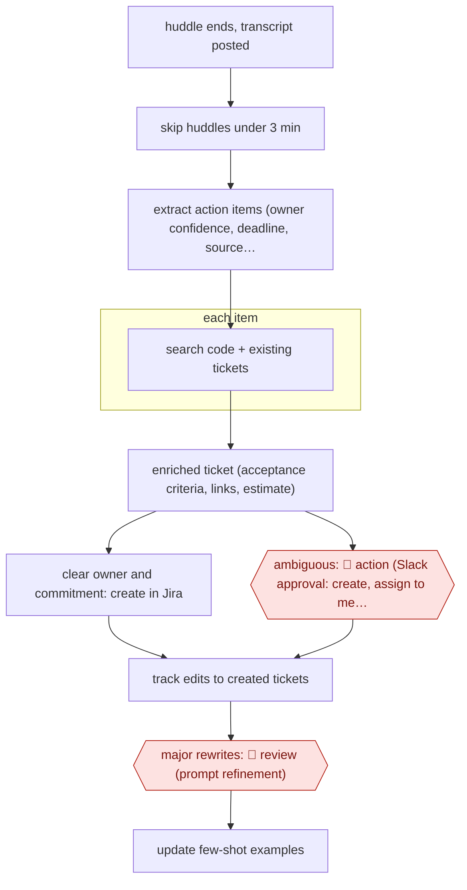

# Confidence-routed meeting tickets

`ORG › XFN › MEET` · sampled · evidence A · **draft: needs a reference example** ([how to add one](../../../../../CONTRIBUTING.md#1-add-an-example-run))

**Shape:** `huddle ends, transcript posted → skip huddles under 3 min → extract action items (owner confidence, deadline, source quote) → each item: search code + existing tickets → enriched ticket (acceptance criteria, links, estimate) → clear owner and commitment: create in Jira | ambiguous: 🛑 action (Slack approval: create, assign to me, modify, discard) → track edits to created tickets → major rewrites: 🛑 review (prompt refinement) → update few-shot examples`
**How it differs:** AWF-0086 Template-driven meeting minutes (closest): that produces minutes a person corrects before circulation. Here the deliverable is tickets written into the tracker. The agent creates confident items itself, and people handle only the ambiguous ~15% plus heavily edited tickets.
**Variants:** `n8n` · `jira` · `slack-huddles` · `granola`

<!-- shape diagram: generated by scripts/build_diagrams.py from `shape`; don't edit -->

<!-- end shape diagram -->

## Steps
1. An n8n workflow fires when a Slack huddle transcript is posted to a designated channel; huddles under 3 minutes are skipped, speaker turns consolidated, and the team roster fetched for name resolution [[1]](#sources).
2. An LLM with team-specific few-shot examples extracts concrete action items into a schema: owner with confidence (explicit, implied, unassigned), deadline and urgency, dependencies, type, and the exact transcript segment [[1]](#sources).
3. For each item the pipeline searches the codebase and existing tickets and generates an enriched Jira ticket: summary, description, 3-5 acceptance criteria, technical notes, related files and tickets, labels, story points [[1]](#sources).
4. 🛑 **Action**: ambiguous extractions (unclear owner, vague timing) go to a Slack approval card with options to create as is, assign to me, modify, or discard, instead of being created; this catches roughly 15% of extractions [[1]](#sources). Confident items are created directly in Jira.
5. 🛑 **Review**: the pipeline compares created tickets with their later edited state; major rewrites trigger a Slack notice for prompt review, and few-shot examples are updated quarterly from failures [[1]](#sources).

**Output:** Jira tickets linked to the meeting segment and related code, plus a queue of approval requests for ambiguous items.
**Failure modes → guards:** Phantom tasks from vague talk ('we should probably…') → few-shot examples that mark these as non-actions, and Slack approval for low-confidence items [1]. Wrong owner → owner confidence field, unassigned items go to approval [1]. Drift in quality → edit-distance feedback loop [1]. Teams wanting every ticket reviewed use the assist version (RADAR: review, edit, select before any ticket is created) [2].

## Public runs

Coverage as of 2026-11-13: **Partial**: first-hand runs that cover part of the shape or put checkpoints elsewhere. Collected and re-checked in [Third collection pass](../../../../../research/2026-11-third-pass.md).

- [Amandeep Singh, Meeting-to-Task Pipeline](https://asinghm.com/blog/ai-meeting-transcript-to-jira-tickets-pipeline) (2025-12-17). Four months in production on one engineering team; approval flow for ambiguous items. "Our ticket creation rate from meetings went from 42% to 91%". *First-hand: yes; confidence: med.*
- [Built This Week, RADAR](https://www.builtthisweek.com/builds/radar-meeting-transcripts-to-jira-tickets) (2026-10-31). TPM's internal app: Granola standup transcript to suggested Jira tickets, reviewed before creation. "He said it took a job that used to take four hours down to minutes.". *First-hand: interview; confidence: med.*

## Sources

1. Amandeep Singh, Building an AI-Powered Meeting-to-Task Pipeline: From Transcripts to Tickets in Minutes, 2025-12-17. https://asinghm.com/blog/ai-meeting-transcript-to-jira-tickets-pipeline
2. Jordan Metzner and Sam Nadler, Built This Week, AI Meeting Transcript to Jira Tickets: How RADAR Works, 2026-10-31. https://www.builtthisweek.com/builds/radar-meeting-transcripts-to-jira-tickets
