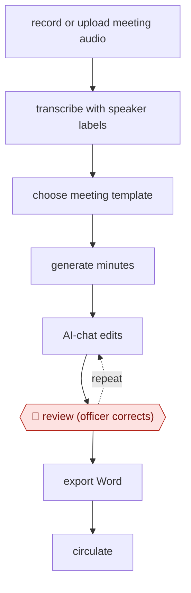

# Template-driven meeting minutes

`ORG › XFN › MEET` · assist · evidence B · **draft: needs a reference example** ([how to add one](../../../../../CONTRIBUTING.md#1-add-an-example-run))

**Shape:** `record or upload meeting audio → transcribe with speaker labels → choose meeting template → generate minutes → (AI-chat edits ⟲ 🛑 review (officer corrects)) → export Word → circulate`
**Variants:** `iai-minute` · `justice-transcribe`

<!-- shape diagram: generated by scripts/build_diagrams.py from `shape`; don't edit -->

<!-- end shape diagram -->

## Background

Public bodies such as councils keep a written record of what was discussed and decided at formal meetings: the minutes. Someone, usually an officer (a council employee), listens back, writes it up in the house style and sends it round, which can take as long as the meeting itself and delays the actions that follow. Here the agent works from the recording's transcript with each speaker identified, chooses the layout that suits the type of meeting and writes the draft minutes. The officer still reads and corrects them before anyone else sees them, because minutes become the official record, a wrongly attributed statement can mislead later decisions, and some meetings (such as social-care supervision) involve personal information.

**Terms:**
- **Minutes**: the official written record of a meeting: what was discussed, what was decided and who is to act.
- **Transcript with speaker labels**: the meeting's words as text, with each passage marked with who said it.
- **Template**: a fixed layout for one type of meeting, such as a Cabinet meeting (the senior decision-making group of a council or government), a planning committee, a care assessment or a general meeting.
- **House style rules**: the organisation's required tense, grammar and format for minutes.
- **Officer**: the member of staff responsible for the meeting record.
- **Supervision session**: a meeting between a social-care worker and their manager about casework.
- **Circulate**: send the approved minutes to the attendees and others who need them.

## Build it with an agent

**Form:** `skill`. One officer prepares one meeting's minutes at a time and stays in the conversation to correct them, so one skill holding the templates and style rules is enough. Turning audio into a transcript is the one step that needs a speech-to-text service, which the agent calls or is handed the result of.

**You need:** a transcript with speaker labels, from the meeting tool or from a speech-to-text service your organisation has approved, run by a script beside the skill if you want the agent to start it; a `templates/` folder with one reference file per meeting type, and a file of the house style rules; a way to write a Word file. Agree beforehand which meetings may be processed at all: sensitive or personal-data meetings need a setup approved at their classification, and no audio should be kept after transcription. Do not connect a mail tool.

| Step | Built as |
|---|---|
| record or upload meeting audio → transcribe with speaker labels | Outside the agent: a speech-to-text service or the meeting tool's own transcript. A script beside the skill can submit the audio; otherwise the officer supplies the transcript file. |
| choose meeting template | The skill's first instruction: name the meeting type (or ask the officer) and open `templates/<type>.md`. |
| generate minutes | The skill writes the minutes from the transcript into the template, applying the style rules, and flags passages where the speaker or a decision is unclear. |
| (AI-chat edits ⟲ 🛑 review (officer corrects)) | The officer asks for changes in the conversation and edits the draft; the skill revises until the officer is satisfied. See Checkpoints. |
| export Word → circulate | A script or document skill writes the `.docx`; the officer circulates it. |

**Checkpoints:** `review`: the skill shows the draft minutes with unclear passages marked, then stops; the officer corrects them and asks for changes as often as needed. The skill has no circulate step and no mail tool, so the officer sends the final file from their own mailbox.

**Since the sources:** Sources date from 2025-05 (source 1) and an undated repository README (source 2). Source 2 could not be opened in 2026-11 (the site refused the request), so the tool's features are taken from the entry text. Searches in 2026-11 found coverage from mid-2025 and snippets of two further pages, an open-source release notice and the UK government AI knowledge hub's page for the tool, neither of which could be opened; one snippet says the hosted service is not open to new departments or authorities. No newer account that could be opened was found as of 2026-11. The sources describe the government's own tool, whose hosted service may not be available to you; this build uses a general agent with the same steps. It leaves out the tool's audio upload and provider choice by duration and quality (steps 1 and 2), which a general agent does not do. The source reports action follow-up only as an aim; this build does not extract actions.

*A design based on this entry's steps and the tool documentation as of 2026-11, not a reported run.*

## Steps

*As reported by the sources.*

1. The officer uploads the meeting recording. The system converts the audio and stores it behind a time-limited upload link [[2]](#sources).
2. The system transcribes it with speech-to-text, choosing the provider by duration and quality [[2]](#sources).
3. The officer chooses a template: Cabinet meeting, planning committee, care assessment, general meeting, or a custom one [[2]](#sources).
4. A language model (LLM) structures the conversation into minutes, applying government tense, grammar and format rules [[2]](#sources).
5. 🛑 **Review**: the officer tweaks and corrects the summary before it is used [[1]](#sources).
6. The officer circulates the final minutes and picks up follow-up work. In councils this was aimed at speeding up actions after planning meetings and recording supervision sessions [[1]](#sources).

**Output:** Corrected minutes, exported and circulated as the meeting record. Follow-up actions are taken from them by officers.
**Failure modes → guards:** Wrong or misattributed statements → the officer corrects them before circulation. Sensitive meetings → handle data at the right classification, and don't retain audio. Action tracking is not documented as a tool feature, so treat action extraction as manual or template-dependent. The time saving comes from early central-government tests, not an independent evaluation [[1]](#sources).
**How it differs:** AWF-0026 Ambient scribe produces clinical notes under clinical sign-off. This workflow produces general government meeting minutes reviewed by an officer, at low risk.

## Public runs

Coverage as of 2026-11-06: **Partial**: first-hand runs that cover part of the shape or put checkpoints elsewhere. Collected and re-checked in [New workflows for empty categories](../../../../../research/2026-11-new-workflows.md).

- [GOV.UK, Humphrey helps townhalls](https://www.gov.uk/government/news/ai-experiments-see-humphrey-help-townhalls-cut-costs-and-improve-services) (2025-05-23). Minute trialled by 25 councils, including West Berkshire and Stockton-on-Tees, for planning and social care meetings. "officials are saved from 60-minutes of admin for each hour-long meeting". *First-hand: yes; confidence: low.*

## Sources

1. GOV.UK press release, AI experiments see Humphrey help townhalls cut costs and improve services, 2025-05-23. https://www.gov.uk/government/news/ai-experiments-see-humphrey-help-townhalls-cut-costs-and-improve-services
2. i.AI, minute (GitHub README), accessed 2026-11. https://github.com/i-dot-ai/minute
