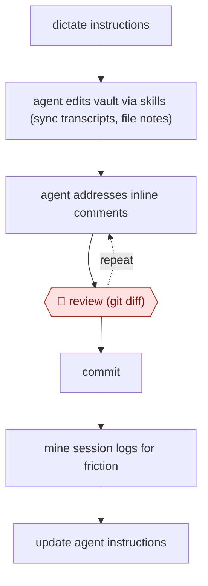

# Diff-reviewed vault upkeep

`ORG › XFN › PKM` · checkpointed · evidence A · **draft: needs a reference example** ([how to add one](../../../../../CONTRIBUTING.md#1-add-an-example-run))

**Shape:** `dictate instructions → agent edits vault via skills (sync transcripts, file notes) → (agent addresses inline comments ⟲ 🛑 review (git diff)) → commit → mine session logs for friction → update agent instructions`
**How it differs:** AWF-0030 Issue-tree research produces a research brief. AWF-0031 handles an inbox. This workflow maintains a personal notes store, with every agent change reviewed as a diff.
**Variants:** `claude-code-obsidian`

<!-- shape diagram: generated by scripts/build_diagrams.py from `shape`; don't edit -->

<!-- end shape diagram -->

## Steps
1. Capture by dictation (Wispr Flow) into the agent session [[1]](#sources).
2. Claude Code works on the Obsidian vault through skills, e.g. syncing Granola meeting transcripts into notes with timestamps and metadata [[1]](#sources).
3. 🛑 **Review**: open the agent's changes in git and read the diff, because 'the agent doesn't do exactly what I told it to do' [[1]](#sources).
4. Leave inline `<!-- USER-COMMENT: -->` notes on the diff and have the agent address them. Repeat until the diff passes [[1]](#sources).
5. Keep backups (git, external drive, Time Machine), and turn on verbose output to see which files the agent read [[1]](#sources).
6. Periodically analyse session messages for friction (made-up dates, skipped steps) and turn the findings into CLAUDE.md edits [[1]](#sources).

**Output:** An updated, versioned notes vault, plus revised agent instructions for the next run.
**Failure modes → guards:** Agent ignores instructions or invents dates → diff review with inline comments, and friction analysis feeding CLAUDE.md. Lost or overwritten notes → git plus offline backups.

## Public runs

Coverage as of 2026-11-06: **Partial**: first-hand runs that cover part of the shape or put checkpoints elsewhere. Collected and re-checked in [New workflows for empty categories](../../../../../research/2026-11-new-workflows.md).

- [Artem Zhutov, Building My Personal AI](https://artemxtech.substack.com/p/what-changed-in-2-weeks-claude-code) (2026-01-12). Claude Code over an Obsidian vault; reviews git diffs with inline comments; friction analysis of own sessions. "1679 user messages across 12 sessions". *First-hand: yes; confidence: med.*

## Sources

1. Artem Zhutov, 280K Words Dictated, 1679 Messages Analyzed: Building My Personal AI (Substack), 2026-01-12. https://artemxtech.substack.com/p/what-changed-in-2-weeks-claude-code
