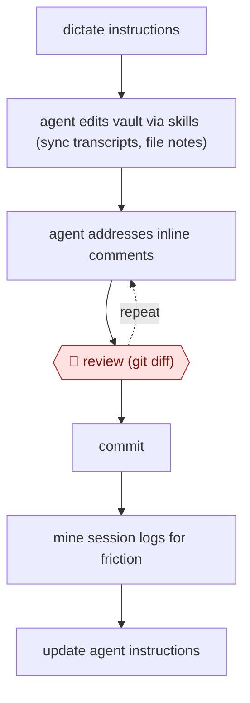

# Diff-reviewed vault upkeep

`ORG › XFN › PKM` · checkpointed · evidence A · **draft: needs a reference example** ([how to add one](../../../../../CONTRIBUTING.md#1-add-an-example-run))

**Shape:** `dictate instructions → agent edits vault via skills (sync transcripts, file notes) → (agent addresses inline comments ⟲ 🛑 review (git diff)) → commit → mine session logs for friction → update agent instructions`
**Variants:** `claude-code-obsidian`

<!-- shape diagram: generated by scripts/build_diagrams.py from `shape`; don't edit -->

<!-- end shape diagram -->

## Background

Many people keep a personal collection of notes (meeting notes, reading notes, project pages) as plain text files in one folder, called a vault, and spend real time tidying it: filing new notes, linking them, adding the transcript of yesterday's meeting. An agent can do that housekeeping from spoken instructions, but it does not always do exactly what was asked, and it may invent a date or rewrite something it should have left alone. So the owner reads every change before it is kept, using git, the tool that records each change to a folder of files so it can be compared and undone. The agent edits, the owner reads the diff and says what to fix, and only the owner decides what becomes part of the notes; the notes are the owner's own record and a quiet error in them can go unnoticed for months.

**Terms:**
- **Vault**: a folder of notes stored as plain Markdown files, in this case opened with the note-taking app Obsidian.
- **Git**: a tool that records every change to a folder of files, so earlier versions can be restored.
- **Diff**: the list of lines a change adds and removes.
- **Commit**: saving a reviewed set of changes as a permanent point in git's history.
- **Inline comment**: a note the owner types into the file itself, here as an HTML comment (`<!-- USER-COMMENT: ... -->`), for the agent to find and act on.
- **Dictation**: speaking instructions and having speech-to-text type them.
- **Friction**: a repeated way the agent goes wrong or annoys the owner, such as inventing dates or skipping steps.
- **`CLAUDE.md`**: a file of standing instructions that the agent reads at the start of every session.

## Build it with an agent

**Form:** `skill`. One person edits their own vault in a conversation they are present for, and reviews each change before saving it, so skills plus `CLAUDE.md` in the vault are enough; no extra workers or enforced rules beyond one permission setting are needed.

**You need:** the vault as a git repository, with backups outside it (an external drive or system backup); a `CLAUDE.md` in the vault with the vault's conventions (folder layout, note format, "never invent dates; leave a placeholder"); one skill per recurring job, such as filing a note or syncing meeting transcripts from the meeting recorder's local files; the owner's dictation tool or keyboard. Meeting transcripts and personal notes may hold other people's information: keep the vault on the owner's own machine.

| Step | Built as |
|---|---|
| dictate instructions | The owner speaks or types the request in the agent session. |
| agent edits vault via skills (sync transcripts, file notes) | Skills for each recurring job, loaded by name (for example `/sync-meetings`), plus the conventions in `CLAUDE.md`. |
| (agent addresses inline comments ⟲ 🛑 review (git diff)) | The owner opens the diff in git, adds `<!-- USER-COMMENT: -->` notes, and tells the agent to read and address them; repeat until the diff is acceptable. See Checkpoints. |
| commit | The owner commits, after review. |
| mine session logs for friction → update agent instructions | A skill the owner runs now and then: it reads the saved conversation logs from the owner's machine, lists repeated corrections and quotes them, and proposes edits to `CLAUDE.md` for the owner to accept. |

**Checkpoints:** `review`: the skill ends each editing job by saying what it changed and stopping; the owner reads the diff in git. A permission rule set to ask for `git commit` (or deny, so the owner commits from their own terminal) means the agent cannot save its changes as a commit, and git history plus the offline backups let a bad edit be undone. Turning on verbose output shows which files the agent read.

**Since the sources:** The source dates from 2026-01. The source builds this with Claude Code skills, dictation, a local meeting recorder and Obsidian; the source's own setup is a single person's, so the build is a design drawn from it. Its remark that skills and slash commands are now unified in Claude Code means a skill can be run by name as a command. The friction analysis relies on the agent's conversation history being stored on the owner's computer; this build leaves the check on whether your setup keeps one to you. The source's author says the friction findings feed edits to `CLAUDE.md`; the build makes no claim about how well that works.

*A design based on this entry's steps and the tool documentation as of 2026-11, not a reported run.*

## Steps

*As reported by the sources.*

1. The owner dictates instructions (with the Wispr Flow dictation tool) into the agent session [[1]](#sources).
2. The agent (Claude Code) works on the Obsidian vault through skills, e.g. syncing Granola meeting transcripts into notes with timestamps and metadata [[1]](#sources).
3. 🛑 **Review**: the owner opens the agent's changes in git and reads the diff, because 'the agent doesn't do exactly what I told it to do' [[1]](#sources).
4. The owner leaves inline `<!-- USER-COMMENT: -->` notes on the diff and has the agent address them. They repeat this until the diff passes [[1]](#sources).
5. The owner keeps backups (git, external drive, Time Machine), and turns on verbose output to see which files the agent read [[1]](#sources).
6. Periodically the owner has the agent analyse session messages for friction (made-up dates, skipped steps) and turn the findings into CLAUDE.md edits [[1]](#sources).

**Output:** An updated, versioned notes vault, plus revised agent instructions for the next run.
**Failure modes → guards:** Agent ignores instructions or invents dates → diff review with inline comments, and friction analysis feeding CLAUDE.md. Lost or overwritten notes → git plus offline backups.
**How it differs:** AWF-0030 Issue-tree research produces a research brief. AWF-0031 handles an inbox. This workflow maintains a personal notes store, with every agent change reviewed as a diff.

## Public runs

Coverage as of 2026-11-06: **Partial**: first-hand runs that cover part of the shape or put checkpoints elsewhere. Collected and re-checked in [New workflows for empty categories](../../../../../research/2026-11-new-workflows.md).

- [Artem Zhutov, Building My Personal AI](https://artemxtech.substack.com/p/what-changed-in-2-weeks-claude-code) (2026-01-12). Claude Code over an Obsidian vault; reviews git diffs with inline comments; friction analysis of own sessions. "1679 user messages across 12 sessions". *First-hand: yes; confidence: med.*

## Sources

1. Artem Zhutov, 280K Words Dictated, 1679 Messages Analyzed: Building My Personal AI (Substack), 2026-01-12. https://artemxtech.substack.com/p/what-changed-in-2-weeks-claude-code
