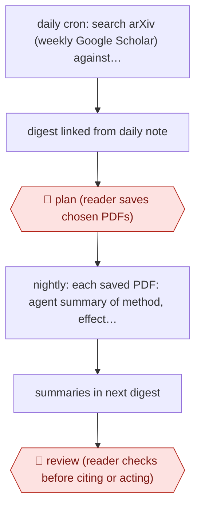

# Pick-then-summarise research digest

`ORG › XFN › PKM` · checkpointed · evidence A · **draft: needs a reference example** ([how to add one](../../../../../CONTRIBUTING.md#1-add-an-example-run))

**Shape:** `daily cron: search arXiv (weekly Google Scholar) against topic config, skip already-shown papers → digest linked from daily note → 🛑 plan (reader saves chosen PDFs) → nightly: each saved PDF: agent summary of method, effect size, evidence → summaries in next digest → 🛑 review (reader checks before citing or acting)`
**How it differs:** AWF-0087 Diff-reviewed vault upkeep. There the agent edits an existing vault on dictated instructions and the checkpoint is a git-diff review of the edits. Here the agent brings in new external literature on a schedule. The deliverable is a digest plus summaries, and the checkpoint is the reader choosing which papers get processed, then reading the summaries.
**Variants:** `claude-code` · `obsidian` · `hermes-agent` · `netnewswire` · `github-pages`

<!-- shape diagram: generated by scripts/build_diagrams.py from `shape`; don't edit -->

<!-- end shape diagram -->

## Steps
1. Keep a config of research topics and a record of papers already shown [[1]](#sources).
2. Each morning a search script queries arXiv, and on Sundays Google Scholar too. New results go into a digest linked from the dated /today note [[1]](#sources).
3. 🛑 **Plan**: the reader scans the digest and saves only promising PDFs to a research folder, which acts as the filter against overload [[1]](#sources).
4. Each night a script finds newly saved PDFs and has a Claude Code agent summarise methodology, effect size and other evidence, not just the abstract [[1]](#sources).
5. The summaries appear in the next day's digest [[1]](#sources).
6. 🛑 **Review**: the reader reads and checks each summary before using it. Torres used one to spot a methodological flaw that she then wrote up publicly [[1]](#sources).
7. Variant (Research Radar): a 09:15 cron filters more than 20 RSS feeds against a research profile, gives each paper a level (read carefully, skim, awareness) with 'why it matters' notes, and a 10:00 QA job checks fields and DOIs. Then the page is committed to GitHub Pages and the author chooses what to read. The agent never adds to Zotero or deletes anything [[2]](#sources).

**Output:** A daily digest page or note of new papers plus evidence-focused summaries of the papers the reader chose.
**Failure modes → guards:** Information overload → only reader-saved PDFs get deep summaries. A summary misstates the method → reader review before citing. Malformed output breaks the page → a separate QA cron fixes minor issues and blocks serious ones [[2]](#sources). Repeats → a seen-papers record in config.

## Public runs

Coverage as of 2026-11-06: **Partial**: first-hand runs that cover part of the shape or put checkpoints elsewhere. Collected and re-checked in [Second collection pass](../../../../../research/2026-11-second-pass.md).

- [How I AI, Teresa Torres](https://www.chatprd.ai/how-i-ai/teresa-torres-claude-code-obsdian-task-management) (2026-01-19). Daily arXiv search, reader-saved PDFs, nightly evidence summaries; one summary exposed a flaw she wrote up. none stated beyond schedule (daily arXiv, Sunday Google Scholar, nightly summaries). *First-hand: interview; confidence: med.*
- [CHEN Yiru, Research Radar](https://chenyiru3.github.io/blog/2026/how-research-radar-works/) (2026-05-15). Personal daily pipeline with tiered recommendations, QA cron and published page; author decides what to read. "help me choose the 13 to 15 papers most worth reading that day". *First-hand: yes; confidence: med.*

## Sources

1. Claire Vo, How I AI: Teresa Torres's Claude Code system for task management, automated research, and 'lazy' prompting, 2026-01-19. https://www.chatprd.ai/how-i-ai/teresa-torres-claude-code-obsdian-task-management
2. CHEN Yiru, How the Research Radar works: an automated literature curation pipeline, 2026-05-15. https://chenyiru3.github.io/blog/2026/how-research-radar-works/
