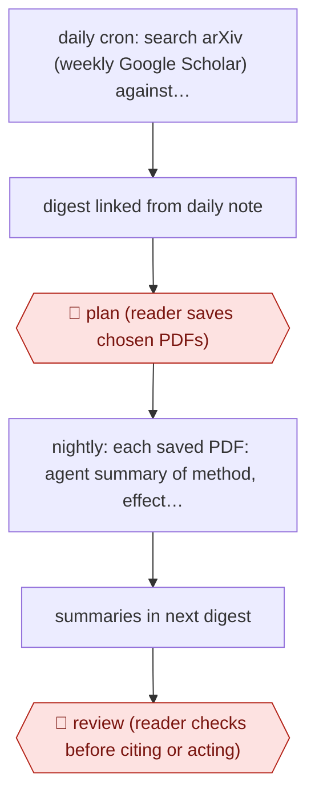

# Pick-then-summarise research digest

`ORG › XFN › PKM` · checkpointed · evidence A · **draft: needs a reference example** ([how to add one](../../../../../CONTRIBUTING.md#1-add-an-example-run))

**Shape:** `daily cron: search arXiv (weekly Google Scholar) against topic config, skip already-shown papers → digest linked from daily note → 🛑 plan (reader saves chosen PDFs) → nightly: each saved PDF: agent summary of method, effect size, evidence → summaries in next digest → 🛑 review (reader checks before citing or acting)`
**Variants:** `claude-code` · `obsidian` · `hermes-agent` · `netnewswire` · `github-pages`

<!-- shape diagram: generated by scripts/build_diagrams.py from `shape`; don't edit -->

<!-- end shape diagram -->

## Background

Researchers and practitioners who follow a field have to keep up with new papers, and far more appear each day than anyone can read. Checking the same search sites and deciding which results are worth opening is repetitive, and reading each chosen paper closely comes after that. Here a scheduled script searches for new papers on the reader's topics and lists them in a daily digest. The reader chooses which to keep, and only for those does the agent write a summary of the method, the size of the effect found and the evidence, instead of just repeating the abstract. The reader stays in the loop twice: the choice of papers is theirs, because they know what matters to their work, and they check each summary against the paper before citing it or acting on it, because a summary can misstate a method.

**Terms:**
- **arXiv, Google Scholar**: a free archive of research papers posted before or alongside journal publication, and a search engine for scholarly papers.
- **Preprint**: a paper posted publicly before peer review.
- **Digest**: a short page or note listing the day's new papers with links.
- **Effect size**: how large the measured difference or result in a study is, as opposed to whether it was merely detected.
- **Cron**: a scheduler on a computer that runs a script at set times, such as every morning.
- **RSS feed**: a subscription feed in which a journal or site lists its new articles for a reader program.
- **DOI**: a permanent identifier and link for a published paper.

## Build it with an agent

**Form:** `service`. A scheduled search and a nightly summary job run with nobody at the keyboard, and the reader sees only the digest and the summaries.

**You need:** a topic configuration file and a record of papers already shown; a search script for arXiv (and, once a week, Google Scholar, if your script can reach it); a daily note or digest page that the search writes to; a research folder where the reader drops the PDFs they choose; a place to run the jobs, such as the reader's own computer. The agent needs read access to the research folder and write access to the digest only.

| Step | Built as |
|---|---|
| daily cron: search arXiv (weekly Google Scholar) against topic config, skip already-shown papers | A plain script run by cron or another scheduler. It needs no agent: it queries the sites, drops papers in the seen record and writes the new ones to the day's digest. |
| digest linked from daily note | The same script adds the link. |
| 🛑 plan (reader saves chosen PDFs) | See Checkpoints. |
| nightly: each saved PDF: agent summary of method, effect size, evidence | A scheduled job (a cloud scheduled task where the folder is reachable from it, otherwise `claude -p` started by your own scheduler) runs a skill over each newly saved PDF; the skill asks for method, effect size and other evidence. |
| summaries in next digest | The job's last step appends each summary to the next day's digest, marked as not yet checked. |
| 🛑 review (reader checks before citing or acting) | See Checkpoints. |

**Checkpoints:** `plan`: the digest only lists papers; nothing is summarised until the reader saves a PDF into the research folder, and the nightly job is given that folder and nothing else. `review`: the summaries are labelled as unchecked and the agent has no tool to publish, cite or send them; the reader opens the paper and compares before relying on a summary.

**Since the sources:** Sources date from 2026-01 to 2026-05. Source 1 runs two Python scripts from cron on the owner's own computer and calls a Claude Code agent for the summary; this build keeps that split and names a cloud scheduled task as an alternative where the files are reachable from the cloud. Step 7 and source 2 describe a variant (Research Radar) built on other tools, a local feed reader, a scheduling layer called Hermes Agent and a different model, with a quality-check job; it is not part of the shape and this build does not reproduce it. The build makes no claim about how accurate the summaries are: source 1 reports one summary that helped its author find a flaw in a paper, and the reader's check is why the review step exists.

*A design based on this entry's steps and the tool documentation as of 2026-11, not a reported run.*

## Steps

*As reported by the sources.*

1. The reader keeps a config of research topics and a record of papers already shown [[1]](#sources).
2. Each morning a search script queries arXiv, and on Sundays Google Scholar too. New results go into a digest (a page of the day's new papers with links) linked from the dated /today note (the reader's daily to-do page) [[1]](#sources).
3. 🛑 **Plan**: the reader scans the digest and saves only promising PDFs to a research folder, which acts as the filter against overload [[1]](#sources).
4. Each night a script finds newly saved PDFs and has a Claude Code agent summarise methodology, effect size and other evidence, not just the abstract [[1]](#sources).
5. The summaries appear in the next day's digest [[1]](#sources).
6. 🛑 **Review**: the reader reads and checks each summary before using it. Torres used one to spot a methodological flaw that she then wrote up publicly [[1]](#sources).
7. Variant (Research Radar): a 09:15 cron job filters more than 20 RSS feeds against a research profile, gives each paper a level (read carefully, skim, awareness) with 'why it matters' notes, and a 10:00 QA (quality-check) job checks fields and DOIs. Then the page is committed to GitHub Pages and the author chooses what to read. The agent never adds to Zotero (a reference manager) or deletes anything [[2]](#sources).

**Output:** A daily digest page or note of new papers plus evidence-focused summaries of the papers the reader chose.
**Failure modes → guards:** Information overload → only reader-saved PDFs get deep summaries. A summary misstates the method → reader review before citing. Malformed output breaks the page → a separate QA cron fixes minor issues and blocks serious ones [[2]](#sources). Repeats → a seen-papers record in config.
**How it differs:** AWF-0087 Diff-reviewed vault upkeep. There the agent edits an existing vault on dictated instructions and the checkpoint is a git-diff review of the edits. Here the agent brings in new external literature on a schedule. The deliverable is a digest plus summaries, and the checkpoint is the reader choosing which papers get processed, then reading the summaries.

## Public runs

Coverage as of 2026-11-06: **Partial**: first-hand runs that cover part of the shape or put checkpoints elsewhere. Collected and re-checked in [Second collection pass](../../../../../research/2026-11-second-pass.md).

- [How I AI, Teresa Torres](https://www.chatprd.ai/how-i-ai/teresa-torres-claude-code-obsdian-task-management) (2026-01-19). Daily arXiv search, reader-saved PDFs, nightly evidence summaries; one summary exposed a flaw she wrote up. none stated beyond schedule (daily arXiv, Sunday Google Scholar, nightly summaries). *First-hand: interview; confidence: med.*
- [CHEN Yiru, Research Radar](https://chenyiru3.github.io/blog/2026/how-research-radar-works/) (2026-05-15). Personal daily pipeline with tiered recommendations, QA cron and published page; author decides what to read. "help me choose the 13 to 15 papers most worth reading that day". *First-hand: yes; confidence: med.*

## Sources

1. Claire Vo, How I AI: Teresa Torres's Claude Code system for task management, automated research, and 'lazy' prompting, 2026-01-19. https://www.chatprd.ai/how-i-ai/teresa-torres-claude-code-obsdian-task-management
2. CHEN Yiru, How the Research Radar works: an automated literature curation pipeline, 2026-05-15. https://chenyiru3.github.io/blog/2026/how-research-radar-works/
