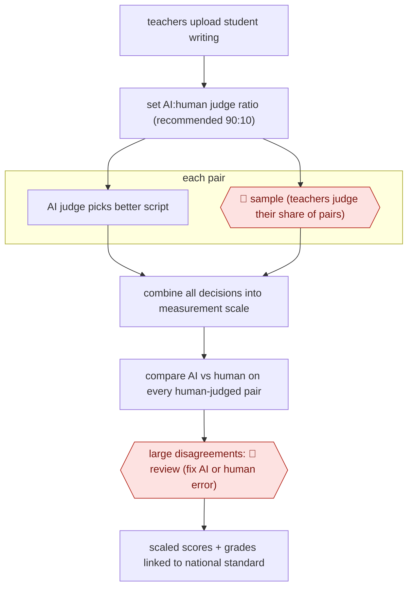

# AI-blended comparative judgement

`PRO › EDU › ASSESS` · sampled · evidence A · **draft: needs a reference example** ([how to add one](../../../../../CONTRIBUTING.md#1-add-an-example-run))

**Shape:** `teachers upload student writing → set AI:human judge ratio (recommended 90:10) → each pair: AI judge picks better script | 🛑 sample (teachers judge their share of pairs) → combine all decisions into measurement scale → compare AI vs human on every human-judged pair → large disagreements: 🛑 review (fix AI or human error) → scaled scores + grades linked to national standard`
**How it differs:** AWF-0028 Anchor-calibrated grader: there the AI gives an absolute rubric score per submission after calibration on anchors, and people sample low-confidence grades. Here the AI only makes pairwise comparisons, humans make a fixed share of the same comparisons alongside it, and a scaling model produces the scores. The human sample is built into the measurement itself, with a different deliverable (a cohort-wide scale) and checkpoint arrangement.
**Variants:** `no-more-marking`

<!-- shape diagram: generated by scripts/build_diagrams.py from `shape`; don't edit -->

<!-- end shape diagram -->

## Steps
1. Teachers upload their students' writing to the platform. Schools choose what share of judgements the AI makes; the recommended split is 90% AI, 10% human [[1]](#sources)[[2]](#sources).
2. Judges compare two pieces of writing and choose the better one, rather than marking each piece in isolation. The organisers found that absolute marking by an LLM 'would make baffling errors', so they moved to comparative judgements [[2]](#sources).
3. 🛑 **Sample**: teachers make their share of the comparative judgements. At 90/10, every response was seen on average 18 times by an AI and twice by a human teacher. One head of department completed her school's quota for 269 Year 7s in 1 hour 12 minutes [[1]](#sources).
4. All human and AI decisions are combined in a statistical model into a fine-grained scale (about 300-700) for every piece of writing [[2]](#sources)[[3]](#sources).
5. Every human-judged pair is checked against the AI. 🛑 **Review**: big disagreements (above 80 points) are inspected. Most turned out to be human error (wrong button, bad handwriting). A few AI errors, such as scripts of one or two words, were 'isolated and fixed... before sending out the results' [[2]](#sources)[[4]](#sources).
6. Release scaled scores and grades linked to live national standards [[1]](#sources).

**Output:** Scaled scores and grades for every student script, comparable across schools. Teachers and schools use them for reporting and moderation.
**Failure modes → guards:** AI 'right 80% of the time, and wrong when it matters most' → check the size of disagreements, not just the agreement rate [1]. Near-empty scripts confuse the AI → flagged and fixed before release [4]. Silent drift of AI judges → the 10% human share keeps every script seen twice by a human [3].

## Public runs

Coverage as of 2026-11-13: **Strong**: a first-hand, detailed run that matches most of the shape. Collected and re-checked in [Third collection pass](../../../../../research/2026-11-third-pass.md).

- [No More Marking, So, can AI assess writing?](https://substack.nomoremarking.com/p/so-can-ai-assess-writing) (2025-03-31). Year 7 writing from 44 schools judged by AI and teachers; agreement checked. "In total, our human judges made 3,640 decisions. Of these 3,640 decisions our AI agreed with 81% of them.". *First-hand: yes; confidence: high.*
- [No More Marking, AI is uncannily good at judging writing](https://substack.nomoremarking.com/p/ai-is-uncannily-good-at-judging-writing) (2025-10-25). Years 7-9 national assessment, most schools at 90% AI judgements. "approximately 70,000 pieces of writing completed by Year 7, 8 & 9 students from 177 UK secondary schools"; "The AI judges agreed with 83% of them". *First-hand: yes; confidence: high.*
- [No More Marking, Australia Term 1 2026](https://aus.nomoremarking.com/assessing-writing-in-australia-how-did-the-ai-judges-do-term-1-2026-05589e2cbdbe) (2026-03-05). Australian schools; first AI-caused big disagreements found and fixed before release. "the human judges completed 10,970 judgements. The AI judges agreed with 80% of those decisions". *First-hand: yes; confidence: high.*

## Sources

1. Daisy Christodoulou, Chris Wheadon (No More Marking), So, can AI assess writing?, 2025-03-31. https://substack.nomoremarking.com/p/so-can-ai-assess-writing
2. Daisy Christodoulou (No More Marking), AI is uncannily good at judging writing, 2025-10-25. https://substack.nomoremarking.com/p/ai-is-uncannily-good-at-judging-writing
3. Daisy Christodoulou, Chris Wheadon, The black box of AI assessment, 2026-04-25. https://substack.nomoremarking.com/p/the-black-box-of-ai-assessment
4. Daisy Christodoulou, Assessing writing in Australia: how did the AI judges do? Term 1 2026, 2026-03-05. https://aus.nomoremarking.com/assessing-writing-in-australia-how-did-the-ai-judges-do-term-1-2026-05589e2cbdbe
