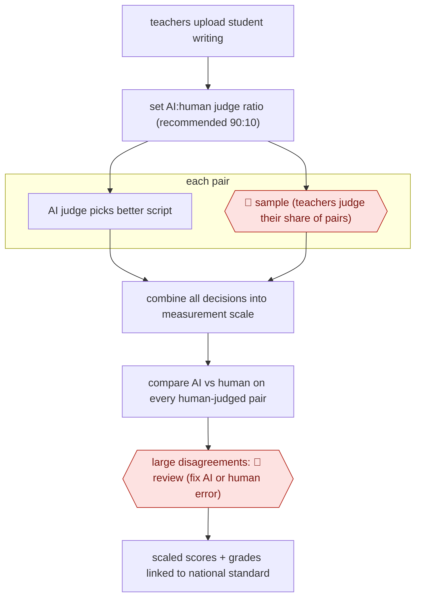

# AI-blended comparative judgement

`PRO › EDU › ASSESS` · sampled · evidence A · **draft: needs a reference example** ([how to add one](../../../../../CONTRIBUTING.md#1-add-an-example-run))

**Shape:** `teachers upload student writing → set AI:human judge ratio (recommended 90:10) → each pair: AI judge picks better script | 🛑 sample (teachers judge their share of pairs) → combine all decisions into measurement scale → compare AI vs human on every human-judged pair → large disagreements: 🛑 review (fix AI or human error) → scaled scores + grades linked to national standard`
**Variants:** `no-more-marking`

<!-- shape diagram: generated by scripts/build_diagrams.py from `shape`; don't edit -->

<!-- end shape diagram -->

## Background

A teacher's mark on a long piece of student writing is hard to make consistent: two markers often disagree, and each mark is made in isolation. Comparative judgement works differently. A judge sees two pieces of writing and chooses the better one, and a statistical model then combines thousands of these choices into a score for every piece. Doing all the judging by hand takes many teacher-hours across a cohort. Here an AI judge makes most of the choices and teachers make a fixed share of the same ones, so that the two can be compared. People stay in the process because the scores go into school reporting, and only a person can tell whether a large disagreement is the AI's error or a teacher's slip.

**Terms:**
- **Comparative judgement**: judging by choosing the better of two scripts, rather than giving each a mark.
- **Script**: one student's piece of work.
- **Scaled score**: a score on one shared scale (about 300-700 here) that the model derives from all the choices, so that scripts can be compared across schools.
- **Moderation**: checking that different teachers apply the same standard when marking.
- **Year 7**: the first year of secondary school in England and Wales, for students aged 11-12.

## Build it with an agent

**Form:** `platform`. A general agent can make the pairwise choices, but the scale shared across schools and the grades linked to a national standard come from the provider's service and its pooled data.

**You need:** the student scripts as files the agent can read (typed text, or scanned handwriting the model can transcribe); a list of pairs to judge, with a fixed share reserved for teachers; a screen where teachers make their choices; a script that fits a pairwise-comparison model; the platform, for the cross-school scale and the national-standard link. Student writing is children's personal data: confirm that the school or trust has approved sending it to the model before the agent sees any.

| Step | Built as |
|---|---|
| teachers upload student writing → set AI:human judge ratio | Files in one folder; the ratio is a setting in the pair-list script. On the platform, schools set it at upload. |
| each pair: AI judge picks better script | A skill that reads two scripts and returns the choice with a one-line reason. A dynamic workflow runs it over the AI's share of pairs, one subagent per batch. |
| 🛑 sample (teachers judge their share of pairs) | The reserved pairs go to teachers on a judging screen; the agent does not see them. |
| combine all decisions into measurement scale | A script that fits the model to all choices. A scale shared across schools needs the platform. |
| compare AI vs human on every human-judged pair → 🛑 review | A script lists each human-judged pair where the AI disagreed, with the gap in scale points, largest first. |
| scaled scores + grades linked to national standard | The platform. A general agent has no national-standard link. |

**Checkpoints:** `sample`: the pair list reserves the teachers' share before any judging starts, and the agent is given only the pairs assigned to it. `review`: the run stops at the list of large disagreements (the sources used a gap above 80 points) and the person decides, pair by pair, whether the AI or the human erred; the agent has no tool to release scores.

**Since the sources:** Sources date from 2025-03 to 2026-04, and the public runs from 2025-03 to 2026-03. Every source describes one provider's own platform, not a build anyone assembled from a general agent, so this design is the catalog's: it covers the judging, the human share and the disagreement check, and leaves the scale and standard link to the provider. The sources say that absolute marking by an LLM made baffling errors, which is why the build uses pairwise choices. The later source (2026-04) discusses how valid the AI's judgements are; this build adds nothing for that.

*A design based on this entry's steps and the tool documentation as of 2026-11, not a reported run.*

## Steps

*As reported by the sources.*

1. Teachers upload their students' writing to the platform. Schools choose what share of judgements the AI makes; the recommended split is 90% AI, 10% human [[1]](#sources)[[2]](#sources).
2. Judges (AI or teacher) compare two pieces of writing and choose the better one, rather than marking each piece in isolation. The organisers found that absolute marking by an LLM 'would make baffling errors', so they moved to comparative judgements [[2]](#sources).
3. 🛑 **Sample**: teachers make their share of the comparative judgements. At 90/10, every response was seen on average 18 times by an AI and twice by a human teacher. One head of department completed her school's quota for 269 Year 7s in 1 hour 12 minutes [[1]](#sources).
4. The provider combines all human and AI decisions in a statistical model into a fine-grained scale (about 300-700) for every piece of writing [[2]](#sources)[[3]](#sources).
5. The provider checks every human-judged pair against the AI. 🛑 **Review**: staff inspect big disagreements (above 80 points). Most turned out to be human error (wrong button, bad handwriting). A few AI errors, such as scripts of one or two words, were 'isolated and fixed... before sending out the results' [[2]](#sources)[[4]](#sources).
6. The provider releases scaled scores and grades linked to live national standards [[1]](#sources).

**Output:** Scaled scores and grades for every student script, comparable across schools. Teachers and schools use them for reporting and moderation.
**Failure modes → guards:** AI 'right 80% of the time, and wrong when it matters most' → check the size of disagreements, not just the agreement rate [1]. Near-empty scripts confuse the AI → flagged and fixed before release [4]. Silent drift of AI judges → the 10% human share keeps every script seen twice by a human [3].
**How it differs:** AWF-0028 Anchor-calibrated grader: there the AI gives an absolute rubric score per submission after calibration on anchors, and people sample low-confidence grades. Here the AI only makes pairwise comparisons, humans make a fixed share of the same comparisons alongside it, and a scaling model produces the scores. The human sample is built into the measurement itself, with a different deliverable (a cohort-wide scale) and checkpoint arrangement.

## Public runs

Coverage as of 2026-11-13: **Strong**: a first-hand, detailed run that matches most of the shape. Collected and re-checked in [Third collection pass](../../../../../research/2026-11-third-pass.md).

- [No More Marking, So, can AI assess writing?](https://substack.nomoremarking.com/p/so-can-ai-assess-writing) (2025-03-31). Year 7 writing from 44 schools judged by AI and teachers; agreement checked. "In total, our human judges made 3,640 decisions. Of these 3,640 decisions our AI agreed with 81% of them.". *First-hand: yes; confidence: high.*
- [No More Marking, AI is uncannily good at judging writing](https://substack.nomoremarking.com/p/ai-is-uncannily-good-at-judging-writing) (2025-10-25). Years 7-9 national assessment, most schools at 90% AI judgements. "approximately 70,000 pieces of writing completed by Year 7, 8 & 9 students from 177 UK secondary schools"; "The AI judges agreed with 83% of them". *First-hand: yes; confidence: high.*
- [No More Marking, Australia Term 1 2026](https://aus.nomoremarking.com/assessing-writing-in-australia-how-did-the-ai-judges-do-term-1-2026-05589e2cbdbe) (2026-03-05). Australian schools; first AI-caused big disagreements found and fixed before release. "the human judges completed 10,970 judgements. The AI judges agreed with 80% of those decisions". *First-hand: yes; confidence: high.*

## Sources

1. Daisy Christodoulou, Chris Wheadon (No More Marking), So, can AI assess writing?, 2025-03-31. https://substack.nomoremarking.com/p/so-can-ai-assess-writing
2. Daisy Christodoulou (No More Marking), AI is uncannily good at judging writing, 2025-10-25. https://substack.nomoremarking.com/p/ai-is-uncannily-good-at-judging-writing
3. Daisy Christodoulou, Chris Wheadon, The black box of AI assessment, 2026-04-25. https://substack.nomoremarking.com/p/the-black-box-of-ai-assessment
4. Daisy Christodoulou, Assessing writing in Australia: how did the AI judges do? Term 1 2026, 2026-03-05. https://aus.nomoremarking.com/assessing-writing-in-australia-how-did-the-ai-judges-do-term-1-2026-05589e2cbdbe
