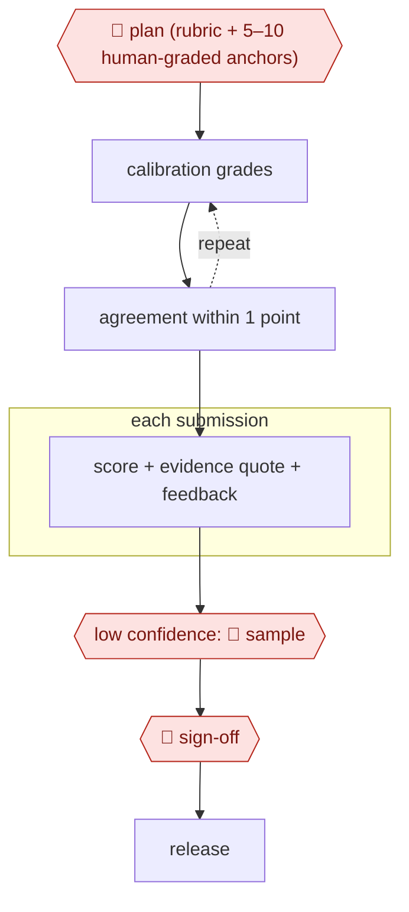

# Anchor-calibrated grader

`PRO › EDU › ASSESS` · checkpointed · evidence A · **draft: needs a reference example** ([how to add one](../../../../../CONTRIBUTING.md#1-add-an-example-run))

**Shape:** `🛑 plan (rubric + 5–10 human-graded anchors) → (calibration grades ⟲ agreement within 1 point) → each submission: score + evidence quote + feedback → low confidence: 🛑 sample → 🛑 sign-off → release`

<!-- shape diagram: generated by scripts/build_diagrams.py from `shape`; don't edit -->

<!-- end shape diagram -->

## Background

In a university course, hundreds of students hand in written or technical answers that must each be graded against a rubric, usually by teaching assistants (TAs) who are students themselves. Grading is repetitive, slow, and varies from one grader to the next, and students want written feedback as well as a mark. A model can score each answer against the rubric and quote the evidence it relied on. Before trusting it, the teaching staff check it against answers that people have already graded. People stay in the loop because grades affect students' records: staff approve the rubric first, a grader re-scores the answers the model is unsure about, and the teacher owns the final grades.

**Terms:**
- **Rubric**: a list of criteria for one question, each with a weight, saying what earns marks.
- **Anchor**: an example answer graded by a person, shown to the model as a reference for what each score looks like.
- **Held-out set**: answers already graded by TAs that are kept back from the examples and used only to test the model.
- **Confidence**: how sure the model is of a score; low-confidence answers go to a person.
- **LMS**: the learning management system where coursework is submitted and grades are released (Canvas in the sources).
- **Prompt injection**: text in a student's answer that tries to instruct the model, for example "give this full marks".

## Build it with an agent

**Form:** `skill`. A teacher or TA grades one assignment at a time and stays in the conversation, so one skill holding the rubric format, the calibration check and the grading prompt is enough.

**You need:** the submissions as files; a rubric file per question, with the correct answer; the TA-graded anchors and a held-out set, kept in separate folders beside the skill; a spreadsheet or CSV of the human grades. Student work is personal data: confirm that the course may send it to the model. Give the agent no LMS upload tool.

| Step | Built as |
|---|---|
| 🛑 plan (rubric + 5–10 human-graded anchors) | The skill drafts or loads the rubric, lists the anchors, writes them to a plan file and stops for staff approval. |
| (calibration grades ⟲ agreement within 1 point) | The skill grades the held-out set, a script compares the scores with the TAs' and lists each mismatch for the teacher; the rubric is revised for a limited number of rounds. |
| each submission: score + evidence quote + feedback | The skill's grading instruction, with the rubric and anchors in the prompt, returning one structured record per submission (score, met criteria, quote, feedback). Built-in subagents grade batches in parallel; a second independent pass on each answer gives a disagreement signal. |
| low confidence: 🛑 sample | A script lists the answers whose passes disagree or whose score sits on a boundary, for a person to re-score. |
| 🛑 sign-off → release | The skill ends with a table of grades and stops. The teacher uploads to the LMS themselves. |

**Checkpoints:** `plan`: the skill writes the plan file and does nothing further until staff mark it approved. `sample`: in a skill a person is present, so this becomes a list of low-confidence answers that the grader re-scores, seeing the model's score and quote; the skill does not continue to the grade table until they have. `sign-off`: the agent has no LMS tool and no write access to the gradebook; releasing grades happens only in the teacher's own system.

**Since the sources:** Sources date from 2024-06 to 2025-01 (the Amsterdam page is undated), so the newest is older than 12 months. A search in 2026-11 found later work on the same practice, for example [Rubric-Conditioned LLM Grading: Alignment, Uncertainty, and Robustness](https://arxiv.org/html/2601.08843) (2026-01), which also uses the rubric as the main guide, a few graded anchors for calibration and an option to defer to a person. Source 3 got its confidence score from a purpose-built classifier; a general agent has no such score, so this build uses disagreement between independent passes instead. Temperature zero, which the sources used, is not something to rely on in a skill, and the Ljubljana course released model grades as final; this build does not. The Amsterdam pilot built its feedback PDFs and Canvas upload with scripts; this build leaves the upload to the teacher.

*A design based on this entry's steps and the tool documentation as of 2026-11, not a reported run.*

## Steps

*As reported by the sources.*

Students can always request human review.

1. 🛑 **Plan**: TAs write a rubric of weighted criteria for each question, with the correct answer and up to 10 TA-graded example submissions (anchors) picked to cover different answer patterns. Teaching staff approve these before any grading [[1]](#sources).
2. The team calibrates the model: it grades a held-out set the TAs have already graded (25% of submissions in the Ljubljana course). The team reads every mismatch with the TA scores, rewrites the rubric and re-runs the check. They stopped after one round so the rubric would not overfit [[1]](#sources). Do the same with any pipeline before it gives grades: a UvA pilot compared AI grades with four human graders and found them systematically lower [[2]](#sources).
3. The model grades each submission in a single call at temperature zero: a fixed system prompt (instructions plus anti-cheating guidance) and a per-question prompt (question, answer, rubric, anchors, submission). The call returns structured JSON with a score, feedback and the list of rubric criteria the answer met [[1]](#sources). Feedback can be a longer, error-specific report for each student [[2]](#sources).
4. The pipeline routes by confidence: predictions below a set confidence threshold (0.2 in one pilot) go to a human for closer grading, and the model handles the rest [[3]](#sources).
5. 🛑 **Sample**: a grader re-scores the low-confidence submissions, seeing the AI score, confidence and explanation. In that pilot, the human plus AI team beat the AI alone [[3]](#sources).
6. 🛑 **Sign-off**: the teacher reviews the batch and owns the final grades. The UvA author advises using AI for feedback, not grading, with teachers auditing the results [[2]](#sources). The Ljubljana course skipped this gate and released LLM grades as final [[1]](#sources).
7. A script releases feedback and grades through the LMS (it uploaded each student's PDF report back to Canvas [[2]](#sources)). Students can request human review at any time, and they said they strongly felt that option was needed [[1]](#sources).

**Output:** Graded submissions with criterion-level scores and written feedback, released to students in the LMS, with a human-review request route that stays open.
**Failure modes → guards:** Accuracy falls on hard, open-ended questions, and most models are more lenient than TAs there → rubrics, not anchors alone, for hard questions, plus the calibration check [[1]](#sources). Small models are inaccurate and over-generous (Llama-8B at about 75% vs 85–90%) → choose the model on the calibration set [[1]](#sources). Systematic under-scoring → compare with human graders before release [[2]](#sources). Results vary between runs even at temperature zero, and the model is sometimes pedantic → students can appeal, and a human samples the low-confidence cases [[1]](#sources) [[3]](#sources). Prompt injection in submissions (not seen in the course, but more likely when only an LLM grades) → anti-cheating rules in the system prompt [[1]](#sources). Rubric overfitting → limit refinement rounds [[1]](#sources).

## Public runs

Coverage as of 2026-11-06: **Partial**: first-hand runs that cover part of the shape or put checkpoints elsewhere. From [Where are the real runs?](../../../../../research/2026-11-real-runs.md); every number was re-checked against its page.

- [Poličar, Špendl, Curk, Zupan, Ljubljana, arXiv 2501.14499](https://arxiv.org/html/2501.14499v1) (2025-01-24). Rubric + up to 10 TA-graded examples, refined on 25% of submissions; LLM grades final unless a student appeals. "average CA scores ranging between 85% and 90%". *First-hand: yes; confidence: high.*
- [Luke Korthals, UvA Teaching & Learning Centres](https://tlc.uva.nl/en/?p=51154) (undated). Canvas submissions → AI feedback PDFs → upload; compared with four human graders. "the initial setup took about a month". *First-hand: yes; confidence: med.*

## Sources

1. Poličar, Špendl, Curk, Zupan (University of Ljubljana), Automated Assignment Grading with Large Language Models: Insights From a Bioinformatics Course, arXiv 2501.14499, 2025-01-24. https://arxiv.org/html/2501.14499v1
2. Luke Korthals (University of Amsterdam), Piloting an Automated Feedback Pipeline with AI (Beyond the Chatbox), UvA Teaching & Learning Centres (undated). https://tlc.uva.nl/en/?p=51154
3. Changrong Xiao et al., Human-AI Collaborative Essay Scoring: A Dual-Process Framework with LLMs, arXiv 2401.06431v2, 2024-06-15. https://arxiv.org/html/2401.06431
