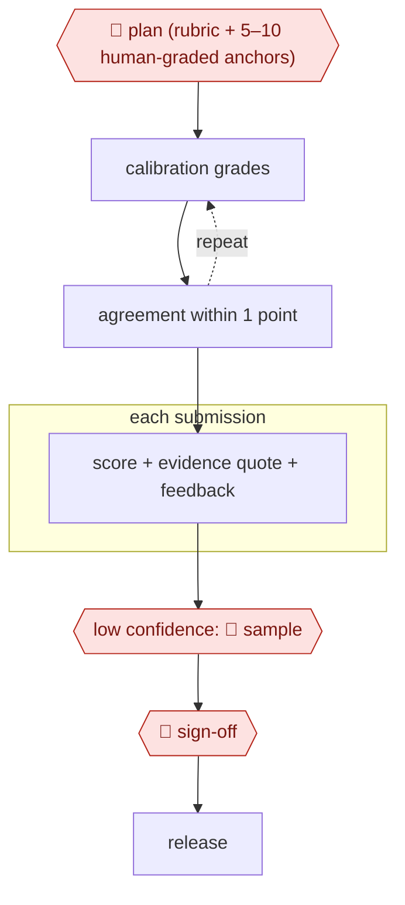

# Anchor-calibrated grader

`PRO › EDU › ASSESS` · checkpointed · evidence A · **draft: needs a reference example** ([how to add one](../../../../../CONTRIBUTING.md#1-add-an-example-run))

**Shape:** `🛑 plan (rubric + 5–10 human-graded anchors) → (calibration grades ⟲ agreement within 1 point) → each submission: score + evidence quote + feedback → low confidence: 🛑 sample → 🛑 sign-off → release`

<!-- shape diagram: generated by scripts/build_diagrams.py from `shape`; don't edit -->

<!-- end shape diagram -->

Students can always request human review.

## Steps
1. 🛑 **Plan**: TAs write a rubric of weighted criteria for each question, with the correct answer and up to 10 TA-graded example submissions picked to cover different answer patterns. Teaching staff approve these before any grading [[1]](#sources).
2. Calibrate: the model grades a held-out set the TAs have already graded (25% of submissions in the Ljubljana course). The team reads every mismatch with the TA scores, rewrites the rubric and re-runs the check. They stopped after one round so the rubric would not overfit [[1]](#sources). Do the same with any pipeline before it gives grades: a UvA pilot compared AI grades with four human graders and found them systematically lower [[2]](#sources).
3. Grade each submission in a single call at temperature zero: a fixed system prompt (instructions plus anti-cheating guidance) and a per-question prompt (question, answer, rubric, anchors, submission). The call returns structured JSON with a score, feedback and the list of rubric criteria the answer met [[1]](#sources). Feedback can be a longer, error-specific report for each student [[2]](#sources).
4. Route by confidence: send predictions below a set confidence threshold (0.2 in one pilot) to a human for closer grading, and let the model handle the rest [[3]](#sources).
5. 🛑 **Sample**: a grader re-scores the low-confidence submissions, seeing the AI score, confidence and explanation. In that pilot, the human plus AI team beat the AI alone [[3]](#sources).
6. 🛑 **Sign-off**: the teacher reviews the batch and owns the final grades. The UvA author advises using AI for feedback, not grading, with teachers auditing the results [[2]](#sources). The Ljubljana course skipped this gate and released LLM grades as final [[1]](#sources).
7. Release feedback and grades through the LMS (a script uploaded each student's PDF report back to Canvas [[2]](#sources)). Students can request human review at any time, and they said they strongly felt that option was needed [[1]](#sources).

**Output:** Graded submissions with criterion-level scores and written feedback, released to students in the LMS, with a human-review request route that stays open.
**Failure modes → guards:** Accuracy falls on hard, open-ended questions, and most models are more lenient than TAs there → rubrics, not anchors alone, for hard questions, plus the calibration check [[1]](#sources). Small models are inaccurate and over-generous (Llama-8B at about 75% vs 85–90%) → choose the model on the calibration set [[1]](#sources). Systematic under-scoring → compare with human graders before release [[2]](#sources). Results vary between runs even at temperature zero, and the model is sometimes pedantic → students can appeal, and a human samples the low-confidence cases [[1]](#sources) [[3]](#sources). Prompt injection in submissions (not seen in the course, but more likely when only an LLM grades) → anti-cheating rules in the system prompt [[1]](#sources). Rubric overfitting → limit refinement rounds [[1]](#sources).

## Public runs

Coverage as of 2026-11-06: **Partial**: first-hand runs that cover part of the shape or put checkpoints elsewhere. From [Where are the real runs?](../../../../../research/2026-11-real-runs.md); every number was re-checked against its page.

- [Poličar, Špendl, Curk, Zupan, Ljubljana, arXiv 2501.14499](https://arxiv.org/html/2501.14499v1) (2025-01-24). Rubric + up to 10 TA-graded examples, refined on 25% of submissions; LLM grades final unless a student appeals. "average CA scores ranging between 85% and 90%". *First-hand: yes; confidence: high.*
- [Luke Korthals, UvA Teaching & Learning Centres](https://tlc.uva.nl/en/?p=51154) (undated). Canvas submissions → AI feedback PDFs → upload; compared with four human graders. "the initial setup took about a month". *First-hand: yes; confidence: med.*

## Sources

1. Poličar, Špendl, Curk, Zupan (University of Ljubljana), Automated Assignment Grading with Large Language Models: Insights From a Bioinformatics Course, arXiv 2501.14499, 2025-01-24. https://arxiv.org/html/2501.14499v1
2. Luke Korthals (University of Amsterdam), Piloting an Automated Feedback Pipeline with AI (Beyond the Chatbox), UvA Teaching & Learning Centres (undated). https://tlc.uva.nl/en/?p=51154
3. Changrong Xiao et al., Human-AI Collaborative Essay Scoring: A Dual-Process Framework with LLMs, arXiv 2401.06431v2, 2024-06-15. https://arxiv.org/html/2401.06431
