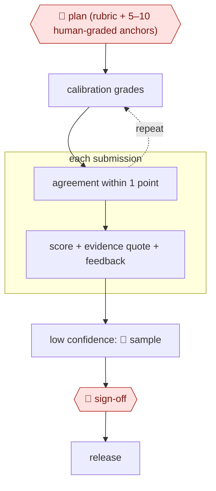

# Anchor-calibrated grader

`PRO › EDU › ASSESS` · checkpointed · evidence A · **draft: needs a reference example** ([how to add one](../../../../../CONTRIBUTING.md#1-add-an-example-run))

**Shape:** `🛑 plan (rubric + 5–10 human-graded anchors) → (calibration grades ⟲ agreement within 1 point) → each submission: score + evidence quote + feedback → low confidence: 🛑 sample → 🛑 sign-off → release`

<!-- shape diagram: generated by scripts/build_diagrams.py from `shape`; don't edit -->

<!-- end shape diagram -->

Students can always request human review.

## Public runs

Coverage as of 2026-11-06: **Partial**: first-hand runs that cover part of the shape or put checkpoints elsewhere. From [Where are the real runs?](../../../../../research/2026-11-real-runs.md); every number was re-checked against its page.

- [Poličar, Špendl, Curk, Zupan, Ljubljana, arXiv 2501.14499](https://arxiv.org/html/2501.14499v1) (2025-01-24). Rubric + up to 10 TA-graded examples, refined on 25% of submissions; LLM grades final unless a student appeals. "average CA scores ranging between 85% and 90%". *First-hand: yes; confidence: high.*
- [Luke Korthals, UvA Teaching & Learning Centres](https://tlc.uva.nl/en/?p=51154) (undated). Canvas submissions → AI feedback PDFs → upload; compared with four human graders. "the initial setup took about a month". *First-hand: yes; confidence: med.*

