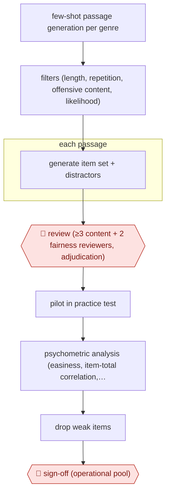

# Generated item bank

`PRO › EDU › ASSESS` · checkpointed · evidence A · **draft: needs a reference example** ([how to add one](../../../../../CONTRIBUTING.md#1-add-an-example-run))

**Shape:** `few-shot passage generation per genre → filters (length, repetition, offensive content, likelihood) → each passage: generate item set + distractors → 🛑 review (≥3 content + 2 fairness reviewers, adjudication) → pilot in practice test → psychometric analysis (easiness, item-total correlation, distractor discrimination) → drop weak items → 🛑 sign-off (operational pool)`
**How it differs:** Closest is AWF-0028 Anchor-calibrated grader (ASSESS), which scores student work. This one produces the test items themselves, gated by panel content and fairness review and by pilot psychometrics, so the deliverable and checkpoints differ.
**Variants:** `gpt3-duolingo-item-factory` · `gpt4`

<!-- shape diagram: generated by scripts/build_diagrams.py from `shape`; don't edit -->

<!-- end shape diagram -->

## Steps
1. A language model generates thousands of reading passages in three genres (news, expository, narrative) from 3–5 examples per genre [[1]](#sources).
2. Automatic filters drop passages by length, repeated 8-grams, offensive content and sentence-likelihood thresholds [[1]](#sources).
3. Each passage gets a full item set: vocabulary-in-context, text completion, two comprehension questions, main idea and title, with generated distractors [[1]](#sources).
4. 🛑 **Review**: each item gets at least three content reviews and two fairness reviews from 12 external and six internal reviewers, then adjudication; 454 of 789 passages survived [[1]](#sources). Later DET pipelines add automated linguistic and social-appropriateness checks before expert copyedit, fact-check and bias review [[2]](#sources).
5. Surviving passages are piloted at the end of the free practice test, then analyzed psychometrically. Distractors that fail discrimination analysis are dropped [[1]](#sources).
6. 🛑 **Sign-off**: the assessment team accepts the calibrated items into the operational pool [[1]](#sources)[[2]](#sources).

**Output:** A pool of reviewed, pilot-calibrated items for a high-stakes adaptive test.
**Failure modes → guards:** Fluent but flawed or biased items → multi-reviewer content and fairness review with adjudication, then pilot statistics [[1]](#sources). Weak distractors → discrimination analysis removes them; items with correlation below 0.1 fell from about 6% to 2% [[1]](#sources).

## Public runs

Coverage as of 2026-11-06: **Strong**: a first-hand, detailed run that matches most of the shape. Collected and re-checked in [Second collection pass](../../../../../research/2026-11-second-pass.md).

- [Attali et al., The interactive reading task](https://www.frontiersin.org/articles/10.3389/frai.2022.903077/full) (2022-07-22). Duolingo English Test generated passages, multi-reviewer screening, pilot with ~200k sessions. "a final set of 454 out of 789 passages (58%) were retained". *First-hand: yes; confidence: high.*

## Sources

1. Attali et al., The interactive reading task: Transformer-based automatic item generation, Frontiers in AI, 2022-07-22. https://www.frontiersin.org/articles/10.3389/frai.2022.903077/full
2. Burstein, Cardwell, Chuang, Michalowski, Nydick (Duolingo), Exploring AI-Enabled Test Practice, Affect, and Test Outcomes in Language Assessment, AIMECon 2025. https://aclanthology.org/2025.aimecon-main.7.pdf
