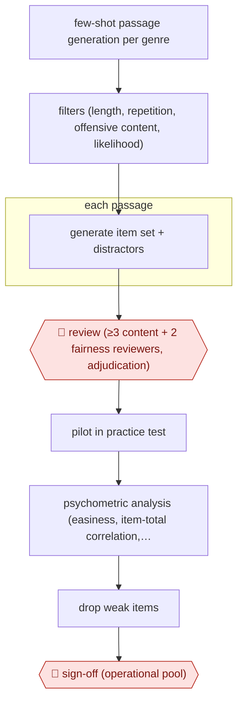

# Generated item bank

`PRO › EDU › ASSESS` · checkpointed · evidence A · **draft: needs a reference example** ([how to add one](../../../../../CONTRIBUTING.md#1-add-an-example-run))

**Shape:** `few-shot passage generation per genre → filters (length, repetition, offensive content, likelihood) → each passage: generate item set + distractors → 🛑 review (≥3 content + 2 fairness reviewers, adjudication) → pilot in practice test → psychometric analysis (easiness, item-total correlation, distractor discrimination) → drop weak items → 🛑 sign-off (operational pool)`
**Variants:** `gpt3-duolingo-item-factory` · `gpt4`

<!-- shape diagram: generated by scripts/build_diagrams.py from `shape`; don't edit -->

<!-- end shape diagram -->

## Background

A language test needs a large pool of questions, and for a test taken at home that may be retaken, each test taker should see fresh ones. Writing them by hand is slow: a reading question needs a passage, several questions about it and wrong answers (distractors) that look plausible but are clearly wrong to someone who understood the passage. A language model can draft passages and questions in volume, but it can produce fluent items that are flawed or biased against some groups. So reviewers with expert and fairness training read each item, and the items are then tried out on real test takers and measured statistically before any counts toward a score. A person must accept items into the live pool because a bad item on a high-stakes test affects real decisions about test takers.

**Terms:**
- **Item**: one test question with its answer options.
- **Distractor**: a wrong answer option written to be plausible.
- **Few-shot**: giving the model a few examples of the wanted output in the prompt.
- **8-gram**: a run of eight consecutive words; repeated ones signal repetitive text.
- **Fairness review**: a check that an item does not disadvantage a group of test takers, for example through culture-specific knowledge.
- **Pilot**: trying new items on real test takers without them counting towards scores.
- **Psychometric analysis**: statistics on how items behave: how easy each is, whether people who do well overall tend to get it right (item-total correlation), and whether the right option and the distractors separate stronger from weaker test takers (discrimination).
- **Operational pool**: the items the live test actually draws from.
- **DET**: the Duolingo English Test.

## Build it with an agent

**Form:** `platform`. A general agent can run the generation, filtering, review packets and statistics, but the pilot needs a live test with real test takers, which only the test platform provides.

**You need:** example passages for each genre; a rubric for content and fairness review; a list of reviewers and a place where they record their verdicts; item-response data from the pilot, exported from the test platform; an approval step owned by the assessment team. Never send pilot data that identifies test takers to the agent.

| Step | Built as |
|---|---|
| few-shot passage generation per genre → filters | A skill with 3–5 examples per genre in a reference file; a script applies the length, repeated 8-gram, offensive-content and sentence-likelihood filters. The likelihood filter needs a model that gives token probabilities, which a general agent may not have; leave it out or run it in your own script. |
| each passage: generate item set + distractors | A dynamic workflow runs one subagent per passage, which returns the item set in a fixed format. |
| 🛑 review | Review packets (passage, items, rubric) go to the content and fairness reviewers in whatever tool they use; verdicts come back as a file. The agent only tallies them and lists items needing adjudication. |
| pilot in practice test | The test platform. A general agent has no part in it. |
| psychometric analysis → drop weak items | A script on the exported pilot data computes easiness, item-total correlation and distractor discrimination; the agent lists the items that fall under the team's thresholds. |
| 🛑 sign-off (operational pool) | The assessment team accepts items in the test platform; the agent has no write access to the live pool. |

**Checkpoints:** `review`: nothing is exported for piloting until the verdicts file shows the required number of content and fairness reviews for every item and any adjudication done; the export script refuses an item that lacks them. `sign-off`: the agent can read pilot statistics but has no tool that writes to the operational pool.

**Since the sources:** Source 1 dates from 2022-07; source 2 is from 2025 (the page gives no month, and its PDF would not read as text through the page reader here, so it was not re-checked). A search in 2026-11 found Duolingo material from 2026 describing the same arrangement of generation followed by staged expert review before items reach the operational bank, for example the [AIMECON 2026 paper](https://aclanthology.org/2026.aimecon-sessions.12.pdf); no change to the review was found there. Source 1 used an early transformer model that needed 3–5 examples; current models need less hand-built machinery for generation itself, but the filters, the multi-reviewer panel and the pilot statistics are not replaced by a better model. The sources describe a vendor's own pipeline; this build does not reproduce its infrastructure.

*A design based on this entry's steps and the tool documentation as of 2026-11, not a reported run.*

## Steps

*As reported by the sources.*

1. A language model generates thousands of reading passages in three genres (news, expository, narrative) from 3–5 examples per genre [[1]](#sources).
2. Automatic filters drop passages by length, repeated 8-grams, offensive content and sentence-likelihood thresholds [[1]](#sources).
3. The model gives each passage a full item set: vocabulary-in-context, text completion, two comprehension questions, main idea and title, with generated distractors [[1]](#sources).
4. 🛑 **Review**: each item gets at least three content reviews and two fairness reviews from 12 external and six internal reviewers, then adjudication; 454 of 789 passages survived [[1]](#sources). Later DET pipelines add automated linguistic and social-appropriateness checks before expert copyedit, fact-check and bias review [[2]](#sources).
5. Surviving passages are piloted at the end of the free practice test, then analyzed psychometrically. Distractors that fail discrimination analysis are dropped [[1]](#sources).
6. 🛑 **Sign-off**: the assessment team accepts the calibrated items into the operational pool [[1]](#sources)[[2]](#sources).

**Output:** A pool of reviewed, pilot-calibrated items for a high-stakes adaptive test.
**Failure modes → guards:** Fluent but flawed or biased items → multi-reviewer content and fairness review with adjudication, then pilot statistics [[1]](#sources). Weak distractors → discrimination analysis removes them; items with correlation below 0.1 fell from about 6% to 2% [[1]](#sources).
**How it differs:** Closest is AWF-0028 Anchor-calibrated grader (ASSESS), which scores student work. This one produces the test items themselves, gated by panel content and fairness review and by pilot psychometrics, so the deliverable and checkpoints differ.

## Public runs

Coverage as of 2026-11-06: **Strong**: a first-hand, detailed run that matches most of the shape. Collected and re-checked in [Second collection pass](../../../../../research/2026-11-second-pass.md).

- [Attali et al., The interactive reading task](https://www.frontiersin.org/articles/10.3389/frai.2022.903077/full) (2022-07-22). Duolingo English Test generated passages, multi-reviewer screening, pilot with ~200k sessions. "a final set of 454 out of 789 passages (58%) were retained". *First-hand: yes; confidence: high.*

## Sources

1. Attali et al., The interactive reading task: Transformer-based automatic item generation, Frontiers in AI, 2022-07-22. https://www.frontiersin.org/articles/10.3389/frai.2022.903077/full
2. Burstein, Cardwell, Chuang, Michalowski, Nydick (Duolingo), Exploring AI-Enabled Test Practice, Affect, and Test Outcomes in Language Assessment, AIMECon 2025. https://aclanthology.org/2025.aimecon-main.7.pdf
