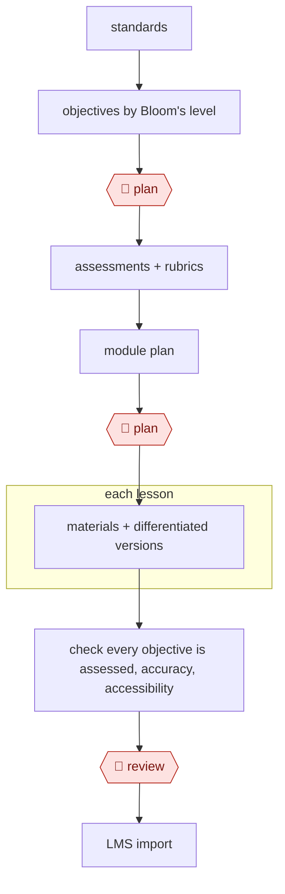

# Backward-design course

`PRO › EDU › COURSE` · assist · evidence A · **draft: needs a reference example** ([how to add one](../../../../../CONTRIBUTING.md#1-add-an-example-run))

**Shape:** `standards → objectives by Bloom's level → 🛑 plan → assessments + rubrics → module plan → 🛑 plan → each lesson: materials + differentiated versions → check every objective is assessed, accuracy, accessibility → 🛑 review → LMS import`

<!-- shape diagram: generated by scripts/build_diagrams.py from `shape`; don't edit -->

<!-- end shape diagram -->

## Background

Building a course is slow because each part has to fit the others. Backward design, the usual method, starts at the end: first decide what students should be able to do (the learning objectives), then how to tell whether they can (assessments), and only then plan the lessons. An instructor does this for every module, then writes the materials, versions for students who need more support, and checks that every objective is actually assessed. An agent can draft each layer and run the alignment checks. The instructor stays in charge, because they know the subject and their students, and because a course that tests the wrong thing or contains an error harms the people who take it.

**Terms:**
- **Learning objective**: a measurable statement of what a student will be able to do after a module or course.
- **Bloom's level**: a ladder of thinking skills (remember, understand, apply, analyse, evaluate, create) used to label how demanding an objective is.
- **Rubric**: a scoring guide listing the criteria an assessed piece of work is judged on.
- **Scaffolded assignment**: a larger task broken into smaller graded parts.
- **Course map**: a table that links each objective to the materials, activities and assessments that serve it.
- **Differentiated version**: a variant of a lesson material adjusted for students at different levels.
- **Accessibility**: whether students with disabilities can use the material, for example through captions and readable structure.
- **LMS**: the learning management system where students find a course's content and submit work.
- **Instructional designer**: a specialist who helps instructors structure courses.

## Build it with an agent

**Form:** `skill`. One instructor builds one course and stays in the conversation, so a single skill that works through the layers in order, stopping at the two approvals, is enough.

**You need:** the course standards or goals, grade level and subject; any existing syllabus or readings the instructor wants used; a place on disk to write the course map and lesson files; a way to produce files your LMS imports, or the instructor's own manual upload. Do not give the agent any student personal data or university-internal information, and no LMS write access.

| Step | Built as |
|---|---|
| standards → objectives by Bloom's level | The skill drafts course- and module-level objectives, labels each with a Bloom's level and charts the spread. A subagent with a fresh context can check them against stated criteria. |
| 🛑 plan | The skill writes the objectives to a plan file and stops. |
| assessments + rubrics → module plan | The skill drafts an assessment and rubric for each objective, then the course map linking everything to the objectives. |
| 🛑 plan | The skill writes the course map to a file and stops again before any lesson material. |
| each lesson: materials + differentiated versions | One pass per lesson in the main conversation; built-in subagents can write several lessons in parallel. |
| check every objective is assessed, accuracy, accessibility | A script lists any objective with no assessment in the course map; a read-only subagent checks accuracy and accessibility and returns a list of issues. |
| 🛑 review → LMS import | The skill presents the content and stops. The instructor imports into the LMS. |

**Checkpoints:** `plan`: the skill stops twice, after the objectives and after the course map, and creates no lesson material until the instructor marks the plan file approved; a permission rule set to ask before any write under the lessons folder makes this firm. `review`: the skill ends with the full content and the issues list, with the instructor reviewing it using their own subject knowledge; the agent has no LMS tool, so nothing reaches students without the instructor.

**Since the sources:** Source 1 dates from 2025-03; source 2 is undated. A search in 2026-11 found later guidance with the same order of work, for example [UConn eCampus, Using GenAI for course design](https://ecampus.uconn.edu/2026/04/22/using-genai-for-course-design/) (2026-04), whose example prompts follow backward design; no independent evaluation of such a workflow was found. Source 1's system (ARCHED) used separate agents for generating and analysing objectives, which this build gives to a subagent check; it has no LMS integration, and this build does not add one. Source 2 is university guidance for instructors using a chat tool, not an agent run; the sources do not report anyone running this whole sequence.

*A design based on this entry's steps and the tool documentation as of 2026-11, not a reported run.*

## Steps

*As reported by the sources.*

1. The educator starts from standards and course goals: they set grade level, subject and target Bloom's levels [[1]](#sources) and summarize the course goals [[2]](#sources). Then they draft measurable course- and module-level objectives with AI, then refine them [[2]](#sources). In ARCHED, one agent generates objectives and a second analyses them against pedagogical criteria and charts the spread across cognitive levels; the educator regenerates and picks which to keep [[1]](#sources).
2. 🛑 **Plan**: the instructor approves the objective set, checking Bloom's levels most closely at adjacent levels around Understanding, where classification errors cluster [[1]](#sources).
3. The instructor and AI write assessments and rubrics aligned to each objective. TWU's example prompt asks for a scoring rubric for each part of a scaffolded assignment, which the instructor then tailors [[2]](#sources). ARCHED did not evaluate assessment generation [[1]](#sources).
4. The instructor builds the module plan as a course map linking materials, activities and assessments to the objectives [[2]](#sources).
5. 🛑 **Plan**: the instructor approves the course map before any lesson materials are made.
6. For each lesson, the AI generates materials (lecture or slide content, discussion prompts, activities, scaffolded assignments) with context such as grade level, time limits and where students struggle [[2]](#sources), plus differentiated versions.
7. The instructor checks that every objective is assessed by adding each generated item to the course map [[2]](#sources), then checks accuracy and accessibility.
8. 🛑 **Review**: the instructor reviews all content with their own subject knowledge, with an instructional designer for support [[2]](#sources).
9. The approved course is imported into the LMS. ARCHED has no LMS integration, which a pilot expert called a gap [[1]](#sources).

**Output:** An aligned course (objectives, assessments with rubrics, module map and lesson materials) imported into the LMS.
**Failure modes → guards:** Objectives filed at the wrong Bloom's level → an analysis pass and instructor approval [[1]](#sources). AI planning the whole course or replacing the instructor's expertise → a human-in-the-loop approach where the instructor iterates and decides [[2]](#sources). Materials that drift from the objectives → the course-map alignment check [[2]](#sources). Student privacy → never share personal student or university information with the AI [[2]](#sources).

## Public runs

Coverage as of 2026-11-06: **None found**: no public first-hand run yet. A real example run would be the first. From [Where are the real runs?](../../../../../research/2026-11-real-runs.md); every number was re-checked against its page.

## Sources

1. Hongming Li, Yizirui Fang, Shan Zhang, Seiyon M. Lee, Yiming Wang, Mark Trexler, Anthony F. Botelho, ARCHED (arXiv 2503.08931v1, iRAISE workshop at AAAI 2025), 2025-03-11. https://arxiv.org/html/2503.08931v1
2. Texas Woman's University, Teaching & Learning Guides, Supporting Course Design with AI, undated. https://sites.google.com/twu.edu/tltteachinglearningguides/supporting-course-design-with-ai
