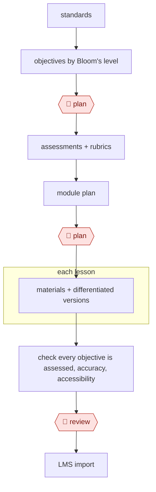

# Backward-design course

`PRO › EDU › COURSE` · assist · evidence A · **draft: needs a reference example** ([how to add one](../../../../../CONTRIBUTING.md#1-add-an-example-run))

**Shape:** `standards → objectives by Bloom's level → 🛑 plan → assessments + rubrics → module plan → 🛑 plan → each lesson: materials + differentiated versions → check every objective is assessed, accuracy, accessibility → 🛑 review → LMS import`

<!-- shape diagram: generated by scripts/build_diagrams.py from `shape`; don't edit -->

<!-- end shape diagram -->

## Steps
1. Start from standards and course goals: the educator sets grade level, subject and target Bloom's levels [[1]](#sources) and summarizes the course goals [[2]](#sources). Then draft measurable course- and module-level objectives with AI, then refine them [[2]](#sources). In ARCHED, one agent generates objectives and a second analyses them against pedagogical criteria and charts the spread across cognitive levels; the educator regenerates and picks which to keep [[1]](#sources).
2. 🛑 **Plan**: the instructor approves the objective set, checking Bloom's levels most closely at adjacent levels around Understanding, where classification errors cluster [[1]](#sources).
3. Write assessments and rubrics aligned to each objective. TWU's example prompt asks for a scoring rubric for each part of a scaffolded assignment, which the instructor then tailors [[2]](#sources). ARCHED did not evaluate assessment generation [[1]](#sources).
4. Build the module plan as a course map linking materials, activities and assessments to the objectives [[2]](#sources).
5. 🛑 **Plan**: the instructor approves the course map before any lesson materials are made.
6. For each lesson, generate materials (lecture or slide content, discussion prompts, activities, scaffolded assignments) with context such as grade level, time limits and where students struggle [[2]](#sources), plus differentiated versions.
7. Check that every objective is assessed by adding each generated item to the course map [[2]](#sources), then check accuracy and accessibility.
8. 🛑 **Review**: the instructor reviews all content with their own subject knowledge, with an instructional designer for support [[2]](#sources).
9. Import the approved course into the LMS. ARCHED has no LMS integration, which a pilot expert called a gap [[1]](#sources).

**Output:** An aligned course (objectives, assessments with rubrics, module map and lesson materials) imported into the LMS.
**Failure modes → guards:** Objectives filed at the wrong Bloom's level → an analysis pass and instructor approval [[1]](#sources). AI planning the whole course or replacing the instructor's expertise → a human-in-the-loop approach where the instructor iterates and decides [[2]](#sources). Materials that drift from the objectives → the course-map alignment check [[2]](#sources). Student privacy → never share personal student or university information with the AI [[2]](#sources).

## Public runs

Coverage as of 2026-11-06: **None found**: no public first-hand run yet. A real example run would be the first. From [Where are the real runs?](../../../../../research/2026-11-real-runs.md); every number was re-checked against its page.

## Sources

1. Hongming Li, Yizirui Fang, Shan Zhang, Seiyon M. Lee, Yiming Wang, Mark Trexler, Anthony F. Botelho, ARCHED (arXiv 2503.08931v1, iRAISE workshop at AAAI 2025), 2025-03-11. https://arxiv.org/html/2503.08931v1
2. Texas Woman's University, Teaching & Learning Guides, Supporting Course Design with AI, undated. https://sites.google.com/twu.edu/tltteachinglearningguides/supporting-course-design-with-ai
