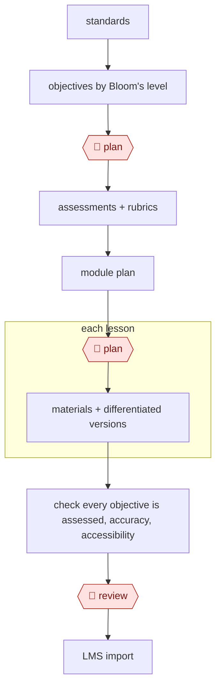

# Backward-design course

`PRO › EDU › COURSE` · assist · evidence A · **draft: needs a reference example** ([how to add one](../../../../../CONTRIBUTING.md#1-add-an-example-run))

**Shape:** `standards → objectives by Bloom's level → 🛑 plan → assessments + rubrics → module plan → 🛑 plan → each lesson: materials + differentiated versions → check every objective is assessed, accuracy, accessibility → 🛑 review → LMS import`

<!-- shape diagram: generated by scripts/build_diagrams.py from `shape`; don't edit -->

<!-- end shape diagram -->

## Public runs

Coverage as of 2026-11-06: **None found**: no public first-hand run yet. A real example run would be the first. From [Where are the real runs?](../../../../../research/2026-11-real-runs.md); every number was re-checked against its page.

