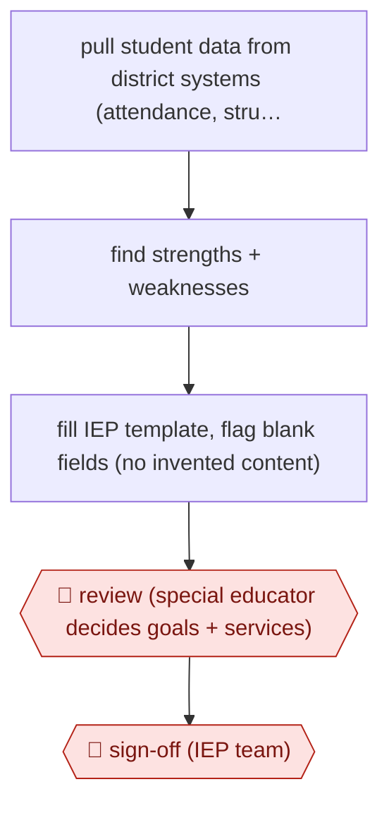

# Data-informed IEP draft

`PRO › EDU › COURSE` · assist · evidence A · **draft: needs a reference example** ([how to add one](../../../../../CONTRIBUTING.md#1-add-an-example-run))

**Shape:** `pull student data from district systems (attendance, struggling subjects) → find strengths + weaknesses → fill IEP template, flag blank fields (no invented content) → 🛑 review (special educator decides goals + services) → 🛑 sign-off (IEP team)`
**Variants:** `panorama-education`

<!-- shape diagram: generated by scripts/build_diagrams.py from `shape`; don't edit -->

<!-- end shape diagram -->

## Background

In US public schools, a student with a disability who qualifies for special education has an individualized education program (IEP): a written plan, required by law, that sets the student's goals and the services the school will provide. A special educator writes it, drawing on the student's records, which sit in several district systems, and then a team that includes the family and school staff meets to agree it. Pulling the records together and writing a first draft takes hours for each student. The agent gathers the data, points out patterns and fills the district's template, leaving blank anything the records do not support. A person still decides every goal and service, because the plan is legally binding on the district and shapes what the student receives, and the team's agreement is a legal step that cannot be delegated.

**Terms:**
- **IEP (individualized education program)**: the legally binding written plan for one student's special education goals and services.
- **Special educator**: the teacher trained to write and carry out IEPs.
- **IEP team**: the group, including the student's family and school staff, that agrees the plan at a meeting.
- **Intervention**: a specific support or teaching approach written into the plan.
- **District platforms**: the school district's own systems that hold attendance, grades and other student records.

## Build it with an agent

**Form:** `skill`. A special educator drafts one student's IEP at a time and stays in the conversation, so one skill that reads the records, fills the template and stops is enough.

**You need:** read-only access, through an MCP connector or exported files, to the one student's attendance and subject records; the district's IEP template as a file the skill fills; a setup that the district has reviewed for compliance and student privacy, as the district in the source did for its tool, and not a general chatbot. Give the agent access to one student at a time, and no tool that writes to district systems or sends a document.

| Step | Built as |
|---|---|
| pull student data from district systems | An MCP connector or export script that returns the one student's records, read-only. |
| find strengths + weaknesses | The skill summarises patterns in the records as input for goal-writing. It is told not to propose goals or interventions as decisions. |
| fill IEP template, flag blank fields (no invented content) | The skill fills the template and writes `NOT IN RECORDS` in any field the data does not support. A script checks that no field is empty without that marker. |
| 🛑 review | The skill stops and presents the draft and the list of blank fields. The special educator writes the goals and services. |
| 🛑 sign-off | The IEP team meets and signs in the district's own process; the agent has no tool to send, file or sign. |

**Checkpoints:** `review`: the skill ends with the draft and the blank-field list and stops; goals and services are entered by the special educator. `sign-off`: the sign-off is the existing legal IEP process; the agent has no mail, filing or signature tool, and its connector is read-only.

**Since the sources:** The single source dates from 2026-10. It is a news report on one district's own tool, with no detail of how it works inside, so the steps are as described to a reporter and this build is the catalog's design, not that tool. The tool in `variants` (`panorama-education`) is a vendor platform. A general agent with a skill has no built-in connection to district systems, and the connector and its privacy review are the district's to arrange. The source says the district reviewed the platform for state and federal compliance and student data privacy before launch; this build cannot show that review is done.

*A design based on this entry's steps and the tool documentation as of 2026-11, not a reported run.*

## Steps

*As reported by the sources.*

1. The tool pulls each student's records from several district platforms, such as attendance trends and subjects where the student is struggling [[1]](#sources).
2. The AI looks for patterns, strengths and weaknesses to inform goal-writing. It is not meant to make IEP decisions or dictate interventions [[1]](#sources).
3. Working from the district's IEP template, the tool drafts the document and flags fields left blank rather than inventing content [[1]](#sources).
4. 🛑 **Review**: the special educator makes the final call on goals and interventions [[1]](#sources).
5. 🛑 **Sign-off**: the draft goes to the IEP team. The article doesn't describe this stage; it is the existing legal IEP process, which the district says the tool does not change [[1]](#sources).
6. Before launch, the platform went through district review for state and federal compliance and for student data privacy [[1]](#sources).

**Output:** A teacher-reviewed IEP draft brought to the IEP team meeting.
**Failure modes → guards:** Data spreading across systems, AI bias and undisclosed reasoning, all raised by a privacy advocate → a vetted district platform instead of general chatbots, plus compliance and privacy review; the advocate also urges telling families and offering an opt-out, which the district hasn't done [[1]](#sources). Invented content → the tool flags blanks instead of filling them [[1]](#sources).
**How it differs:** Closest is AWF-0027 Backward-design course (COURSE). That one designs curriculum for a whole class. This one drafts a legally binding individual plan from one student's records, gated by a special educator and the IEP team, at high risk. Class fit note: an IEP touches assessment too, but its deliverable is an instructional plan.

## Public runs

Coverage as of 2026-11-06: **Partial**: first-hand runs that cover part of the shape or put checkpoints elsewhere. Collected and re-checked in [Second collection pass](../../../../../research/2026-11-second-pass.md).

- [Education Week, How AI tools halved this district's IEP prep time](https://www.edweek.org/teaching-learning/how-ai-tools-halved-this-districts-iep-prep-time/2026/10) (2026-10-28). Mesquite ISD (TX) has used a district-vetted IEP drafting tool for 11 months. "about 45 minutes" per student (from up to three hours). *First-hand: interview; confidence: med.*

## Sources

1. Caitlynn Peetz Stephens, Education Week, How AI tools halved this district's IEP prep time, 2026-10-28. https://www.edweek.org/teaching-learning/how-ai-tools-halved-this-districts-iep-prep-time/2026/10
