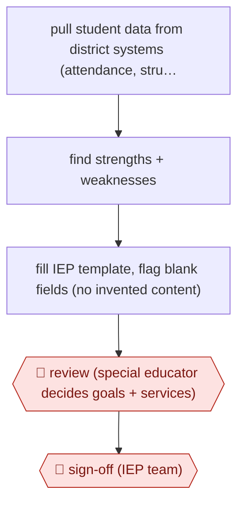

# Data-informed IEP draft

`PRO › EDU › COURSE` · assist · evidence A · **draft: needs a reference example** ([how to add one](../../../../../CONTRIBUTING.md#1-add-an-example-run))

**Shape:** `pull student data from district systems (attendance, struggling subjects) → find strengths + weaknesses → fill IEP template, flag blank fields (no invented content) → 🛑 review (special educator decides goals + services) → 🛑 sign-off (IEP team)`
**How it differs:** Closest is AWF-0027 Backward-design course (COURSE). That one designs curriculum for a whole class. This one drafts a legally binding individual plan from one student's records, gated by a special educator and the IEP team, at high risk. Class fit note: an IEP touches assessment too, but its deliverable is an instructional plan.
**Variants:** `panorama-education`

<!-- shape diagram: generated by scripts/build_diagrams.py from `shape`; don't edit -->

<!-- end shape diagram -->

## Steps
1. The tool pulls each student's records from several district platforms, such as attendance trends and subjects where the student is struggling [[1]](#sources).
2. The AI looks for patterns, strengths and weaknesses to inform goal-writing. It is not meant to make IEP decisions or dictate interventions [[1]](#sources).
3. Working from the district's IEP template, the tool drafts the document and flags fields left blank rather than inventing content [[1]](#sources).
4. 🛑 **Review**: the special educator makes the final call on goals and interventions [[1]](#sources).
5. 🛑 **Sign-off**: the draft goes to the IEP team. The article doesn't describe this stage; it is the existing legal IEP process, which the district says the tool does not change [[1]](#sources).
6. Before launch, the platform went through district review for state and federal compliance and for student data privacy [[1]](#sources).

**Output:** A teacher-reviewed IEP draft brought to the IEP team meeting.
**Failure modes → guards:** Data spreading across systems, AI bias and undisclosed reasoning, all raised by a privacy advocate → a vetted district platform instead of general chatbots, plus compliance and privacy review; the advocate also urges telling families and offering an opt-out, which the district hasn't done [[1]](#sources). Invented content → the tool flags blanks instead of filling them [[1]](#sources).

## Public runs

Coverage as of 2026-11-06: **Partial**: first-hand runs that cover part of the shape or put checkpoints elsewhere. Collected and re-checked in [Second collection pass](../../../../../research/2026-11-second-pass.md).

- [Education Week, How AI tools halved this district's IEP prep time](https://www.edweek.org/teaching-learning/how-ai-tools-halved-this-districts-iep-prep-time/2026/10) (2026-10-28). Mesquite ISD (TX) has used a district-vetted IEP drafting tool for 11 months. "about 45 minutes" per student (from up to three hours). *First-hand: interview; confidence: med.*

## Sources

1. Caitlynn Peetz Stephens, Education Week, How AI tools halved this district's IEP prep time, 2026-10-28. https://www.edweek.org/teaching-learning/how-ai-tools-halved-this-districts-iep-prep-time/2026/10
