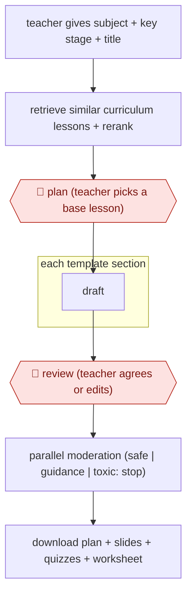

# Section-gated lesson build

`PRO › EDU › COURSE` · assist · evidence A · **draft: needs a reference example** ([how to add one](../../../../../CONTRIBUTING.md#1-add-an-example-run))

**Shape:** `teacher gives subject + key stage + title → retrieve similar curriculum lessons + rerank → 🛑 plan (teacher picks a base lesson) → each template section: draft → 🛑 review (teacher agrees or edits) → parallel moderation (safe | guidance | toxic: stop) → download plan + slides + quizzes + worksheet`
**Variants:** `oak-aila-gpt4o-cohere-rerank`

<!-- shape diagram: generated by scripts/build_diagrams.py from `shape`; don't edit -->

<!-- end shape diagram -->

## Background

A teacher preparing a lesson writes a plan (what students should learn, what they already know, the points to teach, common misunderstandings, key words), then slides, a quiz at the start and the end, and a worksheet. This is done for every lesson, and teachers often start from a colleague's lesson rather than a blank page. The agent can find similar lessons in a bank of existing ones, draft each part of the plan in the school's standard template, and produce the slides and quizzes. The teacher approves the base lesson and every section, because only the teacher knows the class, and because material that is wrong or unsuitable for children reaches a room of pupils.

**Terms:**
- **Key stage**: a stage of schooling in England (for example key stage 2 for ages 7-11); lessons are written for one.
- **Curriculum corpus**: a bank of existing, quality-checked lessons that the new lesson is based on.
- **Content anchoring**: building the new lesson from a chosen existing lesson so that its content is grounded in material already vetted.
- **RAG (retrieval-augmented generation)**: the model is given passages retrieved from a store of documents before it writes.
- **Rerank**: reorder the retrieved results by how well they fit the request.
- **Misconceptions**: mistaken ideas pupils commonly hold about the topic, listed so the teacher can address them.
- **Moderation**: an automatic check that sorts content as safe, needing guidance, or toxic.
- **Starter and exit quiz**: short quizzes at the beginning and end of a lesson.
- **Aila**: Oak National Academy's AI lesson assistant, the tool the source describes.

## Build it with an agent

**Form:** `skill`. One teacher builds one lesson at a time and stays in the conversation, so one skill that holds the template and stops at each section is enough; a subagent supplies the independent moderation.

**You need:** a bank of vetted lessons as files, or an MCP connector to one, which the agent searches; the lesson template with its sections; a place to write the plan, slides, quizzes and worksheet files. Give the agent no pupil data and no way to publish to pupils.

| Step | Built as |
|---|---|
| teacher gives subject + key stage + title | The skill's first step: ask for the three, and write a skeleton plan. |
| retrieve similar curriculum lessons + rerank → 🛑 plan | The skill searches the lesson bank, ranks the best matches against the request, shows them and stops for the teacher to pick a base lesson. |
| each template section: draft → 🛑 review | One section at a time in the main conversation, drafted from the base lesson; the skill stops after each until the teacher agrees or asks for changes. |
| parallel moderation (safe / guidance / toxic: stop) | A read-only subagent that has not seen the conversation gets only the lesson text and returns one of the three labels with reasons. |
| download plan + slides + quizzes + worksheet | The skill writes the files only after every section is agreed and the moderation label is not `toxic`. |

**Checkpoints:** `plan`: the skill writes nothing but the skeleton until the teacher has chosen a base lesson. `review`: the skill stops after every section; the teacher agrees or edits before it continues. A `toxic` label stops the run, and the skill does not write the downloadable files; a `PreToolUse` hook that blocks writes to the output folder until a moderation result is on file makes this hold even if the skill's instruction is missed.

**Since the sources:** The source is dated 2024-12 and describes Aila as in beta, so it is more than 12 months older than this check. A search in 2026-11 found that an independent trial of Aila had been announced (see the [Education Endowment Foundation's news page](https://educationendowmentfoundation.org.uk/news/new-trial-ai-powered-lesson-planning)); results of it were not opened and nothing about the steps was found to have changed. The source describes a purpose-built web app on a hosted model with a vectorised lesson store and a separate moderation model; this build replaces the app with a skill and a subagent, and the vectorised store with whatever search your lesson bank offers. The source, a government transparency record, is Oak's own description of its pipeline.

*A design based on this entry's steps and the tool documentation as of 2026-11, not a reported run.*

## Steps

*As reported by the sources.*

1. The teacher enters a subject, key stage or lesson title. Aila sorts it into subject and key stage and creates a skeleton plan [[1]](#sources).
2. One-shot RAG searches a vectorised set of roughly 10,000 Oak lessons, reranks the hits and shows them to the teacher [[1]](#sources). 🛑 **Plan**: the teacher may pick one as the base lesson ('content anchoring').
3. Aila drafts each section of Oak's template in turn: outcomes, prior knowledge, key learning points, misconceptions, keywords, starter quiz, learning cycles, exit quiz [[1]](#sources).
4. 🛑 **Review**: Aila asks the teacher to agree to each section before moving on and is not designed to make a lesson 'at the touch of a button'. Teachers can ask for changes such as 'make this harder' [[1]](#sources).
5. A separate moderation model with no lesson context sorts content as safe, guidance-required or toxic. Toxic content stops the lesson, and teachers can appeal [[1]](#sources).
6. The teacher downloads the lesson plan, slide deck, starter and exit quizzes and worksheet. Feedback widgets and support triage feed maintenance [[1]](#sources).

**Output:** An editable single-lesson pack (plan, slides, two quizzes, worksheet) the teacher uses in class.
**Failure modes → guards:** Ungrounded or unsafe content → anchoring to a vetted lesson corpus and an independent moderation pass that can stop generation [[1]](#sources). Rubber-stamping → section-by-section agreement is required by design [[1]](#sources).
**How it differs:** Closest is AWF-0027 Backward-design course (COURSE). That one designs a whole course from standards, with plan gates on objectives and modules and an LMS import. This one builds one classroom-ready lesson anchored to an existing curriculum corpus, with a teacher gate on every template section and an automated moderation stop, so deliverable and checkpoint arrangement differ.

## Public runs

Coverage as of 2026-11-06: **Strong**: a first-hand, detailed run that matches most of the shape. Collected and re-checked in [Second collection pass](../../../../../research/2026-11-second-pass.md).

- [GOV.UK, Aila algorithmic transparency record](https://www.gov.uk/algorithmic-transparency-records/oak-national-academy-aila-oaks-ai-lesson-assistant) (2024-12-17). Oak's own record of the production pipeline, models, moderation and oversight. "approximately 10,000 lessons" in the corpus the tool draws on. *First-hand: yes; confidence: high.*

## Sources

1. GOV.UK Algorithmic Transparency Record, Oak National Academy: Aila (Oak's AI Lesson Assistant), 2024-12-17. https://www.gov.uk/algorithmic-transparency-records/oak-national-academy-aila-oaks-ai-lesson-assistant
