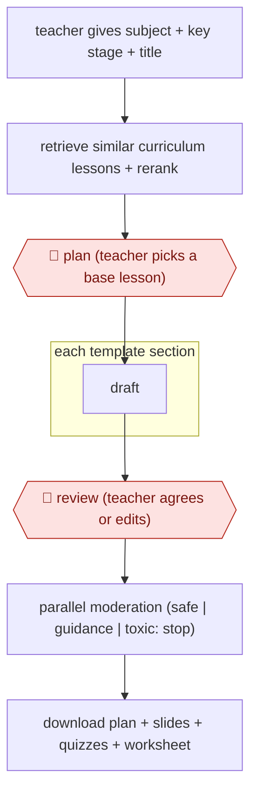

# Section-gated lesson build

`PRO › EDU › COURSE` · assist · evidence A · **draft: needs a reference example** ([how to add one](../../../../../CONTRIBUTING.md#1-add-an-example-run))

**Shape:** `teacher gives subject + key stage + title → retrieve similar curriculum lessons + rerank → 🛑 plan (teacher picks a base lesson) → each template section: draft → 🛑 review (teacher agrees or edits) → parallel moderation (safe | guidance | toxic: stop) → download plan + slides + quizzes + worksheet`
**How it differs:** Closest is AWF-0027 Backward-design course (COURSE). That one designs a whole course from standards, with plan gates on objectives and modules and an LMS import. This one builds one classroom-ready lesson anchored to an existing curriculum corpus, with a teacher gate on every template section and an automated moderation stop, so deliverable and checkpoint arrangement differ.
**Variants:** `oak-aila-gpt4o-cohere-rerank`

<!-- shape diagram: generated by scripts/build_diagrams.py from `shape`; don't edit -->

<!-- end shape diagram -->

## Steps
1. The teacher enters a subject, key stage or lesson title. Aila sorts it into subject and key stage and creates a skeleton plan [[1]](#sources).
2. One-shot RAG searches a vectorised set of roughly 10,000 Oak lessons, reranks the hits and shows them to the teacher [[1]](#sources). 🛑 **Plan**: the teacher may pick one as the base lesson ('content anchoring').
3. Aila drafts each section of Oak's template in turn: outcomes, prior knowledge, key learning points, misconceptions, keywords, starter quiz, learning cycles, exit quiz [[1]](#sources).
4. 🛑 **Review**: Aila asks the teacher to agree to each section before moving on and is not designed to make a lesson 'at the touch of a button'. Teachers can ask for changes such as 'make this harder' [[1]](#sources).
5. A separate moderation model with no lesson context sorts content as safe, guidance-required or toxic. Toxic content stops the lesson, and teachers can appeal [[1]](#sources).
6. Teacher downloads the lesson plan, slide deck, starter and exit quizzes and worksheet. Feedback widgets and support triage feed maintenance [[1]](#sources).

**Output:** An editable single-lesson pack (plan, slides, two quizzes, worksheet) the teacher uses in class.
**Failure modes → guards:** Ungrounded or unsafe content → anchoring to a vetted lesson corpus and an independent moderation pass that can stop generation [[1]](#sources). Rubber-stamping → section-by-section agreement is required by design [[1]](#sources).

## Public runs

Coverage as of 2026-11-06: **Strong**: a first-hand, detailed run that matches most of the shape. Collected and re-checked in [Second collection pass](../../../../../research/2026-11-second-pass.md).

- [GOV.UK, Aila algorithmic transparency record](https://www.gov.uk/algorithmic-transparency-records/oak-national-academy-aila-oaks-ai-lesson-assistant) (2024-12-17). Oak's own record of the production pipeline, models, moderation and oversight. "approximately 10,000 lessons" in the corpus the tool draws on. *First-hand: yes; confidence: high.*

## Sources

1. GOV.UK Algorithmic Transparency Record, Oak National Academy: Aila (Oak's AI Lesson Assistant), 2024-12-17. https://www.gov.uk/algorithmic-transparency-records/oak-national-academy-aila-oaks-ai-lesson-assistant
