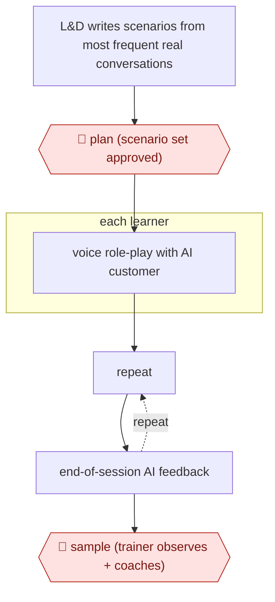

# AI role-play practice

`PRO › EDU › LND` · sampled · evidence B · **draft: needs a reference example** ([how to add one](../../../../../CONTRIBUTING.md#1-add-an-example-run))

**Shape:** `L&D writes scenarios from most frequent real conversations → 🛑 plan (scenario set approved) → each learner: voice role-play with AI customer → (repeat ⟲ end-of-session AI feedback) → 🛑 sample (trainer observes + coaches)`
**How it differs:** Closest is AWF-0043 SME-docs to e-learning (LND), which builds published course content behind SME review. This one delivers practice conversations and feedback that learners run alone, with trainers sampling and coaching, so deliverable and autonomy (sampled) differ.
**Variants:** `easygenerator-easycoach`

<!-- shape diagram: generated by scripts/build_diagrams.py from `shape`; don't edit -->

<!-- end shape diagram -->

## Background

The hardest part of a contact-centre job is the conversation nobody can rehearse: the customer on their third call about the same failed repair, the one who has already been transferred twice, the one whose complaint is justified and whose demand is not. New agents meet these calls live, in their first weeks, with a trainer listening afterwards rather than before. Role-play is the standard remedy and the standard bottleneck: a human plays the customer, so practice is rationed by the availability of colleagues, and a new hire gets a handful of repetitions at exactly the stage where they need dozens. An AI customer removes that ration. The learner puts on a headset, speaks to a simulated customer who reacts to what they say, and gets a scorecard at the end of the session; the trainer stops being the person who plays the angry caller and becomes the person who watches a sample and coaches. What stays human is the scenario design — which conversations are actually worth rehearsing — and the judgement about whether the practice is transferring to the floor, which is the part the scorecard cannot tell you.

**Terms:**
- **role-play**: a rehearsal conversation in which someone plays the customer while the learner practises.
- **persona**: the AI's character in the role-play, with a fixed situation, emotional starting point and escalation rules.
- **scenario**: the written setup — who the customer is, what they want, what the learner may offer.
- **scorecard**: the end-of-session report scoring empathy, listening and call control.
- **ramp time**: how long a new agent takes to reach the team's normal handling time and quality scores.
- **CSAT**: customer satisfaction, usually a post-contact survey score.
- **QA score**: the quality-assurance score from reviewing a sample of real contacts.
- **AHT**: average handle time, the length of a contact.

## Build it with an agent

**Form:** `skill`. One learner sits with one simulated customer for one session, and the deliverable is that session plus its feedback — nothing persists between learners except the approved scenario file the skill reads at the start. The scale comes from many learners running it, not from a service that holds a queue or a project that accumulates a corpus.

**You need:** the scenario file, written from the conversations that actually recur, each with the customer's situation, what they are entitled to and what the learner may not offer; voice in and out, since a text role-play does not practise the thing being trained; a per-learner record of which scenarios have been run and how often, or the same easy scenario gets rehearsed and the hard one avoided; the scorecard rubric, agreed with the trainers before the first run, because a scorecard invented by the tool becomes the definition of good performance; and a route by which a trainer can pull a specific session to listen to. The agent must not score a session as a pass or fail and must not decide a learner is ready: it reports, the trainer judges.

| Step | Built as |
|---|---|
| L&D writes scenarios from most frequent real conversations | The scenario file is the skill's whole world: one file per scenario, each naming the customer's goal, the emotional start, the escalation triggers and the boundary of what may be offered. |
| 🛑 plan (scenario set approved) | The approved set is versioned and read-only during a cohort, so a scenario cannot drift mid-programme and two learners are always compared on the same thing. |
| each learner: voice role-play with AI customer | One skill run per session: the agent plays the persona, stays in character, and escalates or de-escalates on the learner's behaviour rather than on a script. |
| (repeat ⟲ end-of-session AI feedback) | The scorecard is produced from the transcript with the rubric's dimensions, and the repetition loop is available on demand — the learner decides to go again, which is the point of removing the human partner. |
| 🛑 sample (trainer observes + coaches) | Trainers see the sessions chosen by rule, not the sessions the learner would choose; the coaching conversation happens outside the skill, and the build has no way to record a learner as competent. |

**Checkpoints:** `plan`: the scenario set is approved by the training team before a cohort starts, because the scenarios are the curriculum and a bad one teaches the wrong behaviour at scale. `sample`: trainers observe a sample and coach, which is also the only check on whether the scorecard is measuring anything real — if trainers consistently disagree with the scores, the rubric is wrong, not the learner.

**Since the sources:** The source is an undated vendor customer story, and it was not re-opened on this pass. What has changed since: the first randomised workplace test of LLM role-play appeared in 2026-10, and it is a caution rather than a confirmation — 12 call-centre employees, split 6/6 between customer-service and structurally matched non-customer-service scenarios, two sessions a week apart and a follow-up at four weeks. The immediate motivation effect was large (g = 1.11) and every confidence interval included zero, with the four-week responsiveness and productivity estimates slightly favouring the control group; the authors conclude that [the deployment does not establish that the training improved the outcome scores](https://www.frontiersin.org/article/1953650), and warn specifically that a reaction measure aligned with the training content can produce a large estimate whether or not anything transferred. The study was funded by the vendor that built the system, with authors employed by it. That does not sink the method — simulation with feedback has better support, including a 2026 randomised trial of 346 child-helpline counsellors — but it does fix what this workflow should be judged on, and it is not the end-of-session score. Vendor claims in the same period (7% CSAT and 4% QA improvements at a US retailer) publish no cohort sizes or baselines, which is the same gap in a different form. The build above therefore treats the scorecard as a coaching aid and puts the evidence question on the ramp-time and QA numbers the operation already collects.

*A design based on this entry's steps and the tool documentation as of 2026-11, not a reported run.*

## Steps

*As reported by the sources.*

1. The L&D team writes scenarios from the customer-operations conversations that come up most often, such as objecting customers and cybersecurity cases. Separate scenarios cover team managers [[1]](#sources).
2. 🛑 **Plan**: the training team owns and publishes the scenario set [[1]](#sources).
3. Learners practice by voice on a headset while the AI plays the customer. They practice alone with no trainer in the room, repeating a scenario 2 to 3 times per session [[1]](#sources).
4. The AI gives feedback at the end of each session, which the training manager calls more objective than a manager's opinion [[1]](#sources).
5. 🛑 **Sample**: trainers stop playing the customer; they observe conversations and coach. Practice runs about 50/50 between in-person and AI-led sessions [[1]](#sources).

**Output:** Practice sessions with AI feedback that feed the new-hire program and ongoing coaching.
**Failure modes → guards:** Scenarios drifting from real calls → write them from the most frequent real conversations [[1]](#sources). Feedback without human judgment → trainers observe and coach. Odido also uses the same scenario in candidate hiring; that use is high-risk and needs its own fairness review.

## Public runs

Coverage as of 2026-11-06: **Weak**: only anonymous, vendor-linked or journalist-told accounts. Collected and re-checked in [Second collection pass](../../../../../research/2026-11-second-pass.md).

- [Easygenerator, Odido customer story](https://alpha.easygenerator.com/en/customer-stories/how-odido-gave-1800-employees-ai-roleplay-coaching-with-easycoach/) (undated). Telecom training team runs voice role-play for customer-ops agents; trainers observe. "around 1,800 customer operations agents" supported by the training team. *First-hand: vendor; confidence: med.*

## Sources

1. Easygenerator, How Odido gave 1,800 employees AI roleplay coaching with EasyCoach (undated). https://alpha.easygenerator.com/en/customer-stories/how-odido-gave-1800-employees-ai-roleplay-coaching-with-easycoach/
2. K. Sato et al., Preventing escalation in customer service: immediate motivation and 4-week outcomes in a workplace deployment of LLM role-play training, Frontiers in Artificial Intelligence, 2026-10-07. https://www.frontiersin.org/article/1953650
