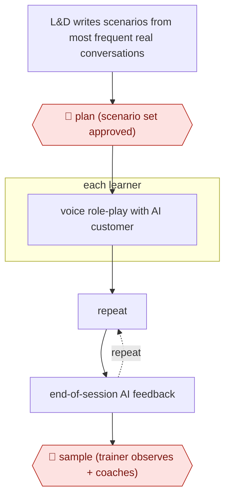

# AI role-play practice

`PRO › EDU › LND` · sampled · evidence B · **draft: needs a reference example** ([how to add one](../../../../../CONTRIBUTING.md#1-add-an-example-run))

**Shape:** `L&D writes scenarios from most frequent real conversations → 🛑 plan (scenario set approved) → each learner: voice role-play with AI customer → (repeat ⟲ end-of-session AI feedback) → 🛑 sample (trainer observes + coaches)`
**How it differs:** Closest is AWF-0043 SME-docs to e-learning (LND), which builds published course content behind SME review. This one delivers practice conversations and feedback that learners run alone, with trainers sampling and coaching, so deliverable and autonomy (sampled) differ.
**Variants:** `easygenerator-easycoach`

<!-- shape diagram: generated by scripts/build_diagrams.py from `shape`; don't edit -->

<!-- end shape diagram -->

## Steps
1. The L&D team writes scenarios from the customer-operations conversations that come up most often, such as objecting customers and cybersecurity cases. Separate scenarios cover team managers [[1]](#sources).
2. 🛑 **Plan**: the training team owns and publishes the scenario set [[1]](#sources).
3. Learners practice by voice on a headset while the AI plays the customer. They practice alone with no trainer in the room, repeating a scenario 2 to 3 times per session [[1]](#sources).
4. The AI gives feedback at the end of each session, which the training manager calls more objective than a manager's opinion [[1]](#sources).
5. 🛑 **Sample**: trainers stop playing the customer; they observe conversations and coach. Practice runs about 50/50 between in-person and AI-led sessions [[1]](#sources).

**Output:** Practice sessions with AI feedback that feed the new-hire program and ongoing coaching.
**Failure modes → guards:** Scenarios drifting from real calls → write them from the most frequent real conversations [[1]](#sources). Feedback without human judgment → trainers observe and coach. Odido also uses the same scenario in candidate hiring; that use is high-risk and needs its own fairness review.

## Public runs

Coverage as of 2026-11-06: **Weak**: only anonymous, vendor-linked or journalist-told accounts. Collected and re-checked in [Second collection pass](../../../../../research/2026-11-second-pass.md).

- [Easygenerator, Odido customer story](https://alpha.easygenerator.com/en/customer-stories/how-odido-gave-1800-employees-ai-roleplay-coaching-with-easycoach/) (undated). Telecom training team runs voice role-play for customer-ops agents; trainers observe. "around 1,800 customer operations agents" supported by the training team. *First-hand: vendor; confidence: med.*

## Sources

1. Easygenerator, How Odido gave 1,800 employees AI roleplay coaching with EasyCoach (undated). https://alpha.easygenerator.com/en/customer-stories/how-odido-gave-1800-employees-ai-roleplay-coaching-with-easycoach/
